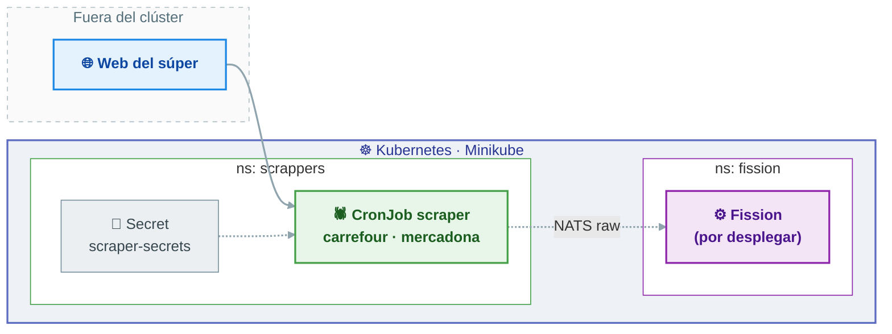

# PTI-Q26-27-TARDOR — Comparador de precios

Parte de **ingesta de datos** del comparador de precios: recolectores (*scrapers*) que
extraen precios de las webs de los supermercados y el clúster de Kubernetes donde se
despliegan.

La cadena completa que este repositorio alimenta es:

```
web del súper  →  scraper (CronJob)  →  NATS raw  →  normalizer (Fission)  →  NATS clean  →  [ API / BD ]
```

> **Estado de la rama `develop`:** esqueleto inicial. Ya están los *namespaces*, el Secret
> de los scrapers, el Ingress y las plantillas de CronJob de cada cadena. La mensajería
> NATS JetStream y la función de normalización se desarrollan en la rama `scrapping` y se
> integrarán aquí.

## Índice

| Sección | Contenido |
|---|---|
| [Estado](#estado) | Qué hay implementado y qué falta en `develop` |
| [Arquitectura](#arquitectura) | Diagrama del flujo y de los namespaces |
| [Estructura del repo](#estructura-del-repo) | Ficheros de la rama y su responsabilidad |
| [Requisitos](#requisitos) | Herramientas necesarias |
| [Puesta en marcha](#puesta-en-marcha) | Pasos para levantar el clúster y los scrapers |
| [Manifiestos](#manifiestos) | Referencia de cada YAML |
| [Verificación](#verificación) | Comandos para comprobar que todo está en su sitio |
| [Limitaciones conocidas](#limitaciones-conocidas) | Lo que aún no funciona y por qué |
| [Ramas](#ramas) | Para qué sirve cada rama |

## Estado

| Componente | Estado en `develop` | Dónde |
|---|---|---|
| Namespaces `scrappers` y `fission` | Hecho | [`flujo-entrada/cluster/`](flujo-entrada/cluster/) |
| Secret compartido de los scrapers | Hecho | [`scrappers/k8s/secrets.yaml`](flujo-entrada/scrappers/k8s/secrets.yaml) |
| Plantillas de CronJob (Carrefour, Mercadona) | Hecho (sin código de scraper aún) | [`scrappers/`](flujo-entrada/scrappers/) |
| Ingress con los hosts de cada cadena | Hecho (sin `Service` detrás) | [`scrappers/k8s/ingress.yaml`](flujo-entrada/scrappers/k8s/ingress.yaml) |
| Imágenes Docker de los scrapers | Pendiente | rama `scrapping` |
| NATS JetStream (sujeto `scraper.mercadona.raw`) | Pendiente | rama `scrapping` |
| Normalizador en Fission (`POST /normalize`) | Pendiente | rama `scrapping` |
| Consumer NATS → Fission → NATS | Pendiente | rama `scrapping` |
| Esquema de BD y API REST | Pendiente | otros compañeros |

## Arquitectura



### Namespaces

| Namespace | Contenido |
|---|---|
| `scrappers` | CronJobs de los recolectores, Secret de configuración e Ingress |
| `fission` | Instalación de Fission (funciones, trigger y router) |
| `default` | Se usará para la función `normalizer` y su consumer |

## Estructura del repo

```
.
├── README.md
└── flujo-entrada/
    ├── cluster/                        # Namespaces del clúster
    │   ├── kustomization.yaml
    │   └── namespace.yaml              # scrappers, fission
    └── scrappers/                      # Recolectores
        ├── k8s/
        │   ├── kustomization.yaml
        │   ├── secrets.yaml            # Secret scraper-secrets
        │   └── ingress.yaml            # Hosts por cadena
        ├── scrapper_carrefour/
        │   ├── kustomization.yaml
        │   └── cronjob.yaml            # CronJob scrapper-carrefour
        └── scrapper_mercadona/
            ├── kustomization.yaml
            └── cronjob.yaml            # CronJob scrapper-mercadona
```

## Requisitos

| Herramienta | Versión mínima | Para qué |
|---|---|---|
| [Minikube](https://minikube.sigs.k8s.io/) | 1.30 | Clúster local de Kubernetes |
| [kubectl](https://kubernetes.io/docs/tasks/tools/) | 1.30 | Aplicar los manifiestos |
| [kustomize](https://kubectl.docs.kubernetes.io/installation/kustomize/) | 5.0 | `kubectl apply -k` |
| Docker | 24.0 | Construir las imágenes de los scrapers |

## Puesta en marcha

### 1 · Levantar el clúster

```bash
minikube start
minikube status
```

### 2 · Crear los namespaces

```bash
kubectl apply -k flujo-entrada/cluster/
kubectl get ns
```

### 3 · Configurar los scrapers

El Secret `scraper-secrets` se inyecta en todos los contenedores con `envFrom`, así que
añadir una variable ahí la hace disponible para cualquier cadena sin tocar los CronJobs.

```bash
kubectl apply -k flujo-entrada/scrappers/k8s/
kubectl describe secret scraper-secrets -n scrappers
```

### 4 · Construir y cargar las imágenes

Las imágenes que usan los CronJob son `scrapper-carrefour:v1` y `scrapper-mercadona:v1`.
En esta rama todavía no hay Dockerfile, así que la imagen se construye desde la rama
`scrapping` (o desde cualquier imagen que respete el contrato de salida del scraper):

```bash
docker build -t scrapper-mercadona:v1 flujo-entrada/scrappers/scrapper_mercadona/
minikube image load scrapper-mercadona:v1
```

### 5 · Desplegar los CronJob

```bash
kubectl apply -k flujo-entrada/scrappers/scrapper_mercadona/
kubectl apply -k flujo-entrada/scrappers/scrapper_carrefour/
kubectl get cronjobs -n scrappers
```

### 6 · Disparar una ejecución sin esperar

Ambos CronJob tienen `schedule: "*/30 * * * *"`, pero se pueden lanzar a mano:

```bash
kubectl create job --from=cronjob/scrapper-mercadona prueba-mercadona -n scrappers
kubectl logs job/prueba-mercadona -n scrappers -f
```

### 7 · Ingress (opcional)

El Ingress no está incluido en el `kustomization.yaml` de `scrappers/k8s`, así que se
aplica a mano. Necesita el addon de ingress de Minikube y un `Service` por detrás, que
todavía no existe en esta rama:

```bash
minikube addons enable ingress
kubectl apply -f flujo-entrada/scrappers/k8s/ingress.yaml
```

Los hosts declarados (`carrefour.local` y `mercadona.local`) se añaden al `hosts` del
sistema apuntando a la IP de Minikube (`minikube ip`).

## Manifiestos

| Manifiesto | Kind | Namespace | Notas |
|---|---|---|---|
| `cluster/namespace.yaml` | Namespace ×2 | — | `scrappers`, `fission` |
| `cluster/kustomization.yaml` | Kustomization | — | Agrupa los namespaces |
| `scrappers/k8s/secrets.yaml` | Secret | `scrappers` | `scraper-secrets` (`USER_AGENT`) |
| `scrappers/k8s/ingress.yaml` | Ingress | `scrappers` | Un host por cadena, clase `nginx` |
| `scrappers/scrapper_carrefour/cronjob.yaml` | CronJob | `scrappers` | `*/30 * * * *`, imagen `scrapper-carrefour:v1` |
| `scrappers/scrapper_mercadona/cronjob.yaml` | CronJob | `scrappers` | `*/30 * * * *`, imagen `scrapper-mercadona:v1` |

Ajustes comunes de los CronJob:

| Campo | Valor | Motivo |
|---|---|---|
| `concurrencyPolicy` | `Forbid` | Impide que dos ejecuciones se solapen |
| `successfulJobsHistoryLimit` / `failedJobsHistoryLimit` | `2` | Acota el histórico de Jobs |
| `backoffLimit` | `2` | Reintentos ante fallo del pod |
| `restartPolicy` | `OnFailure` | Reinicia el contenedor si muere |
| `resources` | requests `100m`/`128Mi`, limits `500m`/`512Mi` | Scraper ligero pero acotado |

## Verificación

```bash
kubectl get ns
kubectl get secret -n scrappers
kubectl get cronjobs -n scrappers
kubectl get jobs -n scrappers
kubectl get pods -n scrappers
```

## Limitaciones conocidas

- **No hay código de scraper en esta rama.** Las imágenes `scrapper-*:v1` referenciadas por
  los CronJob todavía no se construyen aquí; sin cargarlas en Minikube, los pods quedan en
  `ImagePullBackOff`.
- **El Ingress no tiene `Service` detrás.** `scrappers/k8s/ingress.yaml` apunta a
  `scrapper-carrefour` y `scrapper-mercadona` en el puerto 80, y esos Services aún no
  existen: el Ingress devolverá `503` hasta que se creen.
- **El Ingress no está en el kustomization.** `scrappers/k8s/kustomization.yaml` solo
  incluye `secrets.yaml`, así que hay que aplicarlo con `-f`.
- **Carrefour está bloqueado por Cloudflare.** La web responde `403` con un challenge de
  JS, por lo que el scraper no puede extraer productos (15/10/2026). El CronJob se mantiene
  como plantilla a la espera de una solución con navegador real.
- **El scraper no normaliza.** Solo extrae y publica datos crudos; toda la interpretación
  (precio unitario, €/L, €/kg) vive en el normalizador de Fission. Así cada recolector
  es tonto, pequeño y reemplazable si la web cambia.
- **Falta el namespace `messaging`.** En esta rama solo se crean `scrappers` y `fission`;
  el namespace de NATS llega con la integración de la rama `scrapping`.

## Ramas

| Rama | Contenido |
|---|---|
| `develop` | Rama de integración. Esqueleto del clúster y plantillas de los scrapers |
| `scrapping` | Implementación en curso: NATS JetStream, normalizador en Fission, consumer y documentación del flujo |
| `main` | Punto de partida del repositorio |
| `api` / `app` / `ai` | Partes de otros compañeros (API y BD, app móvil, IA) |
