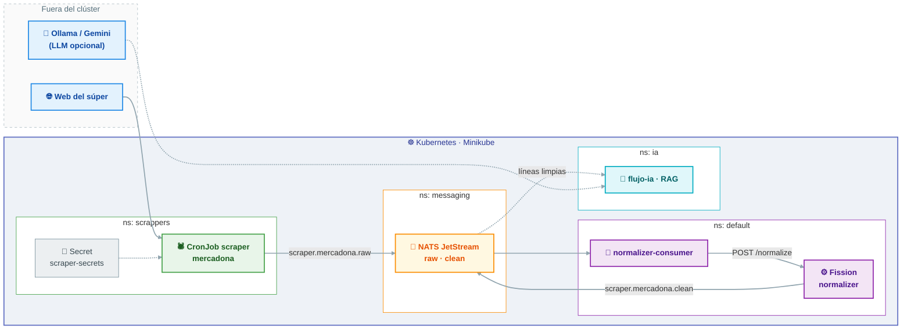

# PTI-Q26-27-TARDOR — Comparador de precios

Comparador de precios de supermercado. En la rama `develop` conviven **dos flujos** que se
consumen el uno al otro:

| Flujo | Qué hace | Carpeta |
|---|---|---|
| [`flujo-entrada`](flujo-entrada/) | Ingesta: extrae precios de las webs de los súpers y los normaliza | [`flujo-entrada/`](flujo-entrada/) |
| [`flujo-ia`](flujo-ia/) | IA: RAG sobre las líneas limpias (catálogo, equivalencias entre cadenas, QA) | [`flujo-ia/`](flujo-ia/) |

Las dos cadenas del proyecto:

```
web del súper  →  scraper (CronJob)  →  NATS raw  →  normalizer (Fission)  →  NATS clean  →  [ API / BD ]
                                                        │
                                                        └──  flujo-ia (RAG)  →  catálogo · equivalencias · QA
```

> **Estado de `develop`:** integra el contenido de las ramas `scrapping`, `ai`, `api` y `app`.
> `flujo-entrada` está implementado y desplegado en la VM del clúster; `flujo-ia` es un
> prototipo completo con dataset, métricas y tests. Falta cerrar el contrato con el equipo de
> API/BD (ver [Limitaciones](#limitaciones-conocidas)).

## Índice

| Sección | Contenido |
|---|---|
| [Los dos flujos](#los-dos-flujos) | Qué aporta cada flujo y dónde está |
| [Estado](#estado) | Qué hay implementado en cada flujo |
| [Arquitectura](#arquitectura) | Diagrama del clúster y de los namespaces |
| [Estructura del repo](#estructura-del-repo) | Ficheros de la rama y su responsabilidad |
| [Requisitos](#requisitos) | Herramientas necesarias |
| [Puesta en marcha](#puesta-en-marcha) | Levantar el flujo de entrada y el de IA |
| [Manifiestos](#manifiestos) | Referencia de cada YAML |
| [Verificación](#verificación) | Comandos para comprobar que todo está en su sitio |
| [Limitaciones conocidas](#limitaciones-conocidas) | Lo que aún no funciona y por qué |
| [Ramas](#ramas) | Para qué sirve cada rama |

## Los dos flujos

### `flujo-entrada` — ingesta

Recolectores que extraen los precios de las webs de los supermercados y los publican en
NATS JetStream; un normalizador en Fission los convierte en **líneas limpias** con precio
unitario canónico (`€/kg`, `€/l`, `€/ud`, `€/m`, `€/lavado`).

```bash
web del súper  →  scraper (CronJob)  →  NATS raw  →  normalizer (Fission)  →  NATS clean
```

- **Documentación**: [`flujo-entrada/docs/`](flujo-entrada/docs/) (arquitectura, flujo de datos,
  contratos, estados y errores, pendientes).
- **Montaje**: [`flujo-entrada/setup-vm.sh`](flujo-entrada/setup-vm.sh) (idempotente) y
  [`flujo-entrada/fission/normalizer/deploy.sh`](flujo-entrada/fission/normalizer/deploy.sh).

### `flujo-ia` — RAG

Prototipo de RAG sobre las **mismas líneas limpias** que produce la ingesta: elige el modelo de
embeddings y el LLM, indexa el catálogo y responde preguntas en lenguaje natural.

```bash
línea limpia  →  embeddings (e5-small)  →  índice vectorial  →  retrieval  →  [ + LLM opcional ]
```

- **Documentación**: [`flujo-ia/docs/`](flujo-ia/docs/) (decisión de modelos, prototipo RAG,
  evaluación, despliegue) y [`flujo-ia/README.md`](flujo-ia/README.md).
- **Montaje**: [`flujo-ia/setup.sh`](flujo-ia/setup.sh) (venv + dependencias + dataset + índice).

### Cómo se unen

El `flujo-ia` consume exactamente lo que publica el `flujo-entrada`: una línea por producto en
el subject `scraper.<cadena>.clean`. Hoy el paso de unión es manual (se copia el `.txt` a
`flujo-ia/data/raw/`); automatizarlo es trabajo pendiente de ambos equipos.

## Estado

### `flujo-entrada`

| Componente | Estado | Dónde |
|---|---|---|
| Namespaces `scrappers`, `messaging`, `fission` | Hecho | [`cluster/namespace.yaml`](flujo-entrada/cluster/namespace.yaml) |
| Secret compartido de los scrapers | Hecho | [`scrappers/k8s/secrets.yaml`](flujo-entrada/scrappers/k8s/secrets.yaml) |
| Scraper Mercadona (extrae y publica en NATS) | Hecho | [`scrapper_mercadona/`](flujo-entrada/scrappers/scrapper_mercadona/) |
| Scraper Carrefour (extracción) | Hecho, **sin publicar** | [`scrapper_carrefour/`](flujo-entrada/scrappers/scrapper_carrefour/) |
| CronJob de Mercadona (`0 2 * * *`) | Hecho | [`scrapper_mercadona/cronjob.yaml`](flujo-entrada/scrappers/scrapper_mercadona/cronjob.yaml) |
| NATS JetStream (stream `SCRAPERS`, subject `scraper.mercadona.raw`) | Hecho | [`messaging/`](flujo-entrada/messaging/) |
| Normalizador en Fission (`POST /normalize`) | Hecho | [`fission/normalizer/`](flujo-entrada/fission/normalizer/) |
| Precio unitario canónico (`€/kg`·`€/l`·`€/ud`·`€/m`·`€/lavado`) | Hecho | [`docs/03-contratos-datos.md`](flujo-entrada/docs/03-contratos-datos.md) |
| Consumer NATS → Fission → NATS | Hecho (`normalizer-consumer`) | [`fission/normalizer/consumer.py`](flujo-entrada/fission/normalizer/consumer.py) |
| Montaje de la VM en un script | Hecho | [`setup-vm.sh`](flujo-entrada/setup-vm.sh) |
| Tests del normalizador (sin clúster) | Hecho | `test_local.py`, `test_unit_price.py`, `test_models.py` |
| Escritura en BD | **Pendiente** | depende del equipo de API/BD |

### `flujo-ia`

| Componente | Estado | Dónde |
|---|---|---|
| Decisión de modelo de embeddings (`e5-small`) | Hecho | [`docs/01-decision-modelos.md`](flujo-ia/docs/01-decision-modelos.md) |
| Prototipo RAG (catálogo, equivalencias, QA) | Hecho | [`rag/pipelines.py`](flujo-ia/rag/pipelines.py) |
| Cadenas con LangChain (LCEL) | Hecho | [`rag/chain.py`](flujo-ia/rag/chain.py) |
| Guardrails + salida con JSON Schema | Hecho | [`rag/guardrails.py`](flujo-ia/rag/guardrails.py) |
| Streaming SSE en `/ask/stream` | Hecho | [`rag/serve.py`](flujo-ia/rag/serve.py) |
| Dataset con ground truth | Hecho | [`data/gold/`](flujo-ia/data/gold/) |
| Evaluación reproducible de retrieval y con LLM | Hecho | [`docs/03-evaluacion.md`](flujo-ia/docs/03-evaluacion.md) |
| Tests (sin GPU ni API) | Hecho (35 tests) | [`tests/`](flujo-ia/tests/) |
| Servicio HTTP para API y app | Hecho | `GET /health`, `POST /search`, `/ask`, `/ask/stream`, `/equiv` |
| Integración automática con `scraper.<cadena>.clean` | **Pendiente** | requiere exponer el subject |

## Arquitectura



### Namespaces

| Namespace | Contenido |
|---|---|
| `scrappers` | CronJobs de los recolectores y Secret de configuración |
| `messaging` | NATS JetStream (stream `SCRAPERS`) y utilidades (`nats-box`) |
| `fission` | Instalación de Fission (funciones, trigger y router) |
| `default` | Función `normalizer`, su `HTTPTrigger` y el `normalizer-consumer` |
| `ia` | Despliegue de `flujo-ia` (Deployment, Service e Ingress) |

## Estructura del repo

```
.
├── README.md
├── LICENSE                            # Apache License 2.0
├── flujo-entrada/                     # Ingesta (rama `scrapping`)
│   ├── cluster/                       # Namespaces del clúster
│   │   ├── kustomization.yaml
│   │   └── namespace.yaml             # scrappers, messaging, fission
│   ├── messaging/                     # NATS JetStream
│   │   ├── nats-values.yaml
│   │   └── subjects.md                # Subjects y envelopes
│   ├── fission/normalizer/            # Normalizador y consumer
│   │   ├── normalizer.py              # POST /normalize + contrato Pydantic
│   │   ├── consumer.py                # Puente NATS → Fission → NATS
│   │   ├── consumer.yaml
│   │   ├── deploy.sh                  # Despliegue idempotente
│   │   └── test_*.py                  # Tests sin clúster
│   ├── scrappers/
│   │   ├── k8s/secrets.yaml           # Secret scraper-secrets
│   │   ├── scrapper_carrefour/        # Extracción (bloqueada por Cloudflare)
│   │   └── scrapper_mercadona/        # Extracción + publicación en NATS
│   ├── docs/                          # 01 arquitectura · 02 datos · 03 contratos · 04 errores · 05 pendientes
│   └── setup-vm.sh                    # Montaje idempotente de la VM
└── flujo-ia/                          # IA / RAG (rama `ai`)
    ├── setup.sh                       # venv + dependencias + dataset + índice
    ├── scripts/verificar.sh           # Humo del montaje
    ├── rag/                           # Pipeline RAG (config, ingest, embeddings, chain, serve…)
    ├── data/                          # Dataset: raw/, gold/ y generate_dataset.py
    ├── tests/                         # 35 tests sin GPU ni API
    ├── deploy/                        # systemd (VM) y k8s (Service, Deployment, Ingress)
    └── docs/                          # 01 modelos · 02 prototipo · 03 evaluación · 04 despliegue
```

## Requisitos

| Herramienta | Versión mínima | Para qué |
|---|---|---|
| [Minikube](https://minikube.sigs.k8s.io/) | 1.30 | Clúster local de Kubernetes |
| [kubectl](https://kubernetes.io/docs/tasks/tools/) | 1.30 | Aplicar los manifiestos |
| [kustomize](https://kubectl.docs.kubernetes.io/installation/kustomize/) | 5.0 | `kubectl apply -k` |
| [Helm](https://helm.sh/) | 3.0 | Instalar NATS y Fission en el clúster |
| [Fission CLI](https://fission.io/) | 1.27 | Desplegar la función `normalizer` |
| [Docker](https://docs.docker.com/) | 24.0 | Construir las imágenes (scrapers y consumer) |
| Python | 3.10 | `flujo-ia` (venv propio) y tests del normalizador |

## Puesta en marcha

### Flujo de entrada

El montaje completo de la VM es **un script idempotente**: se puede repetir sin romper nada.

```bash
bash flujo-entrada/setup-vm.sh          # base + namespaces + nats + fission + normalizer + scraper + verify
bash flujo-entrada/setup-vm.sh verify   # estado real y cómo lanzar una pasada de prueba
```

Cada etapa por separado: `base`, `namespaces`, `nats`, `fission`, `normalizer`, `scraper`,
`verify`. El script carga las imágenes en el clúster con `minikube image load` (no hay
registry): si un pod se queda en `ImagePullBackOff`, es que falta ese paso.

Para redeployar solo el normalizador (entorno con Pydantic, función, trigger, consumer y humo):

```bash
bash flujo-entrada/fission/normalizer/deploy.sh
```

Despliegue manual del scraper, si hace falta:

```bash
docker build -t scrapper-mercadona:v1 flujo-entrada/scrappers/scrapper_mercadona/
minikube image load scrapper-mercadona:v1
kubectl apply -k flujo-entrada/scrappers/scrapper_mercadona/
kubectl get cronjobs -n scrappers
```

El scraper de Mercadona corre de noche (`0 2 * * *`); para dispararlo sin esperar:

```bash
kubectl create job --from=cronjob/scrapper-mercadona prueba-mercadona -n scrappers
kubectl logs job/prueba-mercadona -n scrappers -f
```

### Flujo de IA

```bash
cd flujo-ia
bash setup.sh            # venv + dependencias + dataset + índice
bash setup.sh --verify   # estado del montaje
```

Uso (el LLM es opcional; `--llm none` deja el pipeline en modo solo-recuperación):

```bash
python -m rag.cli index
python -m rag.cli search "aceite de oliva virgen extra"
python -m rag.cli equiv --id 10001 --chain carrefour --llm ollama
python -m rag.cli ask "¿cual es el aceite de oliva mas barato por litro?" --llm ollama
python -m rag.cli eval --llm none
```

El servicio HTTP (`python -m rag.serve`) es lo que consumen el equipo de API y la app:

```bash
curl -s localhost:8080/ask -H 'Content-Type: application/json' \
  -d '{"question":"¿cual es el aceite de oliva mas barato por litro?"}'
```

## Manifiestos

| Manifiesto | Kind | Namespace | Notas |
|---|---|---|---|
| `cluster/namespace.yaml` | Namespace ×3 | — | `scrappers`, `messaging`, `fission` |
| `cluster/kustomization.yaml` | Kustomization | — | Agrupa los namespaces |
| `messaging/nats-values.yaml` | Helm values | `messaging` | NATS con JetStream |
| `scrappers/k8s/secrets.yaml` | Secret | `scrappers` | `scraper-secrets` (`USER_AGENT`) |
| `scrappers/scrapper_mercadona/cronjob.yaml` | CronJob | `scrappers` | `0 2 * * *`, imagen `scrapper-mercadona:v1` |
| `scrappers/scrapper_carrefour/cronjob.yaml` | CronJob | `scrappers` | `*/30 * * * *`, imagen `scrapper-carrefour:v1` |
| `fission/normalizer/fission.yaml` | Function + HTTPTrigger | `default` | `POST /normalize` |
| `fission/normalizer/consumer.yaml` | Deployment | `default` | `normalizer-consumer` (NATS → Fission → NATS) |
| `flujo-ia/deploy/k8s/deployment.yaml` | Deployment + Service | `ia` | `flujo-ia`, puerto 8080 |
| `flujo-ia/deploy/k8s/ingress.yaml` | Ingress | `ia` | Ruta del servicio de IA |

Ajustes comunes de los CronJob del scrapeo:

| Campo | Valor | Motivo |
|---|---|---|
| `concurrencyPolicy` | `Forbid` | Impide que dos ejecuciones se solapen |
| `successfulJobsHistoryLimit` / `failedJobsHistoryLimit` | `2` | Acota el histórico de Jobs |
| `backoffLimit` | `2` | Reintentos ante fallo del pod |
| `restartPolicy` | `OnFailure` | Reinicia el contenedor si muere |
| `resources` | requests `100m`/`128Mi`, limits `500m`/`512Mi` | Scraper ligero pero acotado |

## Verificación

```bash
# flujo de entrada: estado completo de la VM (namespaces, Fission, NATS y scraper)
bash flujo-entrada/setup-vm.sh verify

# a mano
kubectl get ns
kubectl -n default get environment,function,httptrigger
kubectl -n default get deploy normalizer-consumer
kubectl -n scrappers get cronjobs
kubectl -n messaging exec deploy/nats-box -- nats -s nats://nats:4222 stream info SCRAPERS
kubectl -n messaging exec deploy/nats-box -- nats -s nats://nats:4222 consumer info SCRAPERS normalizer

# normalizador (prueba de humo contra el router)
bash flujo-entrada/fission/normalizer/deploy.sh smoke

# flujo de IA
cd flujo-ia && .venv/bin/python -m pytest tests/ -q
bash scripts/verificar.sh
```

## Limitaciones conocidas

- **Falta el contrato con la BD.** El `flujo-entrada` normaliza y publica en
  `scraper.mercadona.clean`, pero nadie escribe en base de datos todavía: el texto plano o el
  JSON estructurado y el dueño de la escritura están sin acordar
  (ver [`05-pendientes.md`](flujo-entrada/docs/05-pendientes.md)).
- **Carrefour está bloqueado por Cloudflare.** La web responde `403` con un challenge de JS,
  así que el scraper no extrae productos (15/10/2026). Su código está, pero no publica y
  `setup-vm.sh` no lo despliega.
- **El `MessageQueueTrigger` de Fission no se usa.** Devuelve `401` contra la auth interna del
  router de Fission 1.27, así que el puente NATS → Fission → NATS lo hace el Deployment
  `normalizer-consumer`.
- **El scraper no normaliza.** Solo extrae y publica datos crudos; toda la interpretación
  (precio unitario, `€/L`, `€/kg`) vive en el normalizador. Así cada recolector es tonto,
  pequeño y reemplazable si la web cambia.
- **Fallo silencioso del scraper.** Si NATS está caído, el scraper sale con código 0: no hay
  alerta ni reingesta.
- **Los dos flujos no están conectados automáticamente.** `flujo-ia` consume las líneas
  limpias copiadas a mano en `data/raw/`; falta automatizarlo.
- **`kubectl apply -k flujo-ia/deploy/k8s/` falla**: el `kustomization.yaml` lista un
  `service.yaml` que no existe (el Service va dentro de `deployment.yaml`).
- **El LLM de `flujo-ia` es opcional.** Sin GPU ni API solo hay retrieval; la calidad de la
  respuesta depende del modelo elegido (ver `docs/03-evaluacion.md`).

## Ramas

| Rama | Contenido |
|---|---|
| `develop` | Rama de integración: contiene los dos flujos (`flujo-entrada` + `flujo-ia`) |
| `scrapping` | Origen de `flujo-entrada`: NATS JetStream, normalizador en Fission, consumer y su documentación |
| `ai` | Origen de `flujo-ia`: modelo de embeddings, prototipo RAG, evaluación y despliegue |
| `api` / `app` | Partes de otros compañeros (API y BD, app móvil) — todavía sin contenido propio |
| `main` | Punto de partida del repositorio, no se integra en `develop` |
