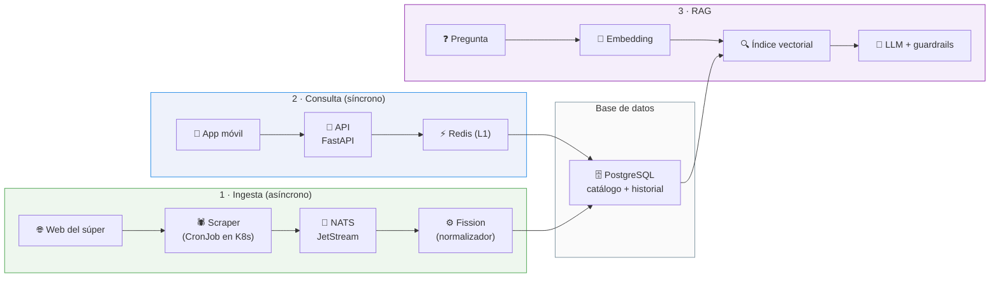

# Comparador de precios de supermercados

Aplicación móvil de «Inteligencia de Mercado» para consultar y comparar los precios de los
productos de varias cadenas de supermercados: buscar un producto, ver cuánto cuesta en cada
establecimiento, seguir la evolución de su precio y construir una lista de la compra
optimizada, con búsquedas tradicionales o preguntando en lenguaje natural a un asistente.

Para que eso sea posible, el sistema **recopila automáticamente** los datos de cada
supermercado, **los convierte a un formato común** y **los expone a la app mediante una API**.
Sobre esa misma base de datos se añade un módulo de **RAG** que responde preguntas abiertas
apoyándose siempre en datos reales de precios.

Este repositorio contiene la parte de datos: la **ingesta** (los scrapers y el normalizador) y
el **módulo de IA**. La app móvil y la API son de otros compañeros y viven en las ramas `app` y
`api`.

## El problema

Los precios de los productos básicos cambian con el tiempo y difieren entre cadenas, así que
comparar supermercado por supermercado exige mucho tiempo. Además, los formatos distintos (1 L
frente a 5 L, packs, bandejas de ahorro) hacen difícil saber cuál es realmente la opción más
barata: hace falta el **precio por unidad** para poder comparar.

El objetivo del proyecto es centralizar esa información, normalizarla para que sea comparable
y ofrecer al usuario herramientas que le ayuden a decidir dónde y qué comprar para gastar
menos.

## La propuesta de valor

Tres pilares:

- **Multicadena**: monitorización de los principales supermercados en una única app.
- **Ahorro máximo**: detección automática de bajadas de precio y promociones.
- **Cesta optimizada**: cálculo del coste total de la lista de la compra en cada establecimiento
  y propuesta de la combinación más económica.

A los tres se suma un **asistente conversacional** que entiende preguntas complejas y responde
con recomendaciones explicables, siempre apoyadas en los datos recuperados.

## Arquitectura: tres flujos



**1 · Ingesta (asíncrono).** Los scrapers corren en un clúster de Kubernetes, uno por
supermercado, en contenedores aislados: cada uno se lanza periódicamente con un CronJob,
extrae los datos crudos de su cadena y los publica. Su única misión es obtener el dato crudo y
publicarlo; no transforman ni escriben en base de datos. Al estar aislados, un cambio en la web
de un supermercado solo afecta a su propio scraper.

El normalizador (una función de Fission, con validación mediante Pydantic) recibe esos datos,
los limpia, los interpreta y los adapta a un esquema común de producto, precio y supermercado,
calculando el **precio unitario canónico** (`€/kg`, `€/l`, `€/ud`, `€/m`, `€/lavado`). El
resultado se escribe en la base de datos, tanto el catálogo limpio como el historial de precios.

Este flujo es asíncrono respecto al usuario: nadie espera una respuesta, así que puede
procesar grandes volúmenes sin afectar a la experiencia de la app.

**2 · Consulta (síncrono).** La app móvil consulta el catálogo y la API responde en menos de
100 ms: primero mira en la caché de Redis (nivel L1) y, si no está, consulta PostgreSQL
(nivel L2) y guarda el resultado para las siguientes peticiones. Es síncrono porque el usuario
está esperando.

**3 · RAG.** Se activa cuando la pregunta es abierta y no una simple búsqueda de producto. La
pregunta se convierte en un embedding, se recuperan por similitud los productos y precios más
relevantes, se ensambla un prompt con esos datos reales y el LLM redacta la respuesta. La salida
se estructura con JSON Schema y guardrails para obtener comparativas consistentes y evitar
respuestas inventadas.

## Qué hay en este repositorio

| Flujo | Carpeta | Estado |
|---|---|---|
| Ingesta | [`flujo-entrada/`](flujo-entrada/) | Implementado y desplegado en el clúster |
| RAG | [`flujo-ia/`](flujo-ia/) | Prototipo completo, con dataset y tests |
| Consulta | — | Pendiente: ramas `api` y `app` |

La **ingesta** se montó con un script idempotente ([`setup-vm.sh`](flujo-entrada/setup-vm.sh))
que levanta los namespaces, NATS con JetStream, Fission, la función normalizadora y el CronJob
del scraper, y deja el clúster en un estado verificable. El **RAG** se monta con
[`setup.sh`](flujo-ia/setup.sh), que crea el entorno, descarga el modelo de embeddings y
construye el índice; el LLM es opcional y se puede trabajar en modo *solo recuperación*.

## Stack

| Capa | Tecnologías |
|---|---|
| Orquestación | Kubernetes (Minikube), Docker, CronJobs |
| Scraping | Python, `requests` (Mercadona: API JSON; Carrefour: `requests` + BeautifulSoup) |
| Transporte | NATS JetStream |
| Normalización | Fission (FaaS), Python, Pydantic |
| Base de datos | PostgreSQL + pgvector *(pendiente)* |
| Caché | Redis *(pendiente)* |
| API | FastAPI, REST/JSON *(pendiente)* |
| App móvil | React Native, TypeScript *(pendiente)* |
| RAG | Embeddings de HuggingFace (`e5-small`), LangChain, LLM local (Ollama) o remoto (Gemini), JSON Schema y guardrails |

## Puesta en marcha

```bash
# Ingesta: monta y verifica el clúster completo
bash flujo-entrada/setup-vm.sh
bash flujo-entrada/setup-vm.sh verify

# RAG: entorno + dataset + índice
cd flujo-ia && bash setup.sh
```

El módulo de IA se maneja por CLI (indexar, buscar, comparar cadenas, preguntar, evaluar) y
además expone un servicio HTTP (`/health`, `/search`, `/ask`, `/ask/stream`, `/equiv`) que es
lo que consumirán la API y la app. El detalle de cada parte está en
[`flujo-entrada/docs/`](flujo-entrada/docs/) y [`flujo-ia/docs/`](flujo-ia/docs/).

## Riesgos conocidos

- **El mantenimiento del scraping.** Las webs de los supermercados cambian su estructura y
  tienen sus propias condiciones de uso: cada scraper necesitará mantenimiento periódico. El
  aislamiento por contenedor limita el impacto de cada cambio. Carrefour está además bloqueado
  por el challenge de JavaScript de Cloudflare.
- **La equivalencia entre productos.** Comparar solo es útil si se identifica correctamente el
  mismo producto en distintas cadenas y se calcula bien el precio por unidad. Es la parte más
  delicada del sistema.
- **La frescura de los datos.** La ingesta es periódica (un CronJob nocturno), no en tiempo
  real: en la práctica será casi tiempo real y dependerá de la frecuencia elegida.
- **La latencia del RAG.** El objetivo de menos de 100 ms es realista para la consulta con
  caché, pero no para una respuesta generada por un LLM: ahí conviene *streaming*.
- **El coste y la fiabilidad del LLM.** Cada pregunta tiene un coste y el modelo debe
  responder solo con los datos recuperados; los guardrails y el anclaje al contexto son
  esenciales para no inventar.

## Ramas

| Rama | Contenido |
|---|---|
| `develop` | Integración de los dos flujos de este repo |
| `scrapping` | Origen de `flujo-entrada`: scrapers, NATS, normalizador y su documentación |
| `ai` | Origen de `flujo-ia`: modelo de embeddings, prototipo RAG y evaluación |
| `api` / `app` | La API y la app móvil, de otros compañeros |
| `main` | Punto de partida del repositorio |
