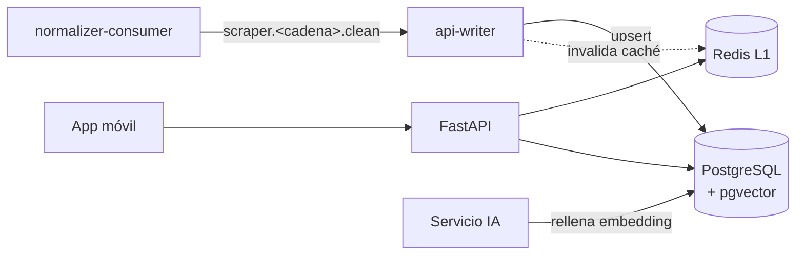
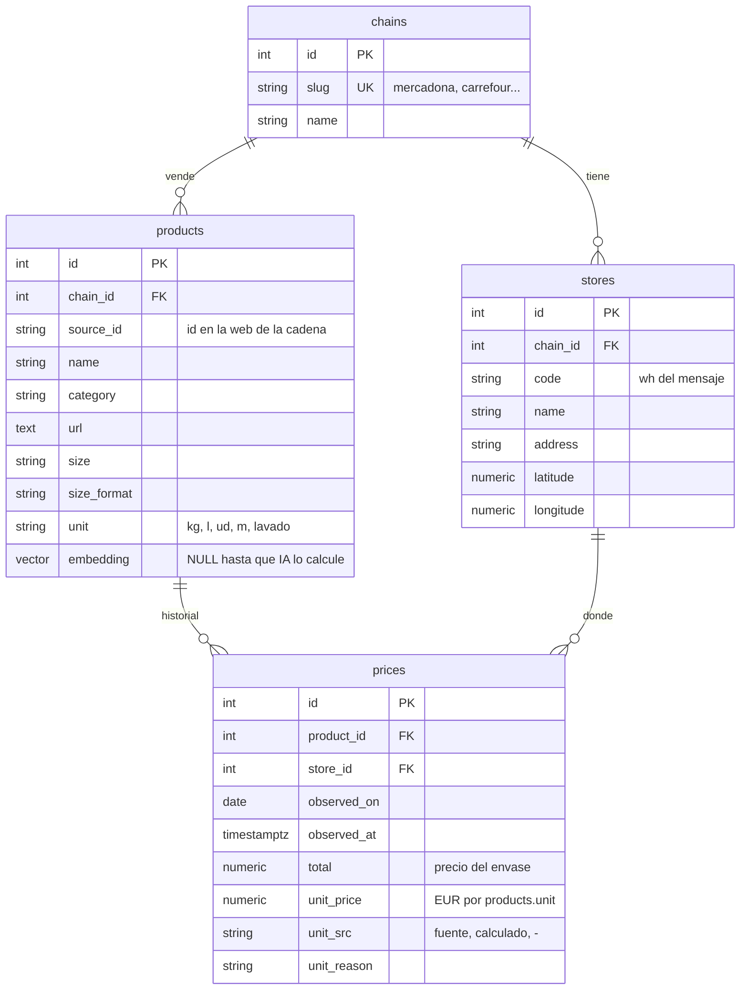

# Contrato API/BD

Respuesta del equipo de API/BD a las decisiones abiertas de
[`flujo-entrada/docs/05-pendientes.md`](../../flujo-entrada/docs/05-pendientes.md) (Prioridad 3)
y contrato que usan la ingesta, la app y la IA.

## Visión general



## Decisiones (respuestas a `05-pendientes.md`)

| # | Pregunta | Decisión |
|---|---|---|
| 1 | ¿`clean` en texto plano o JSON? | **JSON (`CleanBatch` con `items: NormalizedProduct[]`)** como formato objetivo. Mientras tanto el writer **acepta también el texto plano actual**, así que no bloquea nada: el cambio se puede hacer cuando convenga. |
| 2 | ¿Quién escribe en BD? | **Un servicio del equipo de API/BD: `api-writer`** (`api/app/writer.py`). Consume `scraper.*.clean` con un consumidor durable *pull* (`api-writer`, stream `SCRAPERS`). El consumer de ingesta no toca la BD. |
| 3 | ¿Deduplicar? | **Sí, por upsert.** Producto único por `(cadena, id de la fuente)`; precio único por `(producto, tienda, día)`. Reprocesar un mensaje no duplica nada (los `clean` retenidos 7 días se pueden reproducir sin miedo). |
| 4 | Subjects | **Se mantiene `scraper.<cadena>.raw` / `scraper.<cadena>.clean`.** El writer se suscribe con comodín y saca la cadena del subject, así que una cadena nueva no requiere cambios en la API. |
| 5 | ¿Quién genera los embeddings? | **El equipo de IA, fuera del normalizador.** La columna `products.embedding` (pgvector) empieza a `NULL`; un proceso de IA calcula los que falten. La dimensión depende del modelo elegido (`EMBEDDING_DIM`, por defecto 384): **pendiente de confirmar con IA**. |

### Lo que se pide a ingesta
- Publicar `scraper.<cadena>.clean` con `ts` en UTC (ya se hace) y el `wh` real cuando haya multi-tienda.
- Cuando se pueda: publicar `clean` como JSON (`to_clean_json`). Opcional, no bloqueante.

## Esquema de la base de datos

Fuente única: [`app/models.py`](../app/models.py). Las tablas se crean solas al arrancar.



- Únicos: `products(chain_id, source_id)`, `prices(product_id, store_id, observed_on)`, `stores(chain_id, code)`.
- El **precio actual** es el `prices` más reciente del producto; el **historial** son todas sus filas.
- Importes en `NUMERIC(12,4)` (nunca float), como el `Decimal` del normalizador.

### Mapeo `NormalizedProduct` → BD

| Campo del normalizador | Columna |
|---|---|
| subject `scraper.<cadena>.clean` | `chains.slug` |
| `wh` | `stores.code` |
| `ts` | `prices.observed_at` y `prices.observed_on` (fecha UTC) |
| `id` | `products.source_id` |
| `name`, `category`, `url` | `products.*` |
| `size`, `size_format`, `unit` | `products.*` |
| `total`, `unit_price`, `unit_src`, `unit_reason` | `prices.*` |
| `ref`, `ref_format` | no se guardan (solo trazabilidad en la ingesta) |

## API REST

Contrato completo: [`api/openapi.json`](../openapi.json) (generado desde el código) o
`http://localhost:8000/docs` con la API levantada.

| Método y ruta | Qué devuelve |
|---|---|
| `GET /health` | Estado de BD y Redis |
| `GET /chains` | Cadenas disponibles |
| `GET /products/search?q=&chain=&unit=&limit=&offset=` | Productos cuyo nombre contiene todas las palabras de `q` (sin distinguir mayúsculas ni acentos), ordenados por **precio unitario** ascendente. Primero los de la unidad principal (`unit` de la respuesta: la pedida o, si no, la más frecuente) y después el resto, porque €/l y €/ud no se comparan |
| `GET /products/{id}` | Detalle del producto con su precio actual |
| `GET /products/{id}/prices?from=&to=` | Historial de precios (para la gráfica de tendencias) |

Ejemplo de `GET /products/search?q=aceite&limit=1`:

```json
{
  "query": "aceite", "unit": "l", "total": 12, "limit": 1, "offset": 0,
  "items": [{
    "id": 2, "name": "Aceite de oliva 0,4º garrafa 5 L",
    "chain": {"slug": "mercadona", "name": "Mercadona"},
    "category": "Aceite, especias y salsas", "unit": "l", "url": "",
    "price": {"observed_on": "2026-10-20", "store": "default",
              "total": 17.25, "unit_price": 3.45, "unit_src": "calculado"}
  }]
}
```

Las respuestas de búsqueda y detalle llevan la cabecera `X-Cache: HIT|MISS`.

## Caché (Redis)

- Se cachean `search` y `products/{id}` durante `CACHE_TTL` (300 s).
- Invalidación por **versión**: las claves van prefijadas con `catalog:version`; el writer la
  incrementa tras cada lote, así que los datos nuevos se ven al momento.
- Si Redis cae, la API sigue respondiendo desde PostgreSQL.

## Próximo (no incluido aún)

Autenticación y usuarios, listas de la compra y lista optimizada, alertas de bajada de
precio, supermercados cercanos (las columnas `stores.latitude/longitude` ya existen) y el
endpoint del asistente de IA.
