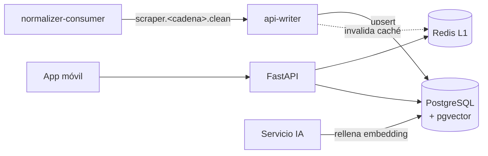
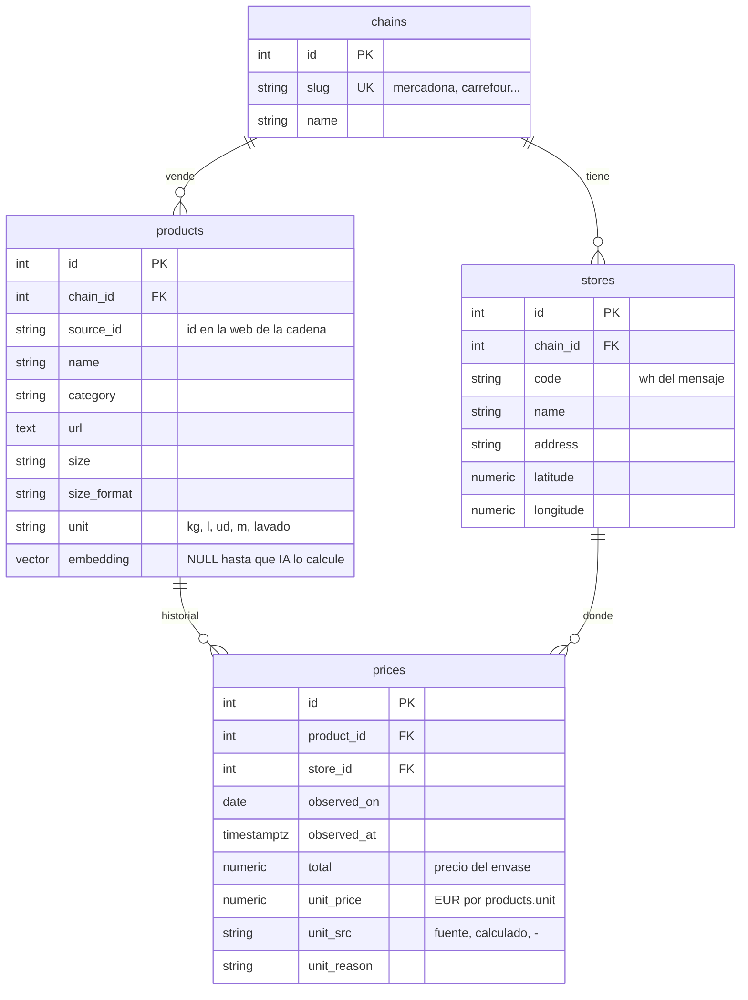

# Contrato API/BD

Respuesta del equipo de API/BD a las decisiones abiertas de
[`flujo-entrada/docs/05-pendientes.md`](../../flujo-entrada/docs/05-pendientes.md) (Prioridad 3)
y contrato que usan la ingesta, la app y la IA.

## Visión general



## Decisiones (respuestas a `05-pendientes.md`)

| # | Pregunta | Decisión |
|---|---|---|
| 1 | ¿`clean` en texto plano o JSON? | **JSON (`CleanBatch` con `items: NormalizedProduct[]`)** como formato objetivo. Mientras tanto el writer **acepta también el texto plano actual**, así que no bloquea nada: el cambio se puede hacer cuando convenga. |
| 2 | ¿Quién escribe en BD? | **Un servicio del equipo de API/BD: `api-writer`** (`api/app/writer.py`). Consume `scraper.*.clean` con un consumidor durable *pull* (`api-writer`, stream `SCRAPERS`). El consumer de ingesta no toca la BD. |
| 3 | ¿Deduplicar? | **Sí, por upsert.** Producto único por `(cadena, id de la fuente)`; precio único por `(producto, tienda, día)`. Reprocesar un mensaje no duplica nada (los `clean` retenidos 7 días se pueden reproducir sin miedo). |
| 4 | Subjects | **Se mantiene `scraper.<cadena>.raw` / `scraper.<cadena>.clean`.** El writer se suscribe con comodín y saca la cadena del subject, así que una cadena nueva no requiere cambios en la API. |
| 5 | ¿Quién genera los embeddings? | **El equipo de IA, fuera del normalizador.** La columna `products.embedding` (pgvector) empieza a `NULL`; un proceso de IA calcula los que falten. **Confirmada: 384 dimensiones, modelo e5-small (`intfloat/multilingual-e5-small`), vectores con norma 1** (`EMBEDDING_DIM=384`). Los calcula el servicio `/embed` de `flujo-ia` (VM 2); ver *Integración con la IA*. |

### Lo que se pide a ingesta
- Publicar `scraper.<cadena>.clean` con `ts` en UTC (ya se hace) y el `wh` real cuando haya multi-tienda.
- Cuando se pueda: publicar `clean` como JSON (`to_clean_json`). Opcional, no bloqueante.

## Esquema de la base de datos

Fuente única: [`app/models.py`](../app/models.py). Las tablas se crean solas al arrancar.



- Únicos: `products(chain_id, source_id)`, `prices(product_id, store_id, observed_on)`, `stores(chain_id, code)`.
- El **precio actual** es el `prices` más reciente del producto; el **historial** son todas sus filas.
- Importes en `NUMERIC(12,4)` (nunca float), como el `Decimal` del normalizador.

### Mapeo `NormalizedProduct` → BD

| Campo del normalizador | Columna |
|---|---|
| subject `scraper.<cadena>.clean` | `chains.slug` |
| `wh` | `stores.code` |
| `ts` | `prices.observed_at` y `prices.observed_on` (fecha UTC) |
| `id` | `products.source_id` |
| `name`, `category`, `url` | `products.*` |
| `size`, `size_format`, `unit` | `products.*` |
| `total`, `unit_price`, `unit_src`, `unit_reason` | `prices.*` |
| `ref`, `ref_format` | no se guardan (solo trazabilidad en la ingesta) |

## API REST

Contrato completo: [`api/openapi.json`](../openapi.json) (generado desde el código) o
`http://localhost:8000/docs` con la API levantada.

| Método y ruta | Qué devuelve |
|---|---|
| `GET /health` | Estado de BD y Redis |
| `GET /chains` | Cadenas disponibles |
| `GET /products/search?q=&chain=&unit=&limit=&offset=` | Productos cuyo nombre contiene todas las palabras de `q` (sin distinguir mayúsculas ni acentos), ordenados por **precio unitario** ascendente. Primero los de la unidad principal (`unit` de la respuesta: la pedida o, si no, la más frecuente) y después el resto, porque €/l y €/ud no se comparan |
| `GET /products/{id}` | Detalle del producto con su precio actual |
| `GET /products/{id}/prices?from=&to=` | Historial de precios (para la gráfica de tendencias) |
| `POST /shopping-list/optimize` | **Lista de la compra optimizada:** cuánto cuesta la lista entera en cada cadena y cuánto comprando cada artículo donde es más barato (ver abajo) |
| `POST /products/search-vector` | **Búsqueda semántica** para el asistente de IA: los productos más parecidos a un embedding, con su último precio (ver abajo) |

Ejemplo de `GET /products/search?q=aceite&limit=1`:

```json
{
  "query": "aceite", "unit": "l", "total": 12, "limit": 1, "offset": 0,
  "items": [{
    "id": 2, "name": "Aceite de oliva 0,4º garrafa 5 L",
    "chain": {"slug": "mercadona", "name": "Mercadona"},
    "category": "Aceite, especias y salsas", "unit": "l", "url": "",
    "price": {"observed_on": "2026-10-20", "store": "default",
              "total": 17.25, "unit_price": 3.45, "unit_src": "calculado"}
  }]
}
```

Las respuestas de búsqueda y detalle llevan la cabecera `X-Cache: HIT|MISS`.

### Lista optimizada

Cuerpo de `POST /shopping-list/optimize` (`amount`, `quantity` y `unit` son opcionales;
`chains` limita las cadenas):

```json
{"items": [{"q": "aceite", "amount": 3, "unit": "l"}, {"q": "arroz redondo", "quantity": 2},
           {"q": "huevos"}],
 "chains": ["mercadona", "alcampo"]}
```

- Solo se comparan productos de la unidad principal (`unit` o la más frecuente), como en la búsqueda.
- **Con `amount`** (recomendado: la app pregunta cuánto quieres al marcar un producto): se
  calcula cuántos envases hacen falta para llegar a esa cantidad (`amount` ÷ tamaño del envase,
  redondeado hacia arriba) y se elige el producto con el que cuesta menos. Así todas las cadenas
  se comparan por la misma cantidad. Ej.: 3 L de aceite → 3 botellas de 1 L (14,55 €) antes que
  una garrafa de 5 L (17,25 €); 5 L → la garrafa. Se ignora `quantity`.
- El **tamaño del envase** sale de la etiqueta: `size` × factor de `size_format` (la tabla de
  conversión de `flujo-entrada/docs/03-contratos-datos.md`: `500 g` → 0,5 kg, `33 cl` → 0,33 l,
  `1 dz` → 12 ud). Solo si no hay tamaño o el formato no es de esa unidad se usa
  total ÷ precio unitario, porque el precio unitario de la fuente a veces no cuadra (ofertas,
  peso escurrido, packs). Los productos sin ninguno de los dos no entran.
- **Sin `amount`**: se elige el envase más barato y se compran `quantity` envases.
- Cada línea lleva `amount` (lo pedido, o `null`), `packs` (envases a comprar) y
  `subtotal` = precio del envase × `packs`. No se mezclan tamaños en una misma línea.
- **Resumen al principio de la respuesta:** `best_chain`, `best_total` (precio final en el mejor
  súper), `combined_total` (precio final combinando) y `savings`. Debajo va el detalle.
- `baskets`: la lista entera en cada cadena, con `total`, `found`, `missing` y las líneas.
  Ordenadas por más artículos encontrados y, dentro, por la más barata.
- `best_chain`: la primera de `baskets` (el mejor supermercado si solo se va a uno).
- `combined`: cada artículo en la cadena donde su línea es más barata.
- `savings`: `best_chain.total − combined.total`. Es `null` si la combinada encuentra artículos
  que la mejor cadena no tiene (no serían comparables).

Con los datos de demo, leche + arroz ×2 + huevos + aceite virgen extra: Alcampo 15,36 €;
combinando 15,28 € (el arroz en Ahorramás), ahorro 0,08 €.

## Integración con la IA (VM 1 ↔ VM 2)

La API (VM 1) guarda los embeddings de los productos en `products.embedding`
(`vector(384)`). Los calcula el servicio `/embed` de `flujo-ia` (VM 2,
`http://10.4.41.108:8080`) con el mismo modelo que el RAG: **e5-small
(`intfloat/multilingual-e5-small`), 384 dimensiones, norma 1**. Con norma 1, `<=>` (coseno)
y `<#>` (producto escalar) ordenan igual; la API usa `<=>`. La API nunca carga el modelo.

### Servicio `/embed` (VM 2)

```
POST {RAG_EMBED_URL}/embed        cabecera X-API-Key: {RAG_EMBED_API_KEY}
{"texts": ["Aceite de oliva 0,4º Hacendado | categoria Aceite, especias y salsas | tamano 5 l"],
 "kind": "passage"}
→ 200 {"embeddings": [[384 floats], ...]}     (mismo orden que texts; [] si texts está vacía)
```

- `kind`: `"passage"` para los productos y `"query"` para lo que escribe el usuario. Los
  prefijos de e5 (`passage: ` / `query: `) los pone el servicio.
- Máximo 256 textos por petición y 2000 caracteres por texto: el cliente (`app/embeddings.py`)
  parte en lotes y recorta los textos.
- Errores: `400` cuerpo inválido · `401` falta la clave o es incorrecta · `413` lote o texto
  demasiado grande · `503` el servicio no tiene la clave configurada (avisar al equipo de IA; no
  se reintenta).
- El texto de cada producto es el mismo que `Product.embed_text` de `flujo-ia`: nombre,
  categoría y tamaño. El precio y la URL no se embeben.

### Embeddings de los productos (VM 1 → VM 2)

1. El upsert de la ingesta pone `embedding = NULL` en los productos nuevos y en los que
   cambian de nombre, categoría o tamaño (un cambio de precio no lo toca).
2. El writer, justo después de cada ingesta (cuando la cola de NATS queda vacía) y al
   arrancar, envía esos productos a `/embed` con `kind: "passage"` y guarda los vectores. No se
   hace dentro del upsert para que una VM 2 caída nunca bloquee la ingesta: si falla, siguen a
   NULL y se reintenta a los 10 minutos (con un `503`, en la próxima ingesta).
3. Carga inicial o manual: `python -m app.embeddings` (`--reset` para recalcularlos todos,
   p. ej. si cambia el modelo).

### Búsqueda semántica

| Método y ruta | Quién la usa | Qué hace |
|---|---|---|
| `GET /products/semantic-search?q=&top_k=&chain=&unit=&max_price=&max_unit_price=` | App | La API pide el vector de `q` a `/embed` con `kind: "query"` y busca con `ORDER BY embedding <=> vector` |
| `POST /products/search-vector` | Servidor MCP (VM 2) | Igual, pero recibe el vector ya calculado |

Cuerpo de `search-vector` (solo `embedding` es obligatorio; exactamente 384 valores, si no 422):

```json
{"embedding": [0.012, -0.45, ...], "top_k": 10,
 "chains": ["mercadona"], "unit": "l", "max_price": 10, "max_unit_price": 4}
```

Las dos responden `{"items": [...]}`: productos con el mismo formato que `/products/search`
más `similarity` (coseno, 1 = idéntico), del más al menos parecido. Los filtros de precio usan
el último precio. Los productos sin embedding todavía no salen. Sin índice vectorial: con
decenas de miles de productos la búsqueda exacta tarda milisegundos y siempre devuelve `top_k`
aunque haya filtros. `semantic-search` responde `503` si falta `RAG_EMBED_URL` y `502` si
`/embed` falla, y se cachea como `search`.

### Configuración

| Variable | Por defecto | Para qué |
|---|---|---|
| `RAG_EMBED_URL` | vacía (sin embeddings) | URL base del servicio, `http://10.4.41.108:8080` |
| `RAG_EMBED_API_KEY` | vacía | Clave de `X-API-Key`. **Solo en el entorno**: `.env` fuera del repo o el Secret del clúster (`kubectl -n api patch secret api-secrets ...`). Nunca en el código, los logs ni un commit |
| `EMBED_BATCH_SIZE` | 256 | Textos por petición (máximo 256) |
| `EMBED_TIMEOUT` | 60 | Segundos por petición (el modelo va en CPU) |

## Caché (Redis)

- Se cachean `search`, `semantic-search`, `products/{id}` y la lista optimizada (clave = hash del cuerpo) durante `CACHE_TTL` (300 s).
- Invalidación por **versión**: las claves van prefijadas con `catalog:version`; el writer la
  incrementa tras cada lote, así que los datos nuevos se ven al momento.
- Si Redis cae, la API sigue respondiendo desde PostgreSQL.

## Próximo (no incluido aún)

Autenticación y usuarios, listas de la compra guardadas por usuario, alertas de bajada de
precio y supermercados cercanos (las columnas `stores.latitude/longitude` ya existen).
