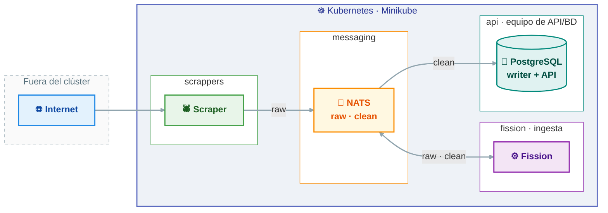
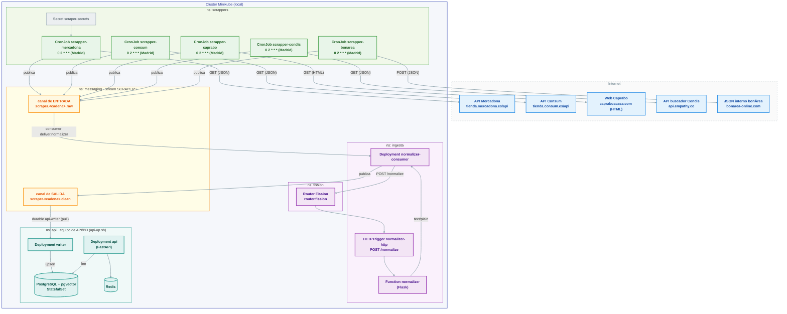

# 01 · Arquitectura y despliegue

## 🏛️ Arquitectura



<details>
<summary><b>🔍 Detalle técnico</b> — componentes, manifiestos, variables y orden de despliegue</summary>

<br/>

### 🗺️ Componentes y namespaces



#### Leyenda

| Muestra | Significado |
|---|---|
| 🟢 **Verde** | scraper |
| 🟠 **Ámbar** | mensajería |
| 🟣 **Morado** | Fission |
| 🔵 **Azul** | fuentes externas |
| 🟦 **Verde azulado** | API y BD: del equipo de API/BD, desplegado aparte en el mismo clúster |

> [!NOTE]
> Sobre las líneas: **continua** = tráfico de datos real; **discontinua** = solo
> configuración (el `Secret` que monta el CronJob).

## 🧩 Componentes

### 1 · 🕷️ `scrapper_mercadona`, `scrapper_consum`, `scrapper_caprabo`, `scrapper_condis` y `scrapper_bonarea` — recolectores

`scrapper_caprabo` no tiene API: lee el HTML de las categorías de capraboacasa.com y publica
en `scraper.caprabo.raw`. Ver su README.

`scrapper_condis` lee la API JSON del buscador de la web de Condis (Empathy.co), por
secciones: todo el catálogo en ~20 peticiones. Publica en `scraper.condis.raw`.

`scrapper_bonarea` usa el JSON interno con el que la web de bonÀrea carga cada categoría
(encontrado con Playwright; el scraper no lo necesita). Publica en `scraper.bonarea.raw`.

`scrapper_consum` recorre la API paginada de Consum (`catalog/product?limit=100&offset=N`)
con `SCRAPER_DELAY` segundos entre páginas y publica en `scraper.consum.raw`.

Hay un recolector por cadena, con la misma estructura (cada uno con su README). Todos salen
con código ≠ 0 si no consiguen productos o no los publican, y todos recorren la tienda que
sirve cada código postal (`SCRAPER_POSTAL_CODES`). Abajo, el de Mercadona como ejemplo.

| Fichero | Responsabilidad |
|---|---|
| `src/client.py` | `fetch_json(url)` → `(status, dict)`; `requests` con `User-Agent`, timeout 15 s |
| `src/extractor.py` | `collect_raw(category_json)` → aplana `categories[].products[]` en una lista |
| `src/dump_txt.py` | `dump(...)` → volcado crudo a `out/mercadona_<wh>_<ts>.txt` |
| `src/publish.py` | `publish(items, wh)` → 1 mensaje NATS por producto (envelope) |
| `src/main.py` | Orquesta: código postal → almacén (`wh`) → categorías → subcategorías → extracción → volcado → publicación |
| `Dockerfile` | `python:3.13-slim`, `CMD ["python", "src/main.py"]` |
| `cronjob.yaml` | CronJob en `scrappers`, `schedule: "0 2 * * *"`, `timeZone: Europe/Madrid`, `concurrencyPolicy: Forbid` |

> [!IMPORTANT]
> **Principio de diseño.** El scraper **no normaliza**: solo extrae y publica datos crudos
> tal como los da la fuente. Toda la interpretación vive en `normalizer`. Esto mantiene cada
> recolector tonto, pequeño y reemplazable si la web cambia.

> [!TIP]
> **Idempotencia de ejecución.** `concurrencyPolicy: Forbid` evita que dos ejecuciones se
> solapen; `successfulJobsHistoryLimit: 2` y `failedJobsHistoryLimit: 2` acotan el histórico.
> `startingDeadlineSeconds: 21600`: si a las 02:00 el clúster estaba parado, la pasada se lanza
> al volver (en las 6 h siguientes).

### 2 · 📨 `messaging` — NATS JetStream

`nats-values.yaml` (Helm):

- `jetstream.enabled: true`, `fileStore` con PVC de 1 Gi (`storageClassName: standard`),
  `memoryStore` de 256 Mi.
- Imagen `nats:2.10.29-alpine`, `service.type: ClusterIP`, `natsBox` habilitado (para depurar).
- Stream `SCRAPERS` con subjects `scraper.>`: guarda **la entrada (`raw`) y la salida
  (`clean`)**. Con Terraform lo declara un CRD de **NACK** (`infra/terraform/nats.tf`), igual
  que el durable `normalizer`. El publisher además lo crea de forma defensiva con
  `js.add_stream`, ignorando el error si ya existe.
- La salida `scraper.<cadena>.clean` la lee el writer del equipo de API/BD con su durable
  `api-writer` (ver [`03`](03-contratos-datos.md#cola-de-salida-frontera-con-apibd)).

> [!NOTE]
> **Por qué JetStream y no pub/sub básico.** Persistencia y `ack` explícito: si el
> normalizador cae, los mensajes no se pierden y se reentregan (`AckWait`).

### 3 · ⚙️ `normalizer` — función Fission

| Fichero | Responsabilidad |
|---|---|
| `normalizer.py` | Limpieza, formateo **y contrato Pydantic** (`RawProduct`, `NormalizedProduct`, `CleanBatch`) |
| `requirements.txt` | `pydantic==2.14.3` — lo necesitan la función y el consumer |
| `fission.yaml` | `HTTPTrigger` POST `/normalize` (la `Function` la crea `deploy.sh`: el CRD no tiene `entrypoint` ni `functionSource`) |
| `deploy.sh` | Despliegue reproducible **en la VM del clúster**: entorno con pydantic + función + consumer + humo |
| `consumer.py` | Puente alternativo: NATS → HTTP Fission → NATS |
| `consumer.yaml` | `Deployment normalizer-consumer` (replicas: 1) |
| `Dockerfile.consumer` | Imagen del consumer (`nats-py` + `pydantic`) |
| `Dockerfile.env` | Imagen de entorno Fission con pydantic (hereda del entorno `python`) |
| `test_local.py` | Prueba local sin cluster: lee el último `mercadona_*.txt` y normaliza |
| `test_unit_price.py` | Prueba del precio unitario contra casos y datos reales |
| `test_models.py` | Prueba del contrato Pydantic, la tolerancia por item y el endpoint |

> [!IMPORTANT]
> **Diseño defensivo.** Si un campo desaparece del JSON de Mercadona, la línea se degrada
> pero el lote no se rompe. Cada producto se procesa por separado y cada línea se valida
> con Pydantic: si no cuadra, se emite un `ERROR id=...` y el lote continúa
> (ver [`03-contratos-datos.md`](03-contratos-datos.md#contrato-pydantic)).

> [!NOTE]
> **Dependencia pydantic.** La imagen `python` prebuilt de Fission no la trae.
> `Dockerfile.env` hornea un entorno con ella; el consumer la instala desde
> `requirements.txt`. El paso a paso es `deploy.sh` (ver *Orden de despliegue*).

### 4 · 🌉 `normalizer-consumer` — el puente

Es el componente que **sustituye** al `MessageQueueTrigger`. Se suscribe a la cola push
`deliver.normalizer`, acumula mensajes en un búfer y cada cierto punto llama a la función
Fission por HTTP.

- **Suscripción:** `nc.subscribe("deliver.normalizer", cb=handler)`.
- **Batching:** vuelca cuando el búfer llega a `CONSUMER_BATCH` (50) **o** cada 5 s (el bucle
  principal fuerza un `flush` periódico; no se queda esperando a llenar el lote).
- **`ack` explícito** de todo el lote **solo si** la publicación del resultado tiene éxito.
- **Conexión con NATS:** reintenta sin fin si NATS se cae. Mientras está conectado toca
  `/tmp/healthy` cada 5 s, y una `livenessProbe` reinicia el pod si la marca tiene más de
  2 min. Si la conexión se cierra del todo, el proceso sale y Kubernetes lo reinicia.
- **Entregas máximas:** el durable `normalizer` tiene `maxDeliver` 100 (~50 min con
  `AckWait` de 30 s): un lote que falla siempre se descarta en vez de reintentarse 7 días.
- **Modo local:** si `NORMALIZE_URL` está vacío, normaliza **en proceso** (`clean_local`), sin
  Fission. Útil para depurar el puente sin cluster.

### 5 · ☸️ `cluster` y `scrappers/k8s` — despliegue

`cluster/namespace.yaml` crea `scrappers`, `fission` y `messaging`.

## 📜 Manifiestos

| Manifiesto | Kind | Namespace | Notas |
|---|---|---|---|
| `../infra/up.sh` + `../infra/terraform/` | Script + Terraform | — | **Despliegue recomendado**: un comando, desde una VM vacía (ver [`infra/README.md`](../infra/README.md)) |
| `../setup-vm.sh` | Script | — | Montaje a mano, idempotente, en el perfil `minikube` (ver *Orden de despliegue*) |
| `cluster/namespace.yaml` | Namespace ×3 | — | `scrappers`, `fission`, `messaging` |
| `messaging/nats-values.yaml` | Helm values | messaging | JetStream + PVC 1 Gi |
| `scrappers/k8s/secrets.yaml` | Secret | scrappers | `scraper-secrets` (`USER_AGENT`, lo leen Mercadona y Carrefour) |
| `scrapper_mercadona/cronjob.yaml` | CronJob | scrappers | `0 2 * * *` (Europe/Madrid); monta el PVC en `/app/out` |
| `scrapper_consum/cronjob.yaml` | CronJob | scrappers | `0 2 * * *` (Europe/Madrid), `SCRAPER_DELAY=5`; mismo PVC |
| `scrapper_caprabo/cronjob.yaml` | CronJob | scrappers | `0 2 * * *` (Europe/Madrid), `SCRAPER_DELAY=3`, máximo 2 h; mismo PVC |
| `scrapper_condis/cronjob.yaml` | CronJob | scrappers | `0 2 * * *` (Europe/Madrid), `SCRAPER_DELAY=3`, `SCRAPER_STORE=718`; mismo PVC |
| `scrapper_bonarea/cronjob.yaml` | CronJob | scrappers | `0 2 * * *` (Europe/Madrid), `SCRAPER_DELAY=3`, máximo 2 h; mismo PVC |
| `scrapper_mercadona/pvc.yaml` | PersistentVolumeClaim | scrappers | `scraper-out`, 1 Gi: guarda los `.txt` de depuración de todos los scrapers |
| `scrappers/k8s/cleanup-cronjob.yaml` | CronJob | scrappers | `scraper-out-cleanup`, 01:30: borra los `.txt` de más de 7 días |
| `fission/normalizer/fission.yaml` | HTTPTrigger | ingesta | POST `/normalize` (a `Function` `normalizer`) |
| `fission/normalizer/consumer.yaml` | Deployment | ingesta | `normalizer-consumer` |
| `../infra/api-up.sh` → `../../api/k8s/` | StatefulSet, Deployments, Services | api | **Del equipo de API/BD**, aplicado tal cual: PostgreSQL + pgvector, Redis, `api` y `writer` (ver [`infra/README.md`](../infra/README.md#api-y-bd-en-la-misma-vm-api-upsh)) |

> [!NOTE]
> Los YAML dicen `namespace: default` porque es lo que usa el montaje a mano. Terraform los
> aplica en `ingesta` (`override_namespace`) e instala Fission con `defaultNamespace: ingesta`.

> [!NOTE]
> `scrappers/scrapper_carrefour/` (CronJob `*/30 * * * *`) está en el repo pero
> **bloqueado** por el challenge de Cloudflare (15/10/2026; también con Playwright el
> 11/11): ni Terraform ni `setup-vm.sh` lo despliegan. Detalle en
> `scrappers/scrapper_carrefour/README.md`.

## 🔧 Variables de entorno

### 📤 Scraper (`publish.py`, `main.py`)

| Variable | Por defecto | Efecto |
|---|---|---|
| `NATS_URL` | `nats://nats.messaging.svc.cluster.local:4222` | Servidor NATS |
| `NATS_STREAM` | `SCRAPERS` | Stream destino |
| `NATS_SUBJECT` | `scraper.<cadena>.raw` | Subject de publicación (cada scraper tiene el suyo) |
| `NATS_DRY_RUN` | `0` | `1` = no publica (solo volcado txt) |
| `SCRAPER_POSTAL_CODES` | `08016` | Códigos postales (separados por comas). Cada uno se traduce a su tienda (`wh`); ver [`03`](03-contratos-datos.md#código-postal-y-tienda) |
| `SCRAPER_DELAY` | según la cadena | Segundos entre peticiones (Consum 5; Caprabo, Condis y bonÀrea 3; Mercadona usa 0,3 fijo) |

### 📥 Consumer

| Variable | Por defecto | Efecto |
|---|---|---|
| `NATS_URL` | `nats://nats.messaging.svc.cluster.local:4222` | Servidor NATS |
| `NATS_DELIVER` | `deliver.normalizer` | Cola a la que se suscribe |
| `NATS_SUBJECT_OUT` | `scraper.mercadona.clean` | Solo de reserva: la salida se deriva del subject de entrada (`scraper.<cadena>.raw` → `scraper.<cadena>.clean`) |
| `NORMALIZE_URL` | `http://router.fission/normalize` | Si vacío → normaliza en proceso |
| `CONSUMER_BATCH` | `50` | Tamaño de lote antes de volcar |

## 🧭 Decisiones de diseño

1. **NATS en lugar del HTTP POST del plan.** El plan (tarea 2) decía "publicando HTML/JSON
   por HTTP POST". Se sustituyó por NATS JetStream por desacoplamiento y persistencia: el
   scraper no conoce al normalizador ni tiene que esperar a que responda.
2. **El scraper no normaliza.** Cada cadena tiene su propio formato; normalizar en un
   único sitio evita duplicar lógica y facilita añadir cadenas.
3. **Consumer propio en vez de `MessageQueueTrigger`.** El conector de KEDA no pasa la
   autenticación interna del router de Fission v1.27 (devuelve 401), así que se descartó.
   `normalizer-consumer` hace las veces de puente.
4. **Fission para la normalización.** Encaja con el requisito de la asignatura y permite
   escalar la función por separado del recolector.
5. **Doble salida del scraper (txt + NATS).** El `.txt` es un respaldo de depuración
   barato si NATS falla o si se quiere probar en local sin cluster.

## 🚀 Orden de despliegue

> [!TIP]
> **Forma recomendada: un solo comando con Terraform.**
>
> ```bash
> bash flujo-entrada/infra/up.sh               # instala lo que falte, crea el perfil `ingesta` y aplica
> API=1 E2E=1 bash flujo-entrada/infra/up.sh   # y además la API/BD y una pasada real de cada cadena
> bash flujo-entrada/infra/down.sh             # lo borra
> ```
>
> `up.sh` instala docker, kubectl, minikube, helm y terraform si faltan (`bootstrap.sh`),
> arranca un perfil de minikube propio y aplica `infra/terraform/`, que crea todo lo de esta
> sección como recursos declarativos: el stream y el durable con NACK, la `Function` y el
> `Package` de Fission sin CLI, e imágenes etiquetadas por hash de su contenido. Detalle y
> problemas conocidos en [`infra/README.md`](../infra/README.md).
>
> Lo de abajo es el montaje **a mano** con `setup-vm.sh`, que sigue funcionando contra el
> perfil `minikube`. No conviene mezclar los dos en el mismo clúster.

> [!IMPORTANT]
> **Todo el montaje está scriptado e idempotente** en `flujo-entrada/setup-vm.sh`.
> `bash setup-vm.sh all` deja la VM lista de cero (base, namespaces, NATS, Fission,
> normalizer y scraper) y `bash setup-vm.sh verify` solo mira el estado. Los pasos de abajo
> son el detalle de lo que hace, por si hay que depurar a mano; el lanzamiento del scraper
> (paso 7) sigue siendo manual.
>
> Tres piezas no están en ningún manifiesto y las crea ese script: el stream `SCRAPERS`
> (subjects `scraper.>`, Max Age 7d), el consumidor durable `normalizer` (filtro
> `scraper.mercadona.raw` → `deliver.normalizer`, ack explícito, `MaxAckPending 1000`) y el
> entorno `python` con `version: 3` / `poolsize: 3`. `setup-vm.sh` es anterior a las demás
> cadenas: solo monta Mercadona (Terraform filtra `scraper.*.raw`, todas).

```bash
# 1. Namespaces
kubectl apply -k flujo-entrada/cluster/

# 2. NATS con JetStream
helm install nats nats/nats -n messaging -f flujo-entrada/messaging/nats-values.yaml

# 3. Configuración de scrapers (secretos)
kubectl apply -k flujo-entrada/scrappers/k8s/

# 4. Fission
helm install fission fission-charts/fission-all -n fission

# 5. Normalizer + consumer (idempotente)
#    entorno `python` con pydantic (Dockerfile.env) -> funcion (--code normalizer.py)
#    -> HTTPTrigger -> consumer nuevo -> prueba de humo (texto y JSON)
bash flujo-entrada/fission/normalizer/deploy.sh
# o por partes: deploy.sh env | fn | consumer | smoke

# 6. Scraper (imagen + CronJob)
docker build -t scrapper-mercadona:v1 flujo-entrada/scrappers/scrapper_mercadona/
minikube image load scrapper-mercadona:v1
kubectl apply -k flujo-entrada/scrappers/scrapper_mercadona/

# 7. Disparo manual (sin esperar a las 02:00)
kubectl create job --from=cronjob/scrapper-mercadona pruebas-mercadona -n scrappers
```

> [!NOTE]
> `fission.yaml` solo versiona el **HTTPTrigger**: en el CRD, la `Function` no tiene
> `entrypoint` ni `functionSource` (el entrypoint vive en `spec.package.functionName`) y el
> paquete que genera el CLI se llama `normalizer-<uuid>`, así que no es un nombre fijo
> versionable. El código se sube con `fission fn create|update --code normalizer.py`, que es
> lo que hace `deploy.sh`.

</details>
