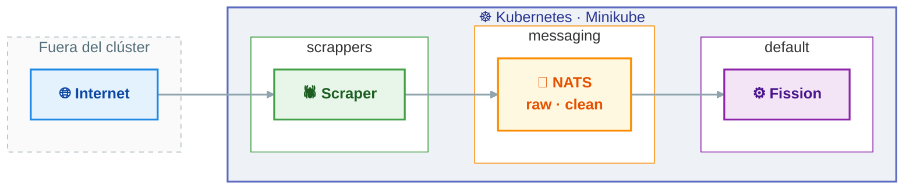
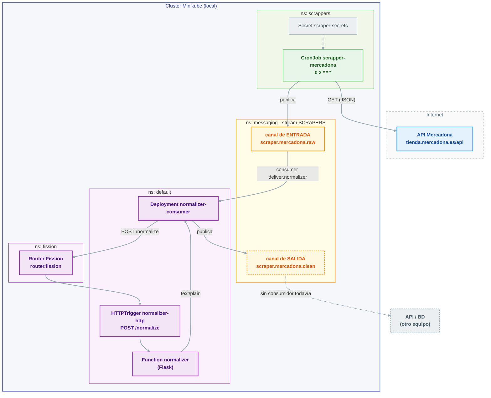

# 01 · Arquitectura y despliegue

## 🏛️ Arquitectura



<details>
<summary><b>🔍 Detalle técnico</b> — componentes, manifiestos, variables y orden de despliegue</summary>

<br/>

### 🗺️ Componentes y namespaces



#### Leyenda

| Muestra | Significado |
|---|---|
| 🟢 **Verde** | scraper |
| 🟠 **Ámbar** | mensajería |
| 🟣 **Morado** | Fission |
| 🔵 **Azul** | fuentes externas |
| ⚪ **Gris discontinuo** | pendiente o de otro equipo |

> [!NOTE]
> - Un **canal ámbar con borde discontinuo** es un canal que todavía no tiene consumidor.
> - Sobre las líneas: **continua** = tráfico de datos real; **discontinua** = montaje de
>   configuración o flujo aún no operativo.

## 🧩 Componentes

### 1 · 🕷️ `scrapper_mercadona` — recolector

| Fichero | Responsabilidad |
|---|---|
| `src/client.py` | `fetch_json(url)` → `(status, dict)`; `requests` con `User-Agent`, timeout 15 s |
| `src/extractor.py` | `collect_raw(category_json)` → aplana `categories[].products[]` en una lista |
| `src/dump_txt.py` | `dump(...)` → volcado crudo a `out/mercadona_<ts>.txt` |
| `src/publish.py` | `publish(items, wh)` → 1 mensaje NATS por producto (envelope) |
| `src/main.py` | Orquesta: categorías → subcategorías → extracción → volcado → publicación |
| `Dockerfile` | `python:3.13-slim`, `CMD ["python", "src/main.py"]` |
| `cronjob.yaml` | CronJob en `scrappers`, `schedule: "0 2 * * *"`, `concurrencyPolicy: Forbid` |

> [!IMPORTANT]
> **Principio de diseño.** El scraper **no normaliza**: solo extrae y publica datos crudos
> tal como los da la fuente. Toda la interpretación vive en `normalizer`. Esto mantiene cada
> recolector tonto, pequeño y reemplazable si la web cambia.

> [!TIP]
> **Idempotencia de ejecución.** `concurrencyPolicy: Forbid` evita que dos ejecuciones se
> solapen; `successfulJobsHistoryLimit: 2` y `failedJobsHistoryLimit: 2` acotan el histórico.

### 2 · 📨 `messaging` — NATS JetStream

`nats-values.yaml` (Helm):

- `jetstream.enabled: true`, `fileStore` con PVC de 1 Gi (`storageClassName: standard`),
  `memoryStore` de 256 Mi.
- Imagen `2.10-alpine`, `service.type: ClusterIP`, `natsBox` habilitado (para depurar).
- Stream `SCRAPERS` con subjects `scraper.>` (creado por el publisher de forma
  defensiva con `js.add_stream`, ignorando el error si ya existe).

> [!NOTE]
> **Por qué JetStream y no pub/sub básico.** Persistencia y `ack` explícito: si el
> normalizador cae, los mensajes no se pierden y se reentregan (`AckWait`).

### 3 · ⚙️ `normalizer` — función Fission

| Fichero | Responsabilidad |
|---|---|
| `normalizer.py` | Limpieza, formateo **y contrato Pydantic** (`RawProduct`, `NormalizedProduct`, `CleanBatch`) |
| `requirements.txt` | `pydantic>=2` — lo necesitan la función y el consumer |
| `fission.yaml` | `HTTPTrigger` POST `/normalize` (la `Function` la crea `deploy.sh`: el CRD no tiene `entrypoint` ni `functionSource`) |
| `deploy.sh` | Despliegue reproducible **en la VM del clúster**: entorno con pydantic + función + consumer + humo |
| `consumer.py` | Puente alternativo: NATS → HTTP Fission → NATS |
| `consumer.yaml` | `Deployment normalizer-consumer` (replicas: 1) |
| `Dockerfile.consumer` | Imagen del consumer (`nats-py` + `pydantic`) |
| `Dockerfile.env` | Imagen de entorno Fission con pydantic (hereda del entorno `python`) |
| `test_local.py` | Prueba local sin cluster: lee el último `mercadona_*.txt` y normaliza |
| `test_unit_price.py` | Prueba del precio unitario contra casos y datos reales |
| `test_models.py` | Prueba del contrato Pydantic, la tolerancia por item y el endpoint |

> [!IMPORTANT]
> **Diseño defensivo.** Si un campo desaparece del JSON de Mercadona, la línea se degrada
> pero el lote no se rompe. Cada producto se procesa por separado y cada línea se valida
> con Pydantic: si no cuadra, se emite un `ERROR id=...` y el lote continúa
> (ver [`05-pendientes.md`](05-pendientes.md#prioridad-2--modelo-pydantic)).

> [!NOTE]
> **Dependencia pydantic.** La imagen `python` prebuilt de Fission no la trae.
> `Dockerfile.env` hornea un entorno con ella; el consumer la instala desde
> `requirements.txt`. El paso a paso es `deploy.sh` (ver *Orden de despliegue*).

### 4 · 🌉 `normalizer-consumer` — el puente

Es el componente que **sustituye** al `MessageQueueTrigger`. Se suscribe a la cola push
`deliver.normalizer`, acumula mensajes en un búfer y cada cierto punto llama a la función
Fission por HTTP.

- **Suscripción:** `nc.subscribe("deliver.normalizer", cb=handler)`.
- **Batching:** vuelca cuando el búfer llega a `CONSUMER_BATCH` (50) **o** cada 5 s (el bucle
  principal fuerza un `flush` periódico; no se queda esperando a llenar el lote).
- **`ack` explícito** de todo el lote **solo si** la publicación del resultado tiene éxito.
- **Modo local:** si `NORMALIZE_URL` está vacío, normaliza **en proceso** (`clean_local`), sin
  Fission. Útil para depurar el puente sin cluster.

### 5 · ☸️ `cluster` y `scrappers/k8s` — despliegue

`cluster/namespace.yaml` crea `scrappers`, `fission` y `messaging`.

## 📜 Manifiestos

| Manifiesto | Kind | Namespace | Notas |
|---|---|---|---|
| `../setup-vm.sh` | Script | — | Montaje completo e idempotente en la VM (ver *Orden de despliegue*) |
| `cluster/namespace.yaml` | Namespace ×3 | — | `scrappers`, `fission`, `messaging` |
| `messaging/nats-values.yaml` | Helm values | messaging | JetStream + PVC 1 Gi |
| `scrappers/k8s/secrets.yaml` | Secret | scrappers | `scraper-secrets` (`USER_AGENT`; hoy solo lo lee el scraper de Carrefour) |
| `scrapper_mercadona/cronjob.yaml` | CronJob | scrappers | `0 2 * * *` |
| `fission/normalizer/fission.yaml` | HTTPTrigger | default | POST `/normalize` (a `Function` `normalizer`) |
| `fission/normalizer/consumer.yaml` | Deployment | default | `normalizer-consumer` |

> [!NOTE]
> `scrappers/scrapper_carrefour/` (CronJob `*/30 * * * *`) está en el repo pero
> **bloqueado** por el challenge de Cloudflare (15/10/2026): `setup-vm.sh` solo despliega
> Mercadona. Detalle en `scrappers/scrapper_carrefour/README.md`.

## 🔧 Variables de entorno

### 📤 Scraper (`publish.py`, `main.py`)

| Variable | Por defecto | Efecto |
|---|---|---|
| `NATS_URL` | `nats://nats.messaging.svc.cluster.local:4222` | Servidor NATS |
| `NATS_STREAM` | `SCRAPERS` | Stream destino |
| `NATS_SUBJECT` | `scraper.mercadona.raw` | Subject de publicación |
| `NATS_DRY_RUN` | `0` | `1` = no publica (solo volcado txt) |
| `SCRAPER_WH` | `default` | Etiqueta de almacén (`wh`) |

### 📥 Consumer

| Variable | Por defecto | Efecto |
|---|---|---|
| `NATS_URL` | `nats://nats.messaging.svc.cluster.local:4222` | Servidor NATS |
| `NATS_DELIVER` | `deliver.normalizer` | Cola a la que se suscribe |
| `NATS_SUBJECT_OUT` | `scraper.mercadona.clean` | Subject de salida limpia |
| `NORMALIZE_URL` | `http://router.fission/normalize` | Si vacío → normaliza en proceso |
| `CONSUMER_BATCH` | `50` | Tamaño de lote antes de volcar |

## 🧭 Decisiones de diseño

1. **NATS en lugar del HTTP POST del plan.** El plan (tarea 2) decía "publicando HTML/JSON
   por HTTP POST". Se sustituyó por NATS JetStream por desacoplamiento y persistencia: el
   scraper no conoce al normalizador ni tiene que esperar a que responda.
2. **El scraper no normaliza.** Cada cadena tiene su propio formato; normalizar en un
   único sitio evita duplicar lógica y facilita añadir cadenas.
3. **Consumer propio en vez de `MessageQueueTrigger`.** El conector de KEDA no pasa la
   autenticación interna del router de Fission v1.27 (devuelve 401), así que se descartó.
   `normalizer-consumer` hace las veces de puente.
4. **Fission para la normalización.** Encaja con el requisito de la asignatura y permite
   escalar la función por separado del recolector.
5. **Doble salida del scraper (txt + NATS).** El `.txt` es un respaldo de depuración
   barato si NATS falla o si se quiere probar en local sin cluster.

## 🚀 Orden de despliegue

> [!IMPORTANT]
> **Todo el montaje está scriptado e idempotente** en `flujo-entrada/setup-vm.sh`.
> `bash setup-vm.sh all` deja la VM lista de cero (base, namespaces, NATS, Fission,
> normalizer y scraper) y `bash setup-vm.sh verify` solo mira el estado. Los pasos de abajo
> son el detalle de lo que hace, por si hay que depurar a mano; el lanzamiento del scraper
> (paso 7) sigue siendo manual.
>
> Tres piezas no están en ningún manifiesto y las crea ese script: el stream `SCRAPERS`
> (subjects `scraper.>`, Max Age 7d), el consumidor durable `normalizer` (filtro
> `scraper.mercadona.raw` → `deliver.normalizer`, ack explícito, `MaxAckPending 1000`) y el
> entorno `python` con `version: 3` / `poolsize: 3`.

```bash
# 1. Namespaces
kubectl apply -k flujo-entrada/cluster/

# 2. NATS con JetStream
helm install nats nats/nats -n messaging -f flujo-entrada/messaging/nats-values.yaml

# 3. Configuración de scrapers (secretos)
kubectl apply -k flujo-entrada/scrappers/k8s/

# 4. Fission
helm install fission fission-charts/fission-all -n fission

# 5. Normalizer + consumer (idempotente)
#    entorno `python` con pydantic (Dockerfile.env) -> funcion (--code normalizer.py)
#    -> HTTPTrigger -> consumer nuevo -> prueba de humo (texto y JSON)
bash flujo-entrada/fission/normalizer/deploy.sh
# o por partes: deploy.sh env | fn | consumer | smoke

# 6. Scraper (imagen + CronJob)
docker build -t scrapper-mercadona:v1 flujo-entrada/scrappers/scrapper_mercadona/
minikube image load scrapper-mercadona:v1
kubectl apply -k flujo-entrada/scrappers/scrapper_mercadona/

# 7. Disparo manual (sin esperar a las 02:00)
kubectl create job --from=cronjob/scrapper-mercadona pruebas-mercadona -n scrappers
```

> [!NOTE]
> `fission.yaml` solo versiona el **HTTPTrigger**: en el CRD, la `Function` no tiene
> `entrypoint` ni `functionSource` (el entrypoint vive en `spec.package.functionName`) y el
> paquete que genera el CLI se llama `normalizer-<uuid>`, así que no es un nombre fijo
> versionable. El código se sube con `fission fn create|update --code normalizer.py`, que es
> lo que hace `deploy.sh`.

</details>
