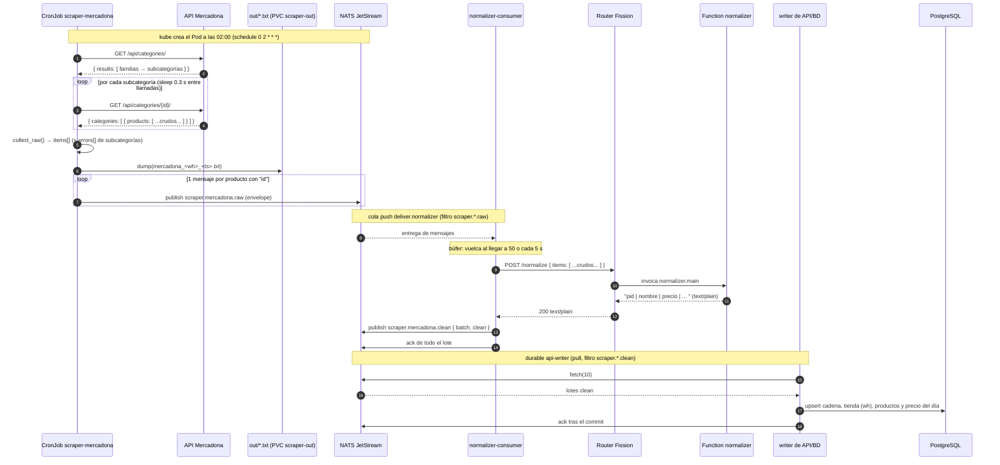
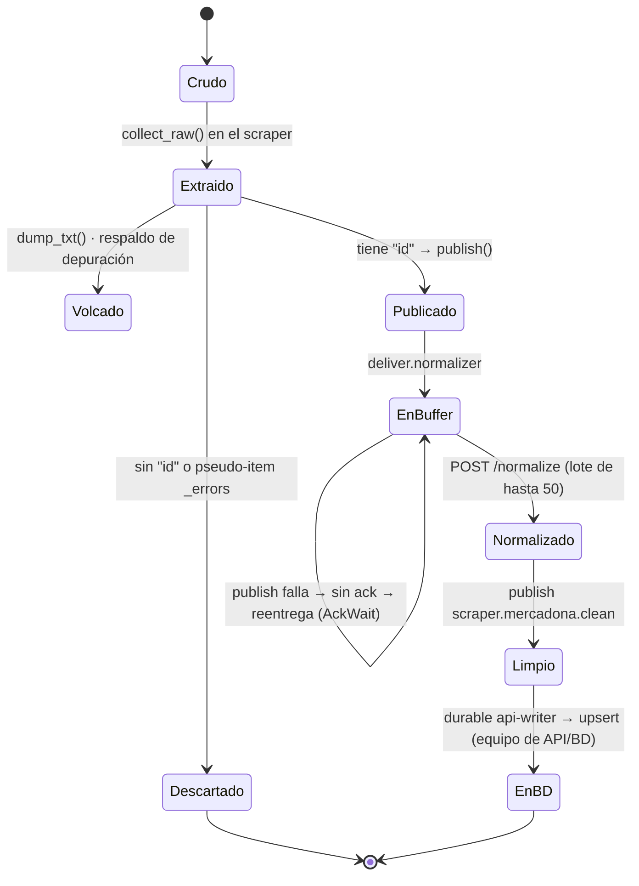

# 02 · Flujo de datos

## Secuencia end-to-end

## Ciclo de vida de un producto

Estados y su significado:

| Estado | Dónde vive | Forma del dato |
|---|---|---|
| Crudo | Memoria del pod | dict tal cual lo da la API de Mercadona |
| Extraído | Memoria del pod | lista `items[]` aplanada |
| Volcado | `out/mercadona_<wh>_<ts>.txt` en el PVC `scraper-out` (se borra a los 7 días) | texto `raw: {...}` por línea |
| Publicado | NATS `scraper.mercadona.raw` | envelope con `product` crudo |
| En búfer | Memoria del consumer | lista de envelopes |
| Normalizado | Respuesta HTTP de Fission | texto plano (`to_clean_txt`) con precio unitario canónico |
| Limpio | NATS `scraper.mercadona.clean` | un mensaje por **lote** con `clean` |
| En BD | PostgreSQL (namespace `api`) | filas en `products` y `prices`: un precio por producto, tienda y día |

## Cadencia temporal

```mermaid
gantt
  title Ciclo diario (esquema, no ejecución real)
  dateFormat HH:mm
  axisFormat %H:%M
  section Mercadona
  Job del scraper        :02:00, 2m
  section Consum
  Job del scraper        :02:00, 10m
  section Caprabo
  Job del scraper        :02:00, 60m
  section Condis
  Job del scraper        :02:00, 2m
  section bonÀrea
  Job del scraper        :02:00, 18m
  section Consumer y writer
  Escucha continua       :00:00, 24h
```

- **Mercadona**, **Consum**, **Caprabo**, **Condis** y **bonÀrea**: una ejecución diaria a
  las 02:00 **hora de Madrid** (`timeZone: Europe/Madrid`), cada uno en serie consigo mismo
  (`Forbid`). Corren a la vez: el consumer agrupa los lotes por cadena. Caprabo es el más
  lento (~1 h, una página por categoría con 3 s de pausa); Condis, el más rápido (~20
  peticiones).
- **Histórico:** la BD guarda un precio por producto, tienda y día
  (`prices(product_id, store_id, observed_on)`), así que cada noche añade un día al
  histórico. Si un scraper se relanza el mismo día, se actualiza ese día, no se duplica.
- El flujo de cada producto es el mismo para todas las cadenas; arriba se usa Mercadona como
  ejemplo.
- **normalizer-consumer** y **writer**: Deployments siempre arriba; no dependen de los
  CronJobs, solo consumen lo que llegue a NATS.
