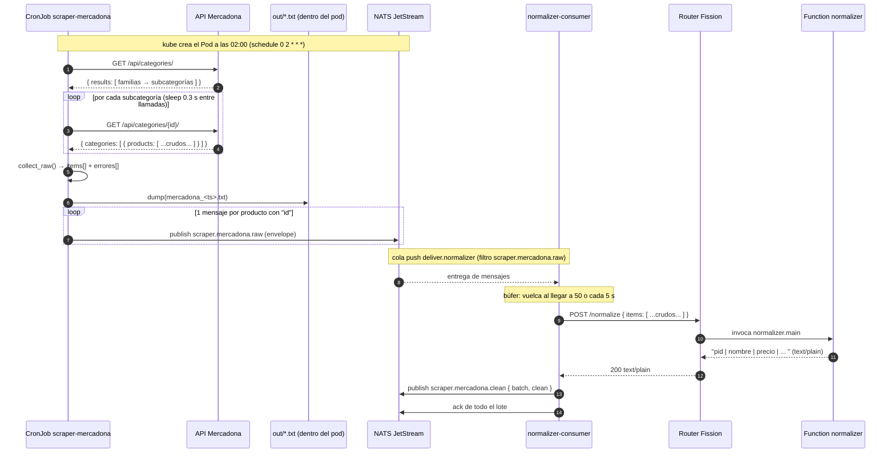
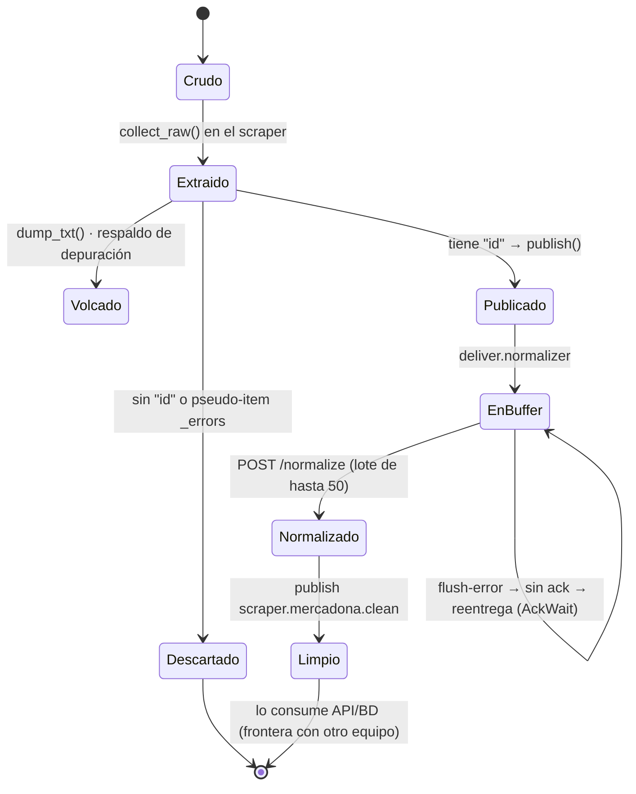

# 02 · Flujo de datos

## Secuencia end-to-end



## Ciclo de vida de un producto



Estados y su significado:

| Estado | Dónde vive | Forma del dato |
|---|---|---|
| Crudo | Memoria del pod | dict tal cual lo da la API de Mercadona |
| Extraído | Memoria del pod | lista `items[]` aplanada |
| Volcado | `out/mercadona_<ts>.txt` (efímero) | texto `raw: {...}` por línea |
| Publicado | NATS `scraper.mercadona.raw` | envelope con `product` crudo |
| En búfer | Memoria del consumer | lista de envelopes |
| Normalizado | Respuesta HTTP de Fission | texto plano (`to_clean_txt`) con precio unitario canónico |
| Limpio | NATS `scraper.mercadona.clean` | un mensaje por **lote** con `clean` |

## Cadencia temporal

```mermaid
gantt
  title Ciclo diario (esquema, no ejecución real)
  dateFormat HH:mm
  axisFormat %H:%M
  section Mercadona
  Job del scraper        :02:00, 15m
  section Consumer
  Escucha continua       :00:00, 24h
```



- **Mercadona**: una ejecución diaria a las 02:00, en serie (`Forbid`).
- **normalizer-consumer**: Deployment siempre arriba; no depende del CronJob, solo consume
  lo que llegue a NATS.

## Flujo mínimo de punta a punta

El plan (tarea 4) define como hito: **1 cadena → BD → API → app**. Hoy está cubierto hasta
la parte intermedia:

```
✅ 1 cadena (Mercadona) → ✅ NATS → ✅ normalizer → ✅ NATS clean
❌ BD        (otro equipo, no existe todavía)
❌ API       (otro equipo)
❌ app       (otro equipo)
```

Comprobado en el clúster el **17/10/2026** con el normalizer ya con el contrato Pydantic: un
disparo manual publicó **4592 productos** y el consumer los normalizó en **92 lotes**
(4592 sin perder ninguno). Detalle y mensaje `clean` de ejemplo:
[`04-estados-y-errores.md`](04-estados-y-errores.md#verificación-end-to-end-17102026).

El flujo actual es **byte-in / texto-out**: entra JSON crudo y sale texto formateado con el
**precio unitario ya normalizado** a una unidad base (`€/kg`, `€/l`, `€/ud`, `€/m`,
`€/lavado`). Mercadona ya trae el precio de referencia, así que se respeta el de la fuente;
cuando no lo traiga, el normalizador lo calcula (ver
[`03-contratos-datos.md`](03-contratos-datos.md#precio-unitario-canónico-€kg--€l--€ud--€m--€lavado)).
