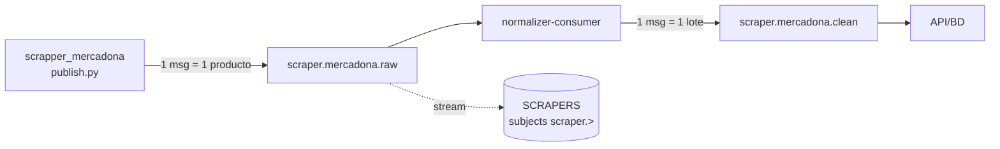
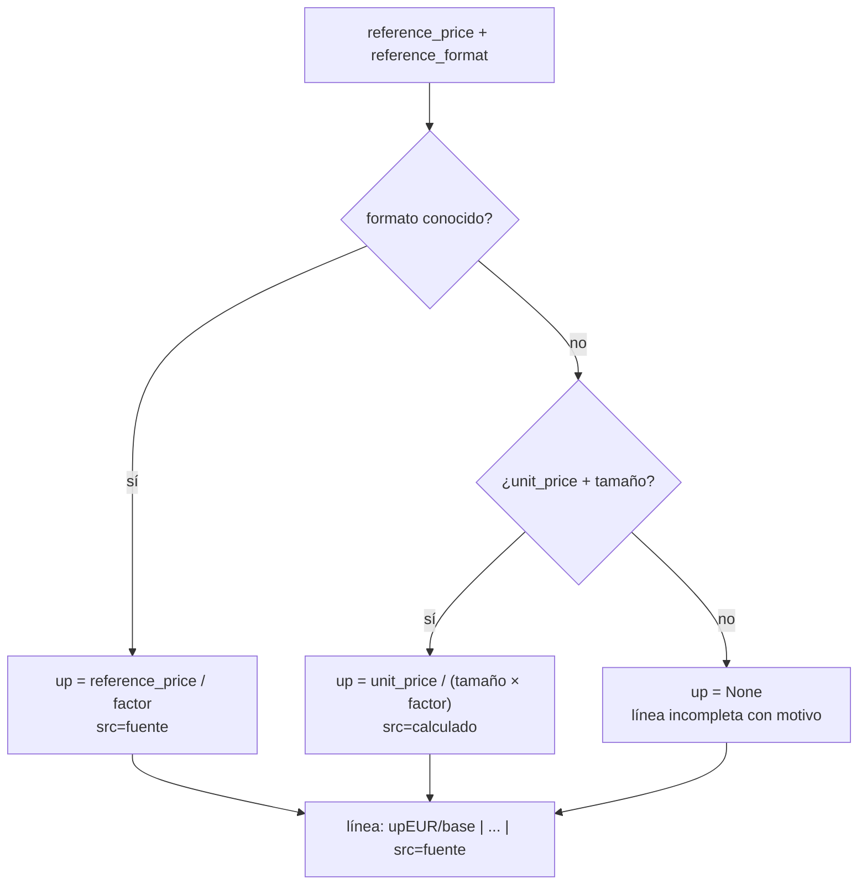
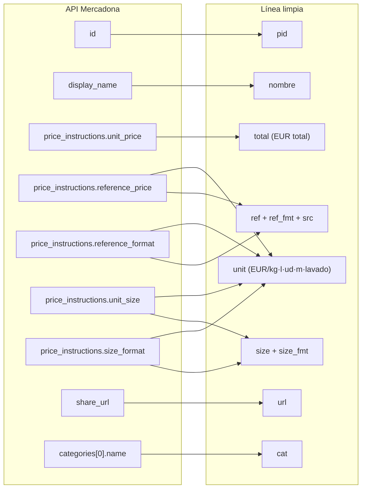
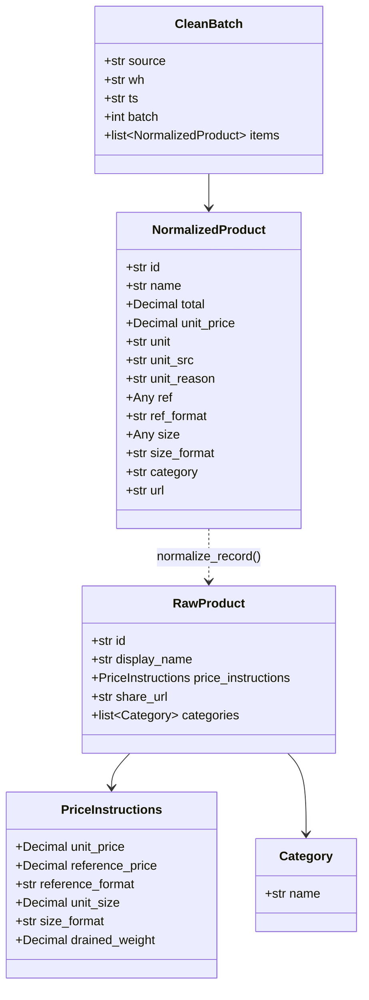

# 03 · Contratos de datos

Contratos de la frontera de ingesta. Cualquier cambio aquí afecta al equipo de API/BD.

## Mapa de subjects



| Subject | Productor | Consumidor | Granularidad |
|---|---|---|---|
| `scraper.mercadona.raw` | scraper | normalizer-consumer | 1 mensaje por producto |
| `scraper.mercadona.clean` | normalizer-consumer | **nadie todavía** | 1 mensaje por lote |

Ambos viven en el stream `SCRAPERS` (subjects `scraper.>`). `publish.py` lo crea de forma
defensiva si falta (`js.add_stream`) y `setup-vm.sh` garantiza la configuración buena:
retiene los mensajes **7 días** (`Maximum Age: 7d`, `Discard Old`) con
`Duplicate Window: 2m`. Los `clean` de esa ventana se pueden reproducir para cargarlos en BD.

## Envelope de entrada (raw)

Publicado por `publish.build_envelope()`:

```json
{
  "source": "mercadona",
  "wh": "default",
  "ts": "2026-10-15T19:20:07+00:00",
  "product_id": "12345",
  "product": { "...": "objeto tal cual lo devuelve la API de Mercadona" }
}
```

| Campo | Tipo | Origen | Notas |
|---|---|---|---|
| `source` | string | constante | Cadena de origen |
| `wh` | string | `SCRAPER_WH` | Almacén/tienda; hoy siempre `default` |
| `ts` | string | UTC, `isoformat(timespec="seconds")` | Formato `...+00:00` |
| `product_id` | string | `str(product["id"])` | Duplicado del id para indexar sin abrir `product` |
| `product` | object | crudo de la fuente | **Sin tocar**: el normalizador decide qué hacer |

> No hay versión de esquema (`schema_version`). Es un hueco a cubrir si el envelope
> evoluciona (ver [`05-pendientes.md`](05-pendientes.md)).

## Mensaje de salida (clean)

Publicado por `consumer.flush()`:

```json
{
  "source": "normalizer",
  "wh": "default",
  "ts": "2026-10-15T19:22:31+00:00",
  "batch": 50,
  "clean": "Items: 50\nUnitarios: 50 (fuente 48, calculado 2) | Incompletos: 0\n---\n12345 | Aceite de oliva 0,5 l | 4.10EUR total | 8.20EUR/l | 0.5l | Aceite | https://... | ref=8.200EUR/L src=fuente\n..."
}
```

| Campo | Tipo | Notas |
|---|---|---|
| `source` | string | Siempre `normalizer` |
| `wh` | string | **Heredado** del primer producto del lote: un lote asume un único almacén |
| `ts` | string | UTC, mismo formato que el envelope |
| `batch` | number | Nº de productos crudos del lote |
| `clean` | string | Texto plano completo del lote (cabecera + una línea por producto) |

**Decisión relevante:** `clean` viaja como **texto plano**, no como JSON estructurado. Es lo
más rápido de producir y de leer, pero obliga al consumidor a parsear por ` | `. La variante
estructurada existe ya como **opt-in** (`POST /normalize?format=json` → `CleanBatch` con
`NormalizedProduct[]`); cambiar el mensaje de `clean` a JSON es decisión del equipo de
API/BD (Prioridad 3 de [`05-pendientes.md`](05-pendientes.md#prioridad-3--contrato-con-apibd)).

## Contrato de entrada de `POST /normalize`

`normalizer._unwrap()` acepta tres formas, para simplificar las pruebas:

| Cuerpo enviado | Se interpreta como |
|---|---|
| `{ "id": ..., "display_name": ... }` | un solo producto |
| `{ "product": {...} }` | un envelope; se extrae `product` |
| `{ "items": [ {...}, {...} ] }` | un lote (lo que manda el consumer) |

Los elementos ya pueden venir envueltos o pelados: `it.get("product", it)` normaliza ambos
casos. Si el cuerpo no es JSON válido → `400` con mensaje de texto.

Respuesta por defecto: `text/plain` con el resultado de `to_clean_txt()`.

Variante estructurada (**opt-in**): `POST /normalize?format=json` valida la entrada con
`RawProduct` y responde `application/json` con un `CleanBatch`
(`{source, wh, ts, batch, items[]}`; `wh`/`ts` se toman del cuerpo si vienen). Es estricta:
si un crudo no valida responde `422` (el formato de texto sigue siendo el tolerante, con
`ERROR id=...` por item). Contrato: [Contrato Pydantic](#contrato-pydantic).

## Formato de línea limpia

La línea limpia tiene exactamente este formato:

```
{pid} | {nombre} | {total}EUR total | {up}EUR/{unidad} | {size}{size_fmt} | {cat} | {url} | ref={ref}EUR/{ref_fmt} src={origen}
```

- `nombre`: `display_name` con espacios colapsados (`" ".join(...split())`).
- `{up}EUR/{unidad}`: **precio unitario canónico** (ver la sección siguiente). Si no
  se puede calcular, se emite `- (<motivo>)`.
- `ref` / `ref_fmt` / `src`: valor original de la fuente y su procedencia, para
  trazabilidad y depuración. Se dejan al final para no romper un parseo posicional.
- `cat`: **solo la primera categoría** (`categories[0].name`); el resto se pierde.
- Cabecera del lote (añadida por `to_clean_txt`): `Items: N` y
  `Unitarios: U (fuente F, calculado C) | Incompletos: I`, seguidas de `---`.
- Si un item falla: se emite `ERROR id=<id>: <mensaje>` y se sigue con el resto. Con el
  contrato Pydantic, un item que no valida deja `ERROR id=<id>: validacion: <motivos>` en
  **una sola línea**.

Ejemplo real:

```
4241 | Aceite de oliva 0,4º Hacendado | 17.25EUR total | 3.45EUR/l | 5.0l | Aceite, especias y salsas | https://tienda.mercadona.es/product/4241/... | ref=3.450EUR/L src=fuente
```

## Precio unitario canónico (€/kg · €/l · €/ud · €/m · €/lavado)

Para comparar precios entre cadenas, el precio unitario se lleva **siempre a una
unidad base**: masa → `kg`, volumen → `l`, recuento → `ud`, longitud → `m`, y la
unidad funcional `lavado` (detergentes). El formato de la fuente (`kg`, `100 g`,
`100 ml`, `dc`…) se convierte con un factor de familia.



Reglas, en orden:

1. **La fuente manda.** Si hay `reference_price` y su `reference_format` es conocido,
   se convierte a la unidad base. `src=fuente`.
2. **Si no**, se calcula desde `unit_price` y el tamaño. `src=calculado`. En productos
   pesables con `drained_weight` (conservas, aceitunas…) se usa el **peso escurrido**
   como tamaño, porque es lo que compara la fuente.
3. **Nunca se inventa.** Si falta el precio, el tamaño o el formato no es conocido, la
   línea queda incompleta (`- (motivo)`) y se cuenta en la cabecera. `motivo` ∈
   `sin_precio`, `sin_tamano`, `formato_no_comparable:<fmt>`.

### Tabla de conversión (formatos reales de Mercadona, 15/10/2026 · 4591 productos)

| Formato (`size_format` / `reference_format`) | Familia | Unidad base | Factor (unidades base por 1 del formato) |
|---|---|---|---|
| `kg` | masa | `kg` | 1 |
| `g` | masa | `kg` | 0,001 |
| `100 g` | masa | `kg` | 0,1 |
| `l`, `L` | volumen | `l` | 1 |
| `ml` | volumen | `l` | 0,001 |
| `cl` | volumen | `l` | 0,01 |
| `100 ml` | volumen | `l` | 0,1 |
| `ud`, `u`, `ud.` | recuento | `ud` | 1 |
| `dc`, `dz` | recuento | `ud` | 12 (docena) |
| `m` | longitud | `m` | 1 |
| `lv` | funcional | `lavado` | 1 |
| cualquier otra | — | — | **no comparable → incompleto** |

> **Aviso: la base del `reference_price` no es derivable.** Mercadona calcula su
> precio de referencia sobre bases distintas según el producto: `unit_size`
> (bruto), `drained_weight` (escurrido), `total_units × pack_size` (packs) o una
> unidad funcional (`botes`, `lavados`), además de casos con `approx_size: true` y
> alguna incoherencia interna (su `bulk_price` no cuadra con `unit_price`/`unit_size`).
> Por eso el cálculo **no sustituye** a la fuente: solo actúa de respaldo cuando
> `reference_price` falta, y siempre se marca `src=calculado`. La validación
> (`test_unit_price.py`) comprueba que, en productos simples, el cálculo reproduce
> la fuente en el **99,1%** de los casos (las diferencias restantes son redondeo de
> la fuente o incoherencias propias).

## Mapeo de campos de Mercadona



| Campo destino | Origen | Ejemplo |
|---|---|---|
| `total` | `price_instructions.unit_price` | `4.10` (precio del envase) |
| `unit` | `reference_price ÷ factor(reference_format)`; si falta, `unit_price ÷ (tamaño × factor(size_format))` | `8.20` (EUR por unidad base) |
| `size` / `size_fmt` | `unit_size` / `size_format` | `0.5` / `l` |
| `ref` / `ref_fmt` / `src` | `reference_price` / `reference_format` / `fuente`·`calculado` | `8.200` / `L` / `fuente` |

## Contrato Pydantic

El plan (tarea 3) pide Pydantic explícitamente. El contrato vive en
`fission/normalizer/normalizer.py`, en el mismo fichero que la función (Fission se sube como
una única fuente con `fission fn create|update --code normalizer.py`, y el consumer reutiliza
el módulo). Los modelos **envuelven** `normalize_record()` con tipos y validación, **sin
rehacer la lógica**: separan la entrada (crudo de la cadena, tolerante) de la salida (línea
ya normalizada, estricta).



### Entrada (cruda, tolerante)

Mercadona manda muchos más campos de los que se usan. El modelo declara **solo** los que
consume el normalizador y **ignora el resto** (`extra="ignore"`): un campo nuevo en la
fuente no rompe la ingesta.

```python
from decimal import Decimal
from typing import Annotated, Any, Literal
from pydantic import (
    BaseModel, BeforeValidator, ConfigDict, Field, field_validator, model_validator,
)

# Reutiliza _dec() de normalizer.py: admite coma decimal y rechaza NaN/Inf/''.
Dec = Annotated[Decimal, BeforeValidator(_dec)]
# Mercadona manda `id` como numero: se coacciona a str (mismo criterio que str(...)).
Id = Annotated[str, BeforeValidator(lambda v: v if isinstance(v, str) else str(v))]


class Category(BaseModel):
    model_config = ConfigDict(extra="ignore")
    name: str = ""


class PriceInstructions(BaseModel):
    """Solo los campos que usa unit_price(); el resto (bulk_price, pack_size,
    approx_size, total_units...) se ignora a proposito."""
    model_config = ConfigDict(extra="ignore")

    unit_price: Dec | None = None        # precio del envase (total)
    reference_price: Dec | None = None   # base de la fuente, si la trae
    reference_format: str = ""
    unit_size: Dec | None = None
    size_format: str = ""
    drained_weight: Dec | None = None    # peso escurrido (pesables)


class RawProduct(BaseModel):
    model_config = ConfigDict(extra="ignore")

    id: Id
    display_name: str = ""
    price_instructions: PriceInstructions = Field(default_factory=PriceInstructions)
    share_url: str = ""
    categories: list[Category] = Field(default_factory=list)
```

### Salida (normalizada, estricta)

Refleja **exactamente** los campos que devuelve `normalize_record()` con tipos y validación:

```python
UnitBase = Literal["kg", "l", "ud", "m", "lavado"]  # debe seguir a UNITS en normalizer.py
UnitSrc = Literal["fuente", "calculado", "-"]


class NormalizedProduct(BaseModel):
    model_config = ConfigDict(extra="forbid", frozen=True)

    id: Id
    name: str
    total: Dec | None
    unit_price: Dec | None
    unit: UnitBase | None
    unit_src: UnitSrc
    unit_reason: str = ""            # "", sin_precio, sin_tamano, formato_no_comparable:<fmt>
    ref: Any = None                  # crudo de la fuente ("-", numero o texto) -> trazabilidad
    ref_format: str = ""
    size: Any = None                 # crudo de la fuente
    size_format: str = ""
    category: str = ""
    url: str = ""

    @field_validator("name", mode="before")
    @classmethod
    def _collapse(cls, v: Any) -> str:
        return " ".join(str(v or "").split())

    @model_validator(mode="after")
    def _coherente(self) -> "NormalizedProduct":
        if self.unit_price is None:
            if not self.unit_reason:
                raise ValueError("sin unit_price hace falta unit_reason")
            if self.unit is not None or self.unit_src != "-":
                raise ValueError("linea incompleta no puede traer unidad ni origen")
        else:
            if self.unit is None or self.unit_src == "-":
                raise ValueError("con unit_price la unidad y el origen son obligatorios")
            if self.unit_reason:
                raise ValueError("unit_reason debe estar vacio cuando hay unit_price")
        return self
```

`unit_reason` conserva la cadena dinámica `formato_no_comparable:<fmt>`, así que se tipa
como `str` con valores documentados en vez de un `Literal` cerrado. `ref` y `size` se
dejan **sin tipar a propósito**: son el dato crudo de la fuente (número, texto o `-`) y se
conservan solo para trazabilidad; la comparación usa siempre `unit_price` + `unit`.

### Lote limpio (variante estructurada de `clean`)

Si el destino deja de ser texto plano y pasa a JSON (decisión abierta con API/BD, Prioridad 3
de [`05-pendientes.md`](05-pendientes.md#prioridad-3--contrato-con-apibd)), el mensaje de
`scraper.mercadona.clean` sería:

```python
class CleanBatch(BaseModel):
    source: Literal["normalizer"] = "normalizer"
    wh: str = "default"
    ts: str                                  # ISO-8601 UTC, igual que el envelope
    batch: int                               # nº de productos crudos del lote
    items: list[NormalizedProduct]
```

Hoy equivale al campo `clean` en texto plano; `items` es su versión tipada, sin parseo por
` | ` (ver [Mensaje de salida (clean)](#mensaje-de-salida-clean)).

### Reglas de validación

1. **Nada se inventa.** Sin precio, sin tamaño o con formato no comparable, la línea queda
   incompleta: `unit_price = None`, `unit = None`, `unit_src = "-"` y `unit_reason` con el
   motivo. El validador de coherencia **exige** esa combinación (`_coherente`).
2. **La fuente manda.** Con `reference_price` convertible → `unit_src = "fuente"`; si no,
   `"calculado"`. Nunca `"fuente"` con un valor del respaldo.
3. **Tolerancia en la frontera, rigor en la salida.** La entrada ignora campos nuevos
   (`extra="ignore"`); la salida los prohíbe (`extra="forbid"`) para que el contrato no
   derive en silencio.
4. **Error por item, no `-` silencioso.** Un `ValidationError` se emite como
   `ERROR id=...` y el lote continúa (como en `to_clean_txt`), pero **deja rastro** en
   vez de degradar el campo a `-`.
5. **Decimal para dinero.** Los importes son `Decimal` (nunca `float`), con la cuantización
   a 4 decimales (`_q`) que ya aplica `unit_price()`.

### Implementación

Lo que se añadió sobre `normalize_record()`:

| Pieza | Qué hace |
|---|---|
| `RawProduct` / `PriceInstructions` / `Category` | Validan la entrada en el camino estructurado |
| `NormalizedProduct` | Valida cada línea normalizada (`normalize_model`) |
| `CleanBatch` | Lote limpio serializable (`to_clean_json`) |
| `POST /normalize?format=json` | Devuelve un `CleanBatch`; `422` si un crudo no valida (**opt-in**) |
| `to_clean_txt` | Sigue igual, pero valida cada item: `ERROR id=...: validacion: ...` en una línea |

`_dec`, `_unit`, `UNITS`, `unit_price()` y `format_record()` se mantienen tal cual: el modelo
es un **envoltorio** sobre `normalize_record()`, que sigue siendo la única fuente de la
lógica. La línea limpia de texto (contrato actual de `clean`) no se altera.

Requiere **Pydantic v2** (`ConfigDict`, `field_validator`, `model_validator`).
