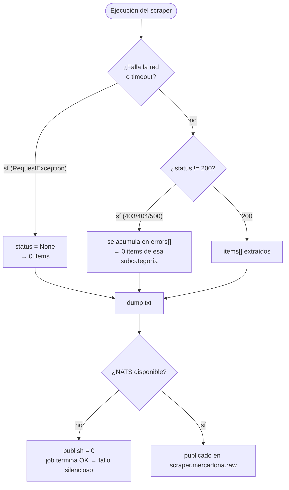

# 04 · Estados, errores y reintentos

## Taxonomía de fallos



## Comportamiento por capa

| Capa | Fallo | Reacción | ¿Pierde datos? |
|---|---|---|---|
| `client.fetch_json` | Timeout / error de red | Devuelve `(None, {})`; se cuenta como error | Sí, esa subcategoría |
| `client.fetch_json` | HTTP != 200 | Devuelve `(status, {})` | Sí, esa subcategoría |
| `main` | Alguna subcategoría falla | Acumula en `errors[]` y añade un pseudo-item `{"_errors": [...]}` | Solo lo fallado |
| `main` | Todas fallan | `status != 200`, se vuelca `ERROR status=...` | Todo |
| `dump_txt` | — | Escribe siempre; es el respaldo | No |
| `publish` | NATS caído | `try/except` → devuelve `0` y log `ERROR NATS (...), txt intacto` | **Sí, silenciosamente** |
| `normalizer` | Campo ausente | `.get()` con defecto `-` | Degrada la línea, no rompe |
| `normalizer` | Precio unitario no calculable (sin precio, sin tamaño o formato no comparable) | Línea con `- (motivo)` y contador `Incompletos` en la cabecera | Degrada la línea, no rompe |
| `normalizer` | Sin `reference_price` en la fuente | Calcula el precio unitario desde `unit_price`/tamaño (`src=calculado`) | No (respaldo aproximado) |
| `normalizer` | Item corrupto | `try/except` → línea `ERROR id=...` | Solo ese item |
| `consumer` | JSON ilegible | Log `parse-error`, **ack** y descarta | Sí, ese mensaje |
| `consumer` | Router Fission caído | Log `flush-error`, **sin ack** → reentrega por `AckWait` | No (pero duplica) |
| `consumer` | Dos `flush()` a la vez (handler + bucle de 5 s) | *(arreglado 17/10)* antes publicaban el mismo lote dos veces y el segundo `ack` fallaba con `message was already acknowledged`; ahora hay `asyncio.Lock` | Ya no |

## Semántica de reintentos

```mermaid
stateDiagram-v2
  [*] --> Publicado
  Publicado --> SinAck: el consumer falla al publicar el lote
  SinAck --> Reentregado: AckWait expira
  Reentregado --> Publicado: nueva entrega (posible duplicado)
  Publicado --> Confirmado: publish OK → ack de todo el lote
  Confirmado --> [*]

  state SinAck {
    note right of SinAck: El búfer se drena antes de publicar<br/>sin ack -> reentrega por AckWait
  }
```

| Mecanismo | Configuración | Efecto |
|---|---|---|
| NATS JetStream | `AckWait` por defecto | Redelivery de lotes no confirmados |
| `consumer` | `CONSUMER_BATCH=50`, flush cada 5 s | Cotas del búfer en condiciones normales |
| `consumer` | `ack` tras publicar | Entrega **at-least-once** → posibles duplicados |
| CronJob | `concurrencyPolicy: Forbid` | Sin solape de ejecuciones |
| CronJob | `backoffLimit: 2` | 2 reintentos del Pod antes de marcar Job fallido |
| CronJob | `restartPolicy: OnFailure` | Reinicio del contenedor dentro del Pod |

## Riesgos detectados en el diseño actual

1. **Fallo silencioso del scraper.** `main.py` nunca devuelve código de salida distinto de
   0. Si NATS está caído, el Job se marca como **exitoso** y los datos solo quedan en un
   `.txt` dentro de un Pod que se destruye. No hay alarma ni reingesta.
2. **Búfer y flushes solapados — resuelto el 17/10/2026.** `flush()` se llama desde el
   handler (al llegar a `CONSUMER_BATCH`) y desde el bucle de 5 s; al no haber lock, dos
   llamadas solapaban, publicaban **el mismo lote dos veces** y el segundo `ack` fallaba con
   `message was already acknowledged` (visto en real durante el despliegue). Ahora `flush()`
   toma un `asyncio.Lock` y **drena el búfer antes de los `await`**: lo que llega mientras se
   publica forma otro lote y, si el publish falla, los mensajes sin ack los reentrega
   `AckWait`. Esto también evita el crecimiento sin cota del punto anterior.
3. **Sin idempotencia.** Nada deduplica por `product_id`. Una reentrega del mismo mensaje
   produce líneas repetidas en `scraper.mercadona.clean`.
4. **`wh` a nivel de lote.** `consumer.flush()` toma el `wh` del **primer** producto del
   lote y lo aplica a todo. Hoy todos los productos son `default`, pero al introducir
   multi-tienda el etiquetado sería incorrecto.
5. **Sin `Service` para los scrapers.** El `Ingress` del repo apunta a Services
   inexistentes. Además, los scrapers son CronJobs (batch), no exponen puertos: el Ingress
   parece un resto de una idea anterior.
6. **Sin observabilidad.** No hay métricas ni logs estructurados; solo `print()` en el
   consumer y en el scraper. Los fallos del punto 1 son invisibles.

## Escenarios límite

| Escenario | Comportamiento esperado hoy |
|---|---|
| Mercadona cambia su JSON | Líneas con `-` en los campos que falten; el lote sigue |
| Mercadona añade un `size_format`/`reference_format` nuevo | Ese producto queda con precio unitario incompleto (`- (formato_no_comparable:...)`); el resto sigue |
| Mercadona bloquea temporalmente | `status` != 200 → 0 items → Job "exitoso" sin datos (visto el 17/10: un disparo manual dio `subs=0`) |
| NATS caído durante el CronJob | Datos solo en el `.txt` efímero → se pierden con el Pod |
| Fission caído un rato | Reentrega por `AckWait` (el búfer ya no crece); duplicados al recuperar |
| Llegan productos de dos tiendas | El lote entero se etiqueta con el `wh` del primero |
| Un producto sin `id` | Se descarta en `publish` (no se publica); sí aparece en el `.txt` |

## Verificación end-to-end (17/10/2026)

Disparo manual del CronJob con el normalizer ya con Pydantic:

| Métrica | Valor |
|---|---|
| Productos publicados por el scraper | 4592 (`nats: 4592 -> scraper.mercadona.raw`) |
| Lotes normalizados por el consumer | 92 (`91 × 50 + 42`) |
| Productos procesados | 4592 (los 92 lotes suman exactamente lo publicado) |
| Errores | 1 (el `flush-error` de flushes solapados, ya arreglado) |
| Mensaje `clean` (inyectando 1 producto a mano) | `{"source":"normalizer","wh":"default","ts":...,"batch":1,"clean":"Items: 1\nUnitarios: 1 (fuente 1, calculado 0) | Incompletos: 0\n---\n4241 | Aceite de oliva Hacendado | 17.25EUR total | 3.45EUR/l | 5.0l | Aceite, especias y salsas | … | ref=3.450EUR/L src=fuente\n"}` |
| Consumer JetStream | 0 ack pendientes, 0 sin procesar |

> El stream `SCRAPERS` no tiene política de retención: el 17/10 acumulaba **28.080 mensajes /
> 41 MiB** (≈ 6 scrapes). Conviene decidir límites (`max-msgs`/`max-age`) antes de que crezca
> sin control.
