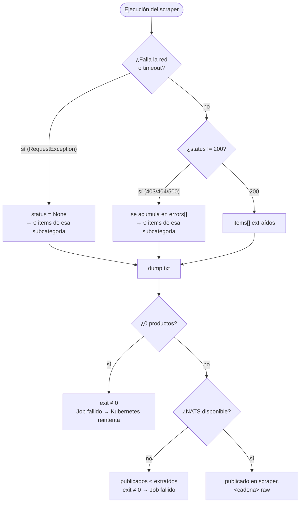
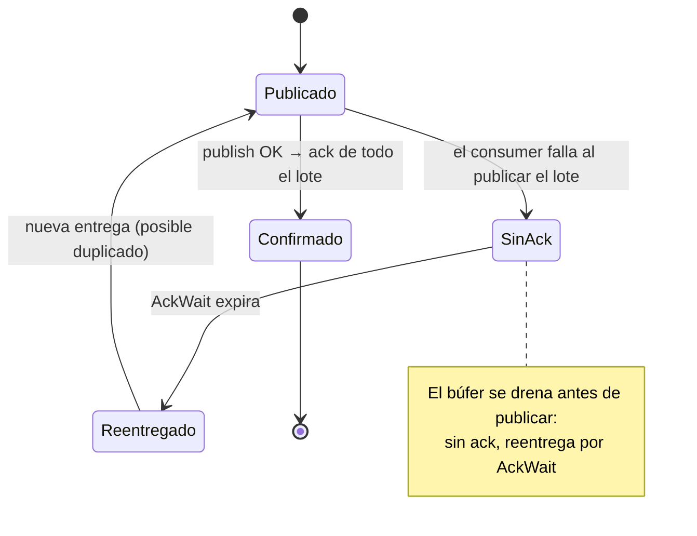

# 04 · Estados, errores y reintentos

## Taxonomía de fallos

## Comportamiento por capa

| Capa | Fallo | Reacción | ¿Pierde datos? |
|---|---|---|---|
| `client.fetch_json` | Timeout / error de red | Devuelve `(None, {})`; se cuenta como error | Sí, esa subcategoría |
| `client.fetch_json` | HTTP != 200 | Devuelve `(status, {})` | Sí, esa subcategoría |
| `main` | Alguna subcategoría falla | Acumula en `errors[]` y añade un pseudo-item `{"_errors": [...]}` | Solo lo fallado |
| `main` | Todas las subcategorías fallan (0 productos) | Sale con `ERROR: wh=...: 0 productos` y código ≠ 0: el Job falla y Kubernetes lo reintenta | Nada se publica; se reintenta |
| `dump_txt` | — | Escribe siempre; es el respaldo | No |
| `publish` | NATS caído | `try/except` → devuelve `0` y log `ERROR NATS (...), txt intacto`; `main` ve que faltan publicados y sale con código ≠ 0 | No mientras el reintento funcione; el Job queda `Failed` si no |
| `normalizer` | Campo ausente | `.get()` con defecto `-` | Degrada la línea, no rompe |
| `normalizer` | Precio unitario no calculable (sin precio, sin tamaño o formato no comparable) | Línea con `- (motivo)` y contador `Incompletos` en la cabecera | Degrada la línea, no rompe |
| `normalizer` | Sin `reference_price` en la fuente | Calcula el precio unitario desde `unit_price`/tamaño (`src=calculado`) | No (respaldo aproximado) |
| `normalizer` | Item corrupto | `try/except` → línea `ERROR id=...` | Solo ese item |
| `consumer` | JSON ilegible | Log `parse-error`, **ack** y descarta | Sí, ese mensaje |
| `consumer` | Router Fission caído | Log `flush-error`, **sin ack** → reentrega por `AckWait` | No (puede repetir un lote; la BD no duplica) |
| `writer` (API/BD) | BD caída | `nak(delay=10)` → NATS lo reentrega | No |
| `writer` (API/BD) | Mensaje mal formado | `term()`: se descarta para siempre | Sí, ese lote |
| `consumer` | Dos `flush()` a la vez (handler + bucle de 5 s) | *(arreglado 17/10)* antes publicaban el mismo lote dos veces y el segundo `ack` fallaba con `message was already acknowledged`; ahora hay `asyncio.Lock` | Ya no |

## Semántica de reintentos

| Mecanismo | Configuración | Efecto |
|---|---|---|
| NATS JetStream | `AckWait` de 30 s (`infra/terraform/nats.tf` o `setup-vm.sh`) | Redelivery de lotes no confirmados |
| Cola de salida | Retención 7 d en `SCRAPERS` + durable `api-writer` | Si el writer de API/BD cae, los lotes `clean` esperan y se cargan al volver; la carga es idempotente (*upsert*) |
| `consumer` | `CONSUMER_BATCH=50`, flush cada 5 s | Cotas del búfer en condiciones normales |
| `consumer` | `ack` tras publicar | Entrega **at-least-once** → posibles lotes repetidos en `clean` (la BD los absorbe con *upsert*) |
| CronJob | `concurrencyPolicy: Forbid` | Sin solape de ejecuciones |
| CronJob | `backoffLimit: 2` (Caprabo 1, porque tarda ~1 h) | Reintentos del Pod antes de marcar el Job fallido |
| CronJob | `activeDeadlineSeconds: 7200` (Caprabo y bonÀrea) | Un Job colgado no pasa de 2 h |
| CronJob | `restartPolicy: OnFailure` | Reinicio del contenedor dentro del Pod |

## Riesgos detectados en el diseño actual

1. **Fallo silencioso del scraper — resuelto el 11/11/2026.** Antes `main.py` nunca
   devolvía código distinto de 0: si NATS o la web fallaban, el Job salía **exitoso** sin
   datos. Ahora todos los scrapers salen con error si una tienda da 0 productos o si no se
   publican todos, y Kubernetes reintenta el Pod (`backoffLimit`). Sigue sin haber
   alarma: el Job fallido solo se ve con `kubectl get jobs`.
2. **Búfer y flushes solapados — resuelto el 17/10/2026.** `flush()` se llama desde el
   handler (al llegar a `CONSUMER_BATCH`) y desde el bucle de 5 s; al no haber lock, dos
   llamadas solapaban, publicaban **el mismo lote dos veces** y el segundo `ack` fallaba con
   `message was already acknowledged` (visto en real durante el despliegue). Ahora `flush()`
   toma un `asyncio.Lock` y **drena el búfer antes de los `await`**: lo que llega mientras se
   publica forma otro lote y, si el publish falla, los mensajes sin ack los reentrega
   `AckWait`. Esto también evita el crecimiento sin cota del punto anterior.
3. **Duplicados en `clean` — absorbidos en la BD.** La ingesta no deduplica por
   `product_id`: una reentrega puede repetir líneas en `scraper.<cadena>.clean`. No llega a
   la BD como duplicado porque el writer hace *upsert* con clave única
   `(product_id, store_id, observed_on)`.
4. **`wh` a nivel de lote — resuelto el 11/11/2026.** El consumer agrupa por cadena, `wh` y
   código postal, así que un lote nunca mezcla tiendas.
5. **Sin observabilidad.** No hay métricas ni logs estructurados; solo `print()` en el
   consumer y en el scraper. Los Jobs fallidos del punto 1 solo se ven si alguien mira.

## Escenarios límite

| Escenario | Comportamiento esperado hoy |
|---|---|
| Mercadona cambia su JSON | Líneas con `-` en los campos que falten; el lote sigue |
| Mercadona añade un `size_format`/`reference_format` nuevo | Ese producto queda con precio unitario incompleto (`- (formato_no_comparable:...)`); el resto sigue |
| Mercadona bloquea temporalmente | `status` != 200 → 0 items → el Job **falla** (antes del 11/11 acababa "exitoso" sin datos, visto el 17/10) |
| Un código postal no tiene tienda de esa cadena | Se salta con un aviso; las demás tiendas siguen |
| NATS caído durante el CronJob | El Job falla (publicados < extraídos) y Kubernetes lo reintenta; el `.txt` queda en el PVC `scraper-out` |
| Fission caído un rato | Reentrega por `AckWait` (el búfer ya no crece); lotes repetidos al recuperar, sin duplicar en BD |
| Writer o BD caídos | Los lotes `clean` esperan en el stream (7 días) y se cargan al volver |
| El scraper se relanza el mismo día | En BD se actualiza el precio de ese día; no hay fila nueva |
| Llegan productos de dos tiendas | Van a lotes distintos, cada uno con su `wh` |
| Un producto sin `id` | Se descarta en `publish` (no se publica); sí aparece en el `.txt` |

## Verificación end-to-end (17/10/2026)

Disparo manual del CronJob con el normalizer ya con Pydantic:

| Métrica | Valor |
|---|---|
| Productos publicados por el scraper | 4592 (`nats: 4592 -> scraper.mercadona.raw`) |
| Lotes normalizados por el consumer | 92 (`91 × 50 + 42`) |
| Productos procesados | 4592 (los 92 lotes suman exactamente lo publicado) |
| Errores, 1er disparo (sin el fix) | 1: `flush-error: nats: message was already acknowledged` (flushes solapados) |
| Errores, 2º disparo (con el fix) | 0 entre `flush-error` y `parse-error` |
| Mensaje `clean` (inyectando 1 producto a mano) | `{"source":"normalizer","wh":"default","ts":...,"batch":1,"clean":"Items: 1\nUnitarios: 1 (fuente 1, calculado 0) | Incompletos: 0\n---\n4241 | Aceite de oliva Hacendado | 17.25EUR total | 3.45EUR/l | 5.0l | Aceite, especias y salsas | … | ref=3.450EUR/L src=fuente\n"}` |
| Consumer JetStream | 0 ack pendientes, 0 sin procesar |

> **Stream `SCRAPERS`** (comprobado el 17/10/2026): los subjects son `scraper.>`, así que
> guarda **también los lotes `clean`**, no solo los crudos. Retención `Limits` con
> `Maximum Age: 7d` (mensajes y bytes ilimitados, `Discard Old`), `Duplicate Window: 2m` y
> borrado por mensaje permitido. Con ~4,7 k mensajes por scrape (4592 crudos + 92 limpios) se
> estabiliza en ~33 k mensajes (~48 MiB): **no crece sin control**, no hace falta tocar
> límites. Con cinco cadenas (12/11/2026) son unos 40 k crudos y ~810 lotes por noche, ~1,65 KiB
> por mensaje: con 7 días, ~460 MiB de los 1 GiB del PVC de NATS. Cada código postal nuevo
> lo hace crecer. Efecto útil: el writer de API/BD, al arrancar por primera vez, carga los `clean` de los
> últimos 7 días.
>
> El consumidor durable `normalizer` filtra `scraper.*.raw`, todas las cadenas (`Max Ack Pending:
> 1000`, 0 pendientes), por eso los `clean` no se reprocesan: no hay bucle.

## Verificación end-to-end hasta la BD (11/11/2026)

Cinco cadenas con el código postal 08016 (`e2e.sh`) y la parte de API/BD desplegada en la
misma VM con `api-up.sh`. Cero líneas `ERROR` en el consumer y en el writer; el parser del
writer leyó todas las líneas sin dejar ninguna sin interpretar.

| Cadena | Tienda (`wh`) | Productos en BD | Con precio por unidad |
|---|---|---|---|
| Mercadona | `bcn1` | 4.389 | 4.389 (100 %) |
| Consum | `378` | 8.611 | 8.611 (100 %) |
| Caprabo | `8284` | 13.068 | 12.983 (99,3 %) |
| Condis | `718` | 7.810 | 7.780 (99,6 %) |
| bonÀrea | `online` | 6.245 | 5.757 (92,2 %) |

Las tiendas `default` de Mercadona y Consum que también aparecen en la BD son lotes de antes
del scraping por código postal (ver [`05`](05-pendientes.md#por-hacer-para-el-equipo-de-api-y-bd)).
