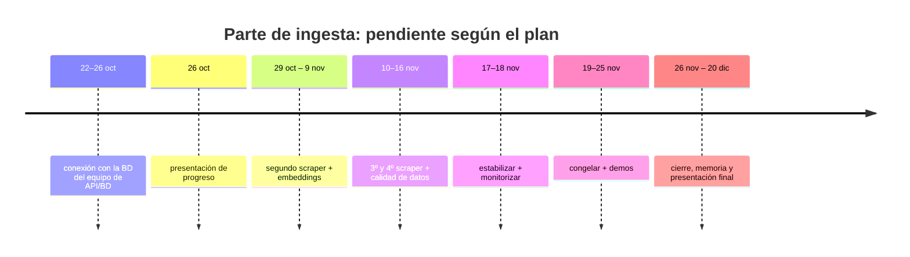

# 05 · Huecos y trabajo pendiente

Lo que falta en la parte de ingesta, ordenado por valor de diseño. Lo ya resuelto (precio
unitario canónico, contrato Pydantic y su despliegue) queda documentado como contrato en
[`03-contratos-datos.md`](03-contratos-datos.md) y en `fission/normalizer/`; aquí solo se
listan huecos y decisiones abiertas.

## Prioridad 3 — Contrato con API/BD

La única prioridad abierta. Quién cierra esto: **el equipo de API/BD** (dueño de la API y la
BD). El plan ya lo marca: *"cierra el esquema de BD y el contrato de API antes del 20/10"*.

Decisiones a acordar:

- ¿El destino `scraper.mercadona.clean` se queda en texto plano o pasa a **JSON
  estructurado** (`NormalizedProduct[]`, ver [`03`](03-contratos-datos.md#lote-limpio-variante-estructurada-de-clean))?
- ¿Quién escribe en BD: el consumer, o un servicio del equipo de API/BD que consume el subject?
- ¿Se necesita deduplicar por `product_id` + `wh` + fecha? (hoy no se hace)
- Subject y nombre de stream definitivos para todo el equipo.

## Otros huecos técnicos

| Hueco | Impacto | Nota |
|---|---|---|
| Fallo silencioso del scraper (exit 0 con NATS caído) | Alto | No hay alerta ni reingesta |
| Sin idempotencia / deduplicación | Medio | Duplicados en reentrega |
| `wh` a nivel de lote | Medio | Bloquea multi-tienda correctamente etiquetada |
| Validar el respaldo `calculado` con una 2ª cadena sin `reference_price` | Medio | Alcampo/Ahorramás; es donde el cálculo trabaja de verdad (ver [`03`](03-contratos-datos.md#precio-unitario-canónico-€kg--€l--€ud--€m--€lavado)) |
| Sin `Service`/PVC para los `.txt` | Bajo | El volcado es solo para depurar |
| Sin monitorización ni logs estructurados | Alto | Tarea 8 del plan |
| Sin `schema_version` en el envelope | Bajo | Necesario si el formato evoluciona |
| 2ª cadena (Carrefour) **bloqueada** | Medio | Challenge JS de Cloudflare desde el 15/10/2026; requiere navegador real. Código en `scrappers/scrapper_carrefour/` (no lo despliega `setup-vm.sh`) |
| Embeddings (coordinado con el equipo de IA) | Alto | Tarea 5; no existe nada |

## Roadmap alineado con el plan

| Tarea | Fechas (plan) | Qué queda por hacer en diseño/código |
|---|---|---|
| 3 (cierre) | 22–26 oct | Conectar la ingesta con la BD del equipo de API/BD (el cálculo €/L·€/kg y el contrato Pydantic ya están cerrados) |
| 4 | 26 oct | Presentación de progreso — estos documentos son la base |
| 5 | 29 oct – 9 nov | Segundo scraper + `publish` + embeddings con el equipo de IA (Carrefour, intentado, quedó bloqueado por Cloudflare) |
| 6 | 10–11 nov | 3º y 4º scraper (Alcampo, Ahorramás) + equivalencia de productos |
| 7 | 12–16 nov | Calidad de datos + multi-tienda (`wh` real) |
| 8 | 17–18 nov | Estabilizar ingesta + monitorización y logs |
| 9–11 | 19–25 nov | Congelar, datos de demo, ensayo y demos |
| 12–15 | 26 nov – 20 dic | Correcciones, despliegue documentado, presentación y memoria |

## Definición de «hecho» por componente

| Componente | Se considera hecho cuando… |
|---|---|
| Scraper | Extrae, publica en NATS y **devuelve código de salida != 0** si no publicó |
| Consumer | Tiene búfer acotado y es idempotente por `product_id` |
| Ingesta | Monitorización básica: nº de items, errores y lag visibles |

## Preguntas abiertas

1. **Equipo de API/BD**: ¿el contrato final es texto plano o JSON estructurado? ¿Escribe su
   servicio en BD?
2. **Equipo de IA**: ¿quién genera los embeddings, el normalizador o su parte de IA?
3. **Equipo**: ¿el subject `scraper.<cadena>.raw` se mantiene como convención para todas
   las cadenas, o se unifica en un único `scraper.raw` con `source` dentro?
4. **Profesor/requisitos**: ¿el `MessageQueueTrigger` de Fission es un requisito evaluable
   (y hay que arreglar el 401), o vale el `Deployment` actual como equivalente?
