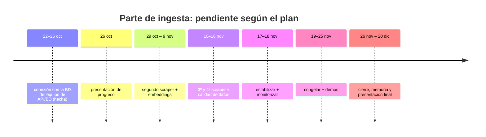

# 05 · Huecos y trabajo pendiente

Lo que falta en la parte de ingesta, ordenado por valor de diseño. Lo ya resuelto (precio
unitario canónico, contrato Pydantic y su despliegue) queda documentado como contrato en
[`03-contratos-datos.md`](03-contratos-datos.md) y en `fission/normalizer/`; aquí solo se
listan huecos y decisiones abiertas.

## Prioridad 3 — Contrato con API/BD

Casi cerrada. La cola de salida ya está conectada: el equipo de API/BD consume
`scraper.*.clean` con su propio durable `api-writer` (ver
[`03`](03-contratos-datos.md#cola-de-salida-frontera-con-apibd)).

| Decisión | Estado |
|---|---|
| ¿Quién escribe en BD? | **Resuelta:** el writer de API/BD (`api/app/writer.py`), no el consumer de la ingesta |
| ¿Deduplicar por producto + tienda + fecha? | **Resuelta en BD:** clave única `(product_id, store_id, observed_on)` con *upsert* |
| Subject y stream definitivos | **Resuelta:** stream `SCRAPERS`, salida `scraper.<cadena>.clean` |
| ¿`clean` en texto plano o JSON (`CleanBatch`)? | **Abierta.** El writer ya acepta las dos formas y prefiere `items`; falta acordar el cambio y una transición publicando ambos campos ([`03`](03-contratos-datos.md#mensaje-de-salida-clean)) |

## Otros huecos técnicos

| Hueco | Impacto | Nota |
|---|---|---|
| Códigos postales desde la API | Alto | Hoy `postal_codes = ["08016"]` fijo. Falta el endpoint de la API con los códigos de los usuarios (propuesta en [`03`](03-contratos-datos.md#código-postal-y-tienda)) |
| Sin alerta si falla un scraper | Medio | Desde el 11/11 el Job falla de forma visible, pero nadie avisa |
| Sin idempotencia / deduplicación | Medio | Duplicados en reentrega |
| Validar el respaldo `calculado` con una 2ª cadena sin `reference_price` | Medio | Alcampo/Ahorramás; es donde el cálculo trabaja de verdad (ver [`03`](03-contratos-datos.md#precio-unitario-canónico-€kg--€l--€ud--€m--€lavado)) |
| Sin `Service` para los `.txt` | Bajo | El volcado es solo para depurar; ya se guarda en el PVC `scraper-out` |
| Sin monitorización ni logs estructurados | Alto | Tarea 8 del plan |
| Sin `schema_version` en el envelope | Bajo | Necesario si el formato evoluciona |
| `ean` fuera de la línea limpia | Medio | Consum lo trae y serviría para emparejar el mismo producto entre cadenas; añadirlo cambia el contrato con API/BD |
| Consum pierde ~0,8 % por paginar con `offset` | Bajo | El catálogo se mueve durante la pasada; se deduplica pero no se recupera lo desplazado |
| Carrefour **bloqueada** (la 2ª cadena acabó siendo Consum) | Medio | Challenge JS de Cloudflare desde el 15/10/2026; requiere navegador real. Código en `scrappers/scrapper_carrefour/` (no lo despliega `setup-vm.sh`) |
| Embeddings (coordinado con el equipo de IA) | Alto | Tarea 5; no existe nada |

## Roadmap alineado con el plan

| Tarea | Fechas (plan) | Qué queda por hacer en diseño/código |
|---|---|---|
| 3 (cierre) | 22–26 oct | **Hecho:** la salida `scraper.*.clean` la consume el writer de API/BD. Solo queda decidir texto vs JSON |
| 4 | 26 oct | Presentación de progreso — estos documentos son la base |
| 5 | 29 oct – 9 nov | Segundo scraper + `publish` + embeddings con el equipo de IA (Carrefour, intentado, quedó bloqueado por Cloudflare) |
| 6 | 10–11 nov | 3º y 4º scraper (Alcampo, Ahorramás) + equivalencia de productos |
| 7 | 12–16 nov | Calidad de datos + multi-tienda (`wh` real) |
| 8 | 17–18 nov | Estabilizar ingesta + monitorización y logs |
| 9–11 | 19–25 nov | Congelar, datos de demo, ensayo y demos |
| 12–15 | 26 nov – 20 dic | Correcciones, despliegue documentado, presentación y memoria |

## Despliegue: separar ingesta y API/BD

Hoy `infra/` (Terraform) despliega solo la ingesta en el perfil de minikube `ingesta`. La
idea es tener **dos despliegues independientes en el mismo clúster**: uno de ingesta y otro
de API/BD. La parte de la ingesta está hecha (pasos 2 y 3); el resto depende del equipo de
API/BD:

| Paso | Dueño | Qué |
|---|---|---|
| 1 | Ambos | Cuando exista el stack de API: sacar `bootstrap.sh` y el arranque de minikube a una carpeta común. Mientras tanto, el otro stack puede desplegar en el mismo perfil (`MINIKUBE_PROFILE`, contexto `ingesta`) |
| 2 | Ingesta | **Hecho:** el pool de Fission y `normalizer-consumer` viven en el namespace `ingesta`, y Fission solo vigila ese namespace |
| 3 | Ambos | **Hecho:** contrato `nats://nats.messaging.svc.cluster.local:4222`, stream `SCRAPERS`, subject `scraper.<cadena>.clean`, durable `api-writer` (ver [`03`](03-contratos-datos.md#cola-de-salida-frontera-con-apibd)). `infra/e2e.sh` comprueba que la salida se llena |
| 4 | API/BD | Su propio stack de Terraform (`api/infra/`) con estado propio; recibe `nats_url` como variable, sin leer el estado de la ingesta |
| 5 | Ambos | `up.sh` en la raíz que encadene bootstrap → clúster → ingesta → API, y prueba end-to-end hasta filas en PostgreSQL |

Por qué un clúster y no dos: la API llega a NATS por DNS interno; con dos clústeres habría
que exponer NATS fuera, se duplica la RAM y vuelve el problema de inotify.

## Definición de «hecho» por componente

| Componente | Se considera hecho cuando… |
|---|---|
| Scraper | Extrae, publica en NATS y **devuelve código de salida != 0** si no publicó |
| Consumer | Tiene búfer acotado y es idempotente por `product_id` |
| Ingesta | Monitorización básica: nº de items, errores y lag visibles |

## Preguntas abiertas

1. **Equipo de API/BD**: ¿pasamos `clean` a JSON estructurado (`CleanBatch`)? Su servicio
   ya escribe en BD y acepta ambos formatos.
2. **Equipo de IA**: ¿quién genera los embeddings, el normalizador o su parte de IA?
3. **Equipo**: ¿el subject `scraper.<cadena>.raw` se mantiene como convención para todas
   las cadenas, o se unifica en un único `scraper.raw` con `source` dentro?
4. **Profesor/requisitos**: ¿el `MessageQueueTrigger` de Fission es un requisito evaluable
   (y hay que arreglar el 401), o vale el `Deployment` actual como equivalente?
