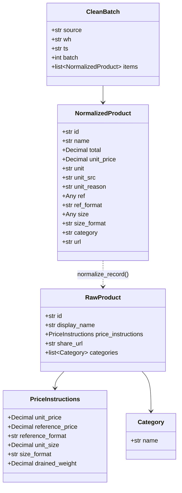
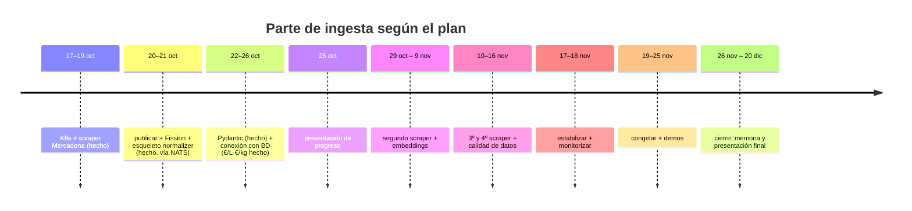

# 05 · Huecos y trabajo pendiente

Lo que falta en la parte de ingesta, ordenado por valor de diseño. La prioridad abierta
(3, contrato con API/BD) conviene cerrarla **antes** de escribir más código; la 2 (modelo
Pydantic) está **implementada y desplegada** en la VM.

## Prioridad 1 — Cálculo de precio unitario (€/L · €/kg) — ✅ HECHO (17/10/2026)

Resuelto en diseño y en código. El precio unitario se **normaliza a una unidad base**
(`kg`, `l`, `ud`, `m`, `lavado`) en vez de copiarse tal cual de la fuente:

- Código: `fission/normalizer/normalizer.py` → `unit_price()` y `format_record()`.
- Prueba: `fission/normalizer/test_unit_price.py` (`python test_unit_price.py`).
- Contrato de la línea y tabla de conversión: [`03-contratos-datos.md`](03-contratos-datos.md#precio-unitario-canónico-€kg--€l--€ud--€m--€lavado).

Regla aplicada, tras validar con datos reales:

1. **La fuente manda**: si hay `reference_price` con formato conocido, se convierte a la
   unidad base (`src=fuente`). Es el caso de todos los productos de Mercadona.
2. **Respaldo**: si no hay `reference_price`, se calcula desde `unit_price` y el tamaño
   (usando el **peso escurrido** `drained_weight` en pesables) → `src=calculado`.
3. **Nunca inventar**: si falta precio, tamaño o el formato no es comparable, la línea se
   marca **incompleta** con motivo, en lugar de dar un número dudoso.

Formatos reales cubiertos (4591 productos, 15/10/2026): `kg`, `g`, `100 g`, `l`, `ml`,
`cl`, `100 ml`, `ud`, `dc`, `dz`, `m`, `lv`. Hallazgos de la validación:

- `dc`/`dz` = **docena** (12 ud); `lv` = **lavado** (detergente); `m` = **metro** (film).
- El `reference_price` de la fuente **no siempre se deriva de `unit_size`**: a veces usa
  escurrido, `total_units × pack_size`, o una unidad funcional (`botes`, `lavados`); hay
  además productos con `approx_size: true` e incoherencias internas de Mercadona.
  Por eso el cálculo es **respaldo**, nunca sustituto.
- En productos "simples" el respaldo reproduce la fuente en el **99,1%** de los casos
  (resto: redondeo de céntimos, `test_unit_price.py`).

**Sigue abierto:** validar el respaldo `calculado` con una 2ª cadena que **no** dé
`reference_price` (Alcampo, Ahorramás). Es ahí donde el cálculo trabaja de verdad.

## Prioridad 2 — Modelo Pydantic

> ✅ **Definido, implementado y desplegado** (17/10/2026). Código:
> `fission/normalizer/normalizer.py`; pruebas: `fission/normalizer/test_models.py`;
> despliegue: `fission/normalizer/deploy.sh` (ejecutado en la VM, ver *Despliegue*).

El plan pide Pydantic explícitamente. El **contrato queda cerrado aquí**: el modelo
envuelve `normalize_record()` con tipos y validación, **sin rehacer la lógica**. Se
separan los modelos de **entrada** (crudo de la cadena, tolerante) y los de **salida**
(línea ya normalizada, estricta).



### Entrada (cruda, tolerante)

Mercadona manda muchos más campos de los que se usan. El modelo declara **solo** los que
consume el normalizador y **ignora el resto** (`extra="ignore"`): un campo nuevo en la
fuente no rompe la ingesta.

```python
from decimal import Decimal
from typing import Annotated, Any, Literal
from pydantic import (
    BaseModel, BeforeValidator, ConfigDict, Field, field_validator, model_validator,
)

# Reutiliza _dec() de normalizer.py: admite coma decimal y rechaza NaN/Inf/''.
Dec = Annotated[Decimal, BeforeValidator(_dec)]
# Mercadona manda `id` como numero: se coacciona a str (mismo criterio que str(...)).
Id = Annotated[str, BeforeValidator(lambda v: v if isinstance(v, str) else str(v))]


class Category(BaseModel):
    model_config = ConfigDict(extra="ignore")
    name: str = ""


class PriceInstructions(BaseModel):
    """Solo los campos que usa unit_price(); el resto (bulk_price, pack_size,
    approx_size, total_units...) se ignora a proposito."""
    model_config = ConfigDict(extra="ignore")

    unit_price: Dec | None = None        # precio del envase (total)
    reference_price: Dec | None = None   # base de la fuente, si la trae
    reference_format: str = ""
    unit_size: Dec | None = None
    size_format: str = ""
    drained_weight: Dec | None = None    # peso escurrido (pesables)


class RawProduct(BaseModel):
    model_config = ConfigDict(extra="ignore")

    id: Id
    display_name: str = ""
    price_instructions: PriceInstructions = Field(default_factory=PriceInstructions)
    share_url: str = ""
    categories: list[Category] = Field(default_factory=list)
```

### Salida (normalizada, estricta)

Refleja **exactamente** los campos que hoy devuelve `normalize_record()` con tipos y
validación:

```python
UnitBase = Literal["kg", "l", "ud", "m", "lavado"]  # debe seguir a UNITS en normalizer.py
UnitSrc = Literal["fuente", "calculado", "-"]


class NormalizedProduct(BaseModel):
    model_config = ConfigDict(extra="forbid", frozen=True)

    id: Id
    name: str
    total: Dec | None
    unit_price: Dec | None
    unit: UnitBase | None
    unit_src: UnitSrc
    unit_reason: str = ""            # "", sin_precio, sin_tamano, formato_no_comparable:<fmt>
    ref: Any = None                  # crudo de la fuente ("-", numero o texto) -> trazabilidad
    ref_format: str = ""
    size: Any = None                 # crudo de la fuente
    size_format: str = ""
    category: str = ""
    url: str = ""

    @field_validator("name", mode="before")
    @classmethod
    def _collapse(cls, v: Any) -> str:
        return " ".join(str(v or "").split())

    @model_validator(mode="after")
    def _coherente(self) -> "NormalizedProduct":
        if self.unit_price is None:
            if not self.unit_reason:
                raise ValueError("sin unit_price hace falta unit_reason")
            if self.unit is not None or self.unit_src != "-":
                raise ValueError("linea incompleta no puede traer unidad ni origen")
        else:
            if self.unit is None or self.unit_src == "-":
                raise ValueError("con unit_price la unidad y el origen son obligatorios")
            if self.unit_reason:
                raise ValueError("unit_reason debe estar vacio cuando hay unit_price")
        return self
```

`unit_reason` conserva la cadena dinámica `formato_no_comparable:<fmt>`, así que se tipa
como `str` con valores documentados en vez de un `Literal` cerrado. `ref` y `size` se
dejan **sin tipar a propósito**: son el dato crudo de la fuente (número, texto o `-`) y se
conservan solo para trazabilidad; la comparación usa siempre `unit_price` + `unit`.

### Lote limpio (variante estructurada de `clean`)

La decisión sigue **abierta con Xavi** (Prioridad 3). Si el destino deja de ser texto plano
y pasa a JSON, el mensaje de `scraper.mercadona.clean` sería:

```python
class CleanBatch(BaseModel):
    source: Literal["normalizer"] = "normalizer"
    wh: str = "default"
    ts: str                                  # ISO-8601 UTC, igual que el envelope
    batch: int                               # nº de productos crudos del lote
    items: list[NormalizedProduct]
```

Hoy equivale al campo `clean` en texto plano; `items` es su versión tipada, sin parseo por
` | ` (ver [`03-contratos-datos.md`](03-contratos-datos.md#mensaje-de-salida-clean)).

### Reglas de validación

1. **Nada se inventa.** Sin precio, sin tamaño o con formato no comparable, la línea queda
   incompleta: `unit_price = None`, `unit = None`, `unit_src = "-"` y `unit_reason` con el
   motivo. El validador de coherencia **exige** esa combinación (`_coherente`).
2. **La fuente manda.** Con `reference_price` convertible → `unit_src = "fuente"`; si no,
   `"calculado"`. Nunca `"fuente"` con un valor del respaldo.
3. **Tolerancia en la frontera, rigor en la salida.** La entrada ignora campos nuevos
   (`extra="ignore"`); la salida los prohíbe (`extra="forbid"`) para que el contrato no
   derive en silencio.
4. **Error por item, no `-` silencioso.** Un `ValidationError` se emite como
   `ERROR id=...` y el lote continúa (como hoy en `to_clean_txt`), pero **deja rastro** en
   vez de degradar el campo a `-`.
5. **Decimal para dinero.** Los importes son `Decimal` (nunca `float`), con la cuantización
   a 4 decimales (`_q`) que ya aplica `unit_price()`.

### Implementación

Todo vive en `fission/normalizer/normalizer.py` (los modelos van en la misma fuente porque la
función de Fission se sube como un único fichero: `fission fn update --code normalizer.py`), y
el consumer reutiliza el módulo. Lo que se añadió:

| Pieza | Qué hace |
|---|---|
| `RawProduct` / `PriceInstructions` / `Category` | Validan la entrada en el camino estructurado |
| `NormalizedProduct` | Valida cada línea normalizada (`normalize_model`) |
| `CleanBatch` | Lote limpio serializable (`to_clean_json`) |
| `POST /normalize?format=json` | Devuelve un `CleanBatch`; `422` si un crudo no valida (**opt-in**) |
| `to_clean_txt` | Sigue igual, pero valida cada item: `ERROR id=...: validacion: ...` en una línea |

### Qué NO cambia

`_dec`, `_unit`, `UNITS`, `unit_price()` y `format_record()` se mantienen tal cual. El
modelo es un **envoltorio** sobre `normalize_record()`, que sigue siendo la única fuente de
la lógica: solo añade validación y, opcionalmente, serialización a JSON. La línea limpia de
texto (contrato actual de `clean`) no se altera: los 4591 productos del volcado del 15/10
validan y la salida es idéntica.

### Despliegue

Pydantic **no** está en la imagen `python` prebuilt de Fission, y la función lo necesita.
Todo está scriptado en `fission/normalizer/deploy.sh`, que se ejecuta **en la VM del clúster**
(desde aquí no hay acceso) y es idempotente:

1. **Entorno**: construye `Dockerfile.env` heredando de la imagen que ya usa el entorno
   `python` (la detecta del CRD; en la VM es `ghcr.io/fission/python-env`, Fission v1.27.0,
   `version: 3`, `poolsize: 3`), la carga en minikube, parchea `spec.runtime.image` (conserva
   version/builder/poolsize) y borra los pods del pool precalentado. Después **comprueba
   dentro de un pod del pool que `import pydantic` funciona**.
2. **Función**: `fission fn create|update --code normalizer.py --entrypoint normalizer.main`
   (reutiliza el paquete `normalizer-<uuid>` existente) y aplica el `HTTPTrigger`
   (`fission.yaml`).
3. **Consumer**: reconstruye la imagen (`Dockerfile.consumer`, que ya instala
   `requirements.txt`, así `clean_local` también valida) y hace el rollout.
4. **Humo**: `port-forward` al `svc/router` y `POST /normalize` en texto y en `?format=json`,
   comprobando que la línea sale exacta (`3.45EUR/l … src=fuente`) y que el JSON valida.

> Hallazgo al preparar el despliegue: el `fission.yaml` original declaraba `entrypoint` y
> `functionSource` dentro de la `Function`, **campos que no existen en el CRD** (el
> entrypoint va en `spec.package.functionName`) y sin `packageref`. El manifiesto solo
> versiona ahora el `HTTPTrigger`; la `Function` y su paquete los gestiona el CLI. Los flags
> de namespace del CLI son `fnNamespace`/`envNamespace` (no `fnns`/`envns`), y en el
> `HTTPTrigger` el `functionref.type` válido es `name` (el API server rechaza `Function`:
> *supported values: "name", "function-weights"*).

**Verificado en la VM el 17/10/2026:** el entorno quedó con pydantic 2.14.1 (comprobado con
`kubectl exec` en un pod del pool), la función y el consumer con el código nuevo, y la prueba
de humo devuelve la línea limpia exacta y el `CleanBatch` en `?format=json`.

Requiere **Pydantic v2** (`ConfigDict`, `field_validator`, `model_validator`).

## Prioridad 3 — Contrato con API/BD

Quién cierra esto: **Xavi** (dueño de BD y API). El plan ya lo marca: *"Xavi cierra esquema
de BD y contrato API antes del 20/10"*.

Decisiones a acordar:

- ¿El destino `scraper.mercadona.clean` se queda en texto plano o pasa a **JSON
  estructurado** (`NormalizedProduct[]`)?
- ¿Quién escribe en BD: el consumer, o un servicio de Xavi que consume el subject?
- ¿Se necesita deduplicar por `product_id` + `wh` + fecha? (hoy no se hace)
- Subject y nombre de stream definitivos para todo el equipo.

## Otros huecos técnicos

| Hueco | Impacto | Nota |
|---|---|---|
| Fallo silencioso del scraper (exit 0 con NATS caído) | Alto | No hay alerta ni reingesta |
| Búfer del consumer sin cota | Medio | Crece si Fission falla de forma sostenida |
| Sin idempotencia / deduplicación | Medio | Duplicados en reentrega |
| `wh` a nivel de lote | Medio | Bloquea multi-tienda correctamente etiquetada |
| Ingress sin `Service` | Bajo | Resto de un diseño anterior; los CronJob no exponen puertos |
| Sin `Service`/PVC para los `.txt` | Bajo | El volcado es solo para depurar |
| Sin monitorización ni logs estructurados | Alto | Tarea 8 del plan |
| Sin `schema_version` en el envelope | Bajo | Necesario si el formato evoluciona |
| `NATS_SUBJECT_IN` declarada y no usada | Muy bajo | Limpieza |
| Embeddings (coordinado con Joel) | Alto | Tarea 5; no existe nada |

## Roadmap alineado con el plan

| Tarea | Fechas (plan) | Qué hay que hacer en diseño/código |
|---|---|---|
| 3 (cierre) | 22–26 oct | Modelo Pydantic **hecho** (17 oct, ver Prioridad 2) + conectar con BD de Xavi (cálculo €/L·€/kg **hecho** 17 oct) |
| 4 | 26 oct | **Presentación de progreso** — estos documentos son la base |
| 5 | 29 oct – 9 nov | Segundo scraper + `publish` + embeddings con Joel |
| 6 | 10–11 nov | 3º y 4º scraper (Alcampo, Ahorramás) + equivalencia de productos |
| 7 | 12–16 nov | Calidad de datos + multi-tienda (`wh` real) |
| 8 | 17–18 nov | Estabilizar ingesta + monitorización y logs |
| 9–11 | 19–25 nov | Congelar, datos de demo, ensayo y demos |
| 12–15 | 26 nov – 20 dic | Correcciones, despliegue documentado, presentación y memoria |



## Definición de «hecho» por componente

| Componente | Se considera hecho cuando… |
|---|---|
| Scraper | Extrae, publica en NATS y **devuelve código de salida != 0** si no publicó |
| Normalizador | Calcula €/L·€/kg (**hecho**), valida con Pydantic (**hecho**) y emite JSON estructurado (**opt-in** vía `?format=json`) |
| Consumer | Tiene búfer acotado y es idempotente por `product_id` |
| Ingesta | Monitorización básica: nº de items, errores y lag visibles |

## Preguntas abiertas

1. **Xavi**: ¿el contrato final es texto plano o JSON estructurado? ¿Escribe él en BD?
2. **Joel**: ¿quién genera los embeddings, el normalizador o su parte de IA?
3. **Equipo**: ¿el subject `scraper.<cadena>.raw` se mantiene como convención para todas
   las cadenas, o se unifica en un único `scraper.raw` con `source` dentro?
4. **Profesor/requisitos**: ¿el `MessageQueueTrigger` de Fission es un requisito evaluable
   (y hay que arreglar el 401), o vale el `Deployment` actual como equivalente?
