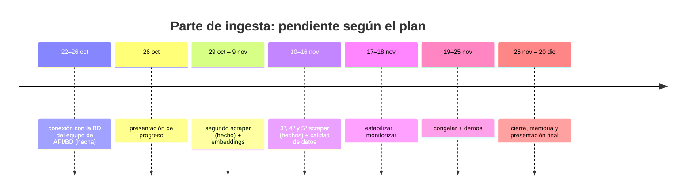

# 05 · Huecos y trabajo pendiente

Lo que falta en la parte de ingesta, ordenado por valor de diseño. Lo ya resuelto (precio
unitario canónico, contrato Pydantic y su despliegue) queda documentado como contrato en
[`03-contratos-datos.md`](03-contratos-datos.md) y en `fission/normalizer/`; aquí solo se
listan huecos y decisiones abiertas.

## Prioridad 3 — Contrato con API/BD

Casi cerrada. La cola de salida ya está conectada: el equipo de API/BD consume
`scraper.*.clean` con su propio durable `api-writer` (ver
[`03`](03-contratos-datos.md#cola-de-salida-frontera-con-apibd)).

| Decisión | Estado |
|---|---|
| ¿Quién escribe en BD? | **Resuelta:** el writer de API/BD (`api/app/writer.py`), no el consumer de la ingesta |
| ¿Deduplicar por producto + tienda + fecha? | **Resuelta en BD:** clave única `(product_id, store_id, observed_on)` con *upsert* |
| Subject y stream definitivos | **Resuelta:** stream `SCRAPERS`, salida `scraper.<cadena>.clean` |
| ¿`clean` en texto plano o JSON (`CleanBatch`)? | **Abierta.** El writer ya acepta las dos formas y prefiere `items`; falta acordar el cambio y una transición publicando ambos campos ([`03`](03-contratos-datos.md#mensaje-de-salida-clean)) |

## Otros huecos técnicos

| Hueco | Impacto | Nota |
|---|---|---|
| Códigos postales desde la API | Alto | Hoy `postal_codes = ["08016"]` fijo. Falta el endpoint de la API con los códigos de los usuarios (propuesta en [`03`](03-contratos-datos.md#código-postal-y-tienda)) |
| Sin alerta si falla un scraper | Medio | Desde el 11/11 el Job falla de forma visible (y desde el 12/11 también si se queda a medias), pero nadie avisa |
| ~~La VM se reinicia y nada vuelve~~ | Hecho | `infra/autostart.sh` (12/11/2026): instalado en la VM y probado con un reinicio real |
| ~~Consumer sordo si NATS cae~~ | Hecho | Reintentos sin fin + `livenessProbe` (12/11/2026) |
| ~~`e2e.sh` siempre decía 0 errores~~ | Hecho | Buscaba `ERROR` en mayúsculas en el log; ahora mira `flush-error`/`parse-error` y las líneas `ERROR id=` de los lotes (12/11/2026) |
| ~~Volcados `.txt` sin rotar~~ | Hecho | `scraper-out-cleanup` borra los de más de 7 días (12/11/2026) |
| Sin deduplicación en la ingesta | Bajo | Una reentrega repite líneas en `clean`; la BD lo absorbe con *upsert* (clave producto + tienda + día) |
| ~~Validar el respaldo `calculado` con una cadena sin `reference_price`~~ | Hecho | Con Caprabo (11/11/2026): donde la web da el precio por unidad, el calculado coincide en el 98 % ([`03`](03-contratos-datos.md#mapeo-de-campos-de-caprabo)) |
| Sin `Service` para los `.txt` | Bajo | El volcado es solo para depurar; ya se guarda en el PVC `scraper-out` |
| Sin monitorización ni logs estructurados | Alto | Tarea 8 del plan |
| Sin `schema_version` en el envelope | Bajo | Necesario si el formato evoluciona |
| Tamaño del stream con más códigos postales | Bajo | Con cinco cadenas y un código postal, 7 días ocupan ~460 MiB de 1 GiB ([`04`](04-estados-y-errores.md)). Con más tiendas habrá que subir el PVC o bajar la retención (sin bajar del tiempo que el writer pueda estar parado) |
| `ean` fuera de la línea limpia | Medio | Consum lo trae y serviría para emparejar el mismo producto entre cadenas; añadirlo cambia el contrato con API/BD |
| Consum pierde ~0,8 % por paginar con `offset` | Bajo | El catálogo se mueve durante la pasada; se deduplica pero no se recupera lo desplazado |
| Carrefour, Alcampo, Dia y Bonpreu **bloqueados** | Bajo | Probado el 11/11/2026 con Playwright (Chromium sin interfaz, sin camuflar el bot): las cuatro dan 403 (Cloudflare, CloudFront, Akamai). Pasarlos exigiría técnicas para ocultar el bot (huella falsa, proxies residenciales, captchas): **descartado** por condiciones de uso y `robots.txt`. Vía limpia: pedir acceso a los datos como proyecto académico. Playwright se usa solo para **descubrir** APIs internas de webs sin antibot (así salió bonÀrea) |
| Embeddings (coordinado con el equipo de IA) | Alto | Tarea 5; no existe nada |

## Roadmap alineado con el plan

| Tarea | Fechas (plan) | Qué queda por hacer en diseño/código |
|---|---|---|
| 3 (cierre) | 22–26 oct | **Hecho:** la salida `scraper.*.clean` la consume el writer de API/BD. Solo queda decidir texto vs JSON |
| 4 | 26 oct | Presentación de progreso — estos documentos son la base |
| 5 | 29 oct – 9 nov | Segundo scraper (hecho: Consum; Carrefour quedó bloqueado por Cloudflare) + embeddings con el equipo de IA (pendiente) |
| 6 | 10–11 nov | **Hecho con otras cadenas:** Consum, Caprabo, Condis y bonÀrea (Alcampo bloquea; Ahorramás no reparte en Cataluña). Queda la equivalencia de productos entre cadenas |
| 7 | 12–16 nov | Calidad de datos + multi-tienda (`wh` real) |
| 8 | 17–18 nov | Estabilizar ingesta + monitorización y logs |
| 9–11 | 19–25 nov | Congelar, datos de demo, ensayo y demos |
| 12–15 | 26 nov – 20 dic | Correcciones, despliegue documentado, presentación y memoria |

## Por hacer para el equipo de API y BD

Encontrado al conectar la ingesta con su BD (11/11/2026). El contrato del mensaje `clean`
**cuadra**: su parser lee todas las líneas de las cuatro primeras cadenas (66.129 productos),
sin líneas sin parsear ni campos más largos que sus columnas; bonÀrea se cargó después con 0
errores. Lo que queda es de modelo de datos,
y no se ha tocado:

| Qué | Detalle |
|---|---|
| Precio "actual" con varias tiendas | `_latest_prices()` (`api/app/repository.py`) hace `DISTINCT ON (product_id)` ordenando solo por `observed_on` (fecha). Si un producto tiene precio de dos tiendas el mismo día, sale una cualquiera. Pasará en cuanto haya varios códigos postales. Falta decidir: ¿precio por tienda/código postal del usuario, o el más reciente (`observed_at`)? |
| `postal_code` no se guarda | El mensaje `clean` trae `postal_code` (y la ingesta ya lo publica), pero `stores` no tiene columna para él. Sin eso la API no puede filtrar por el código postal del usuario |
| Tienda `default` antigua | Los lotes de antes del scraping por código postal llevaban `wh="default"`: en la BD hay tiendas `default` de Mercadona y Consum con precios del 11/11. No solo duplican a `bcn1`/`378`: 1.860 productos (243 de Mercadona y 1.617 de Consum) **solo** existen ahí, y la búsqueda los devuelve (en `/products/search?q=aceite oliva`, 3 de los 5 primeros son de `default` del 11/11). Propuesta: borrarlas |
| Precios obsoletos | Sin filtro de frescura, un producto que desaparece del catálogo se sigue mostrando con su último precio para siempre. Propuesta: ignorar precios de más de N días (o marcarlos) |
| `MaxDeliver` del writer | El durable `api-writer` no tiene límite de entregas. Un error de BD que no sea `ValueError` (p. ej. un nombre de más de 300 caracteres) se reintenta cada 10 s durante 7 días. La ingesta ya lo tiene en su durable (`maxDeliver` 100) |
| Copia del histórico | El volumen de PostgreSQL se pierde con `down.sh`, `minikube delete` o `kubectl delete -k`, y es el único dato que no se puede recuperar. Propuesta: `pg_dump` nocturno (CronJob en `api`) a un volumen o fuera de la VM |
| API solo dentro del clúster | El Service `api` es `ClusterIP`: solo se llega con `port-forward`, y la VM solo expone el puerto 22. Para la app hará falta un `NodePort`/Ingress o un túnel |
| Versiones sin fijar | `python:3.12-slim`, `pgvector/pgvector:pg16` y `redis:7.4-alpine` van por etiqueta móvil |
| Writer y caídas de NATS | Al reiniciar NATS (prueba del 12/11/2026) el writer muere con `ConnectionRefusedError` y vuelve porque Kubernetes reinicia el pod (1 reinicio). Funciona, pero conviene que reintente la conexión como el consumer de la ingesta (`max_reconnect_attempts=-1`) |
| Nombres de cadena | `CHAIN_NAMES` (`api/app/ingest.py`) solo tiene `ahorramas`; las demás salen con `capitalize()`. Bien para Mercadona, Consum, Caprabo y Condis, pero bonÀrea sale como `Bonarea`: falta `"bonarea": "bonÀrea"` |
| Endpoint de códigos postales | La ingesta necesita `GET /internal/postal-codes` (ver [`03`](03-contratos-datos.md)) para dejar de usar 08016 fijo |

## Despliegue: separar ingesta y API/BD

`infra/` (Terraform) despliega la ingesta en el perfil de minikube `ingesta`, y
`infra/api-up.sh` añade la API/BD en el mismo clúster. La idea es tener **dos despliegues
independientes en el mismo clúster**. Hechos los pasos 2, 3 y 5; el 1 y el 4 dependen sobre
todo del equipo de API/BD:

| Paso | Dueño | Qué |
|---|---|---|
| 1 | Ambos | Sacar `bootstrap.sh` y el arranque de minikube a una carpeta común. Mientras tanto, `api-up.sh` despliega la API en el mismo perfil (`MINIKUBE_PROFILE`, contexto `ingesta`) |
| 2 | Ingesta | **Hecho:** el pool de Fission y `normalizer-consumer` viven en el namespace `ingesta`, y Fission solo vigila ese namespace |
| 3 | Ambos | **Hecho:** contrato `nats://nats.messaging.svc.cluster.local:4222`, stream `SCRAPERS`, subject `scraper.<cadena>.clean`, durable `api-writer` (ver [`03`](03-contratos-datos.md#cola-de-salida-frontera-con-apibd)). `infra/e2e.sh` comprueba que la salida se llena |
| 4 | API/BD | Su propio stack de Terraform (`api/infra/`) con estado propio; recibe `nats_url` como variable, sin leer el estado de la ingesta |
| 5 | Ambos | **Hecho (11/11/2026):** `infra/api-up.sh` despliega `api/k8s` tal cual en el mismo clúster (namespace `api`) y comprueba filas en PostgreSQL; `API=1 up.sh` lo encadena. Sigue pendiente el paso 4 (Terraform propio de API/BD) |

Por qué un clúster y no dos: la API llega a NATS por DNS interno; con dos clústeres habría
que exponer NATS fuera, se duplica la RAM y vuelve el problema de inotify.

## Definición de «hecho» por componente

| Componente | Se considera hecho cuando… |
|---|---|
| Scraper | Extrae, publica en NATS y **devuelve código de salida != 0** si no publicó |
| Consumer | Tiene búfer acotado y es idempotente por `product_id` |
| Ingesta | Monitorización básica: nº de items, errores y lag visibles |

## Preguntas abiertas

1. **Equipo de API/BD**: ¿pasamos `clean` a JSON estructurado (`CleanBatch`)? Su servicio
   ya escribe en BD y acepta ambos formatos.
2. **Equipo de IA**: ¿quién genera los embeddings, el normalizador o su parte de IA?
3. **Equipo**: ¿el subject `scraper.<cadena>.raw` se mantiene como convención para todas
   las cadenas, o se unifica en un único `scraper.raw` con `source` dentro?
4. **Profesor/requisitos**: ¿el `MessageQueueTrigger` de Fission es un requisito evaluable
   (y hay que arreglar el 401), o vale el `Deployment` actual como equivalente?
