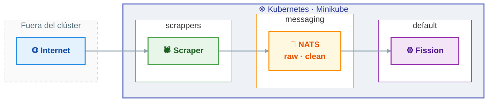

# Diseño de la ingesta — parte de Samuel

Documentación de diseño del **flujo de entrada** del comparador de precios: scrapers,
cluster Kubernetes, mensajería NATS JetStream y normalización con Fission.

> Estado: `scrapping` @ `ed5aa47` (15/10/2026). Los esquemas describen lo que hay
> **implementado** en el repo, no lo que se desearía tener.

## Alcance

**Cubre** la cadena completa desde la web del supermercado hasta la frontera con el
equipo de API/BD:

```
web del súper  →  scraper (CronJob)  →  NATS raw  →  normalizer  →  NATS clean  →  [ API/BD ]
```

**No cubre** (es de otros compañeros): esquema de BD, API REST, Redis, app móvil,
modelo RAG/embeddings y LLM.

## Mapa en 30 segundos



## Índice

| Documento | Contenido |
|---|---|
| [`01-arquitectura.md`](01-arquitectura.md) | Componentes, despliegue en K8s, decisiones de diseño y variables de entorno |
| [`02-flujo-datos.md`](02-flujo-datos.md) | Secuencia end-to-end, ciclo de vida de un producto y cadencia temporal |
| [`03-contratos-datos.md`](03-contratos-datos.md) | Subjects, envelopes, formato de línea limpia con precio unitario canónico y mapeo de Mercadona |
| [`04-estados-y-errores.md`](04-estados-y-errores.md) | Estados, tipos de fallo, reintentos y escenarios límite |
| [`05-pendientes.md`](05-pendientes.md) | Huecos detectados y siguiente trabajo previsto en el plan |

## Relación con el plan de tareas

Referencia: hoja **Samuel** de `Plan_tareas_PTI.xlsx` (15 tareas).

| Tarea del plan | Estado real | Dónde |
|---|---|---|
| 1. Clúster K8s local, repo y Dockerfile base + scraper Mercadona | Hecha | [`01`](01-arquitectura.md), [`02`](02-flujo-datos.md) |
| 2. Scraper publicando + router Fission + esqueleto del normalizador | Hecha (con cambio de diseño: NATS en vez de HTTP POST) | [`01`](01-arquitectura.md), [`03`](03-contratos-datos.md) |
| 3. Normalizador con Pydantic + cálculo €/L·€/kg + escritura en BD + CronJob | Parcial (cálculo €/L·€/kg, contrato Pydantic y despliegue en la VM **hechos**; falta conectar la BD) | [`03`](03-contratos-datos.md), [`05`](05-pendientes.md) |
| 4–15. Presentación de progreso, Alcampo/Ahorramás, calidad de datos, ingesta, demos, memoria | No iniciadas | [`05`](05-pendientes.md) |

## Convenciones

- **Namespaces**: `scrappers` (recolectores), `messaging` (NATS), `fission` (instalación
  de Fission), `default` (función `normalizer`, trigger y consumer).
- **Nombres de subject**: `<recurso>.<cadena>.<estado>` → `scraper.mercadona.raw`,
  `scraper.mercadona.clean`.
- **`wh`**: etiqueta de almacén/tienda que viaja en el envelope. Hoy siempre `default`;
  es el gancho para multi-tienda (datos de supermercados cercanos).
