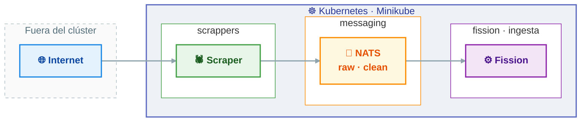

# Diseño de la ingesta — parte de Samuel

Documentación de diseño del **flujo de entrada** del comparador de precios: scrapers,
cluster Kubernetes, mensajería NATS JetStream y normalización con Fission.

> Estado: rama `develop` (actualizado el 11/11/2026). Los esquemas describen lo que hay
> **implementado** en el repo, no lo que se desearía tener.

## Alcance

**Cubre** la cadena completa desde la web del supermercado hasta la frontera con el
equipo de API/BD:

```
web del súper  →  scraper (CronJob)  →  NATS raw  →  normalizer  →  NATS clean  →  [ writer API/BD → PostgreSQL ]
```

**No cubre** (es de otros compañeros): esquema de BD, API REST, Redis, app móvil,
modelo RAG/embeddings y LLM.

## Mapa en 30 segundos



## Índice

| Documento | Contenido |
|---|---|
| [`01-arquitectura.md`](01-arquitectura.md) | Componentes, despliegue en K8s, decisiones de diseño y variables de entorno |
| [`02-flujo-datos.md`](02-flujo-datos.md) | Secuencia end-to-end, ciclo de vida de un producto y cadencia temporal |
| [`03-contratos-datos.md`](03-contratos-datos.md) | Subjects, envelopes, formato de línea limpia con precio unitario canónico, mapeo de Mercadona y contrato Pydantic |
| [`04-estados-y-errores.md`](04-estados-y-errores.md) | Estados, tipos de fallo, reintentos y escenarios límite |
| [`05-pendientes.md`](05-pendientes.md) | Huecos detectados, plan para separar ingesta y API/BD, y siguiente trabajo previsto |
| [`../infra/README.md`](../infra/README.md) | Despliegue con un comando (`up.sh` + Terraform), versiones fijadas y problemas conocidos |

## Relación con el plan de tareas

Referencia: hoja **Samuel** de `Plan_tareas_PTI.xlsx` (15 tareas).

| Tarea del plan | Estado real | Dónde |
|---|---|---|
| 1. Clúster K8s local, repo y Dockerfile base + scraper Mercadona | Hecha | [`01`](01-arquitectura.md), [`02`](02-flujo-datos.md) |
| 2. Scraper publicando + router Fission + esqueleto del normalizador | Hecha (con cambio de diseño: NATS en vez de HTTP POST) | [`01`](01-arquitectura.md), [`03`](03-contratos-datos.md) |
| 3. Normalizador con Pydantic + cálculo €/L·€/kg + escritura en BD + CronJob | Hecha (la salida `scraper.*.clean` la carga en BD el writer de API/BD; queda abierto texto vs JSON) | [`03`](03-contratos-datos.md), [`05`](05-pendientes.md) |
| Despliegue reproducible (Terraform) | Hecho: `infra/up.sh` monta la ingesta desde una VM vacía | [`infra/README.md`](../infra/README.md) |
| 5–6. Más cadenas | **Consum** (API JSON), **Caprabo** (HTML) y **Condis** (API JSON del buscador) y **bonÀrea** (JSON interno) activos desde el 11/11. Carrefour, Alcampo, Dia y Bonpreu bloqueados por antibots, también con Playwright; Veritas viable (ver [`scrappers/README.md`](../scrappers/README.md)) | [`03`](03-contratos-datos.md#mapeo-de-campos-de-consum) |
| 4, 7–15. Presentación de progreso, calidad de datos, ingesta, demos, memoria | No iniciadas | [`05`](05-pendientes.md) |

## Convenciones

- **Namespaces**: `scrappers` (recolectores), `messaging` (NATS), `fission` (instalación
  de Fission), `ingesta` (función `normalizer`, entorno, trigger, pods del pool y consumer).
  Con el montaje a mano (`setup-vm.sh`) esto último sigue en `default`.
- **Nombres de subject**: `<recurso>.<cadena>.<estado>` → `scraper.mercadona.raw`,
  `scraper.mercadona.clean`, `scraper.consum.raw`, `scraper.consum.clean`,
  `scraper.caprabo.raw`, `scraper.caprabo.clean`, `scraper.condis.raw`, `scraper.condis.clean`, `scraper.bonarea.raw`, `scraper.bonarea.clean`.
- **`wh`**: tienda o almacén de la cadena que sirve un código postal (`bcn1` en Mercadona,
  `378` en Consum para 08016). Viaja en el envelope y en el lote limpio junto a
  `postal_code`. Los códigos postales los dará la app; de momento, 08016 de ejemplo.
