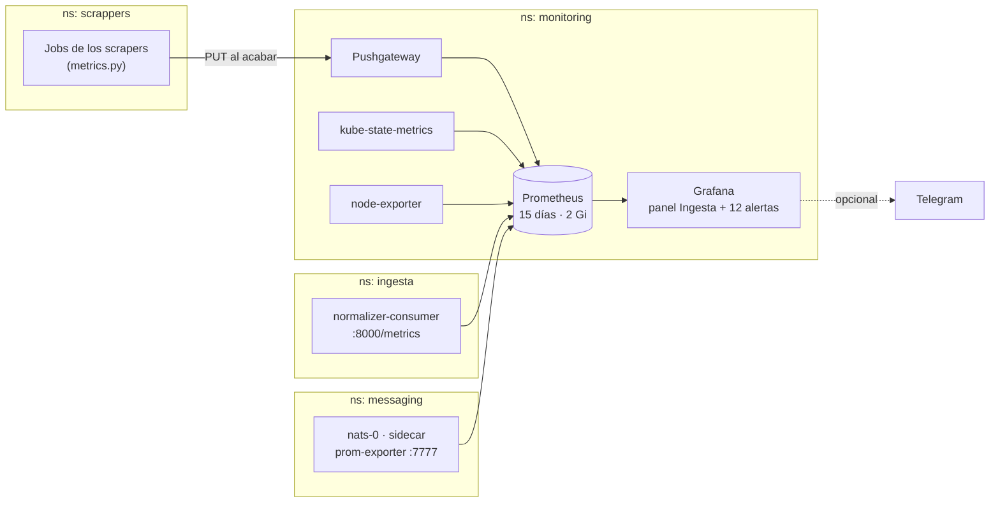

# Monitorización de la ingesta (Prometheus + Grafana)

Prometheus recoge las métricas y Grafana las enseña en un panel y lanza las alertas. Todo se
despliega con Terraform (`infra/terraform/monitoring.tf`) en el namespace `monitoring`, dentro
del mismo minikube, con `up.sh`.



## Entrar

```bash
cd flujo-entrada/infra/terraform && terraform output -raw grafana
```

Da la contraseña de `admin` (la genera el chart en el secreto `grafana`) y el
`port-forward` (Grafana en `http://localhost:3000`, Prometheus en `:9090`). Desde fuera de
la VM: `ssh -L 3000:localhost:3000 <vm>` y abrir el port-forward en la VM. El panel está en
**Dashboards → Ingesta → Ingesta** y las alertas en **Alerting → Alert rules**.

## Qué se mide

| Fuente | Cómo llega | Métricas principales |
|---|---|---|
| Scrapers | `src/metrics.py` (igual en los cinco) hace un `PUT` al Pushgateway al publicar cada tienda; un Job dura poco y Prometheus podría no verlo. Si el Pushgateway falla, solo avisa: nunca hace fallar el scraper | `scraper_products_scraped`, `scraper_products_published`, `scraper_publish_ok`, `scraper_job_elapsed_seconds`, `scraper_last_run_timestamp_seconds` (etiquetas `chain`, `store`, `postal_code`) |
| CronJobs y pods | kube-state-metrics | `kube_cronjob_status_last_successful_time`, `kube_job_status_failed`, `kube_pod_container_status_restarts_total` |
| NATS | sidecar `prom-exporter` del chart (`promExporter` en `messaging/nats-values.yaml`, con `-jsz=all`) | `nats_stream_total_bytes`, `nats_stream_total_messages`, `nats_consumer_num_pending`, `nats_consumer_num_ack_pending`, `nats_consumer_num_redelivered` (etiquetas `stream_name`, `consumer_name`) |
| Normalizador | `consumer.py` con `prometheus_client` en `:8000/metrics` | `normalizer_raw_messages_total`, `normalizer_batches_total`, `normalizer_products_total`, `normalizer_clean_errors_total` (líneas `ERROR`), `normalizer_clean_incomplete_total` (sin precio por unidad), `normalizer_flush_errors_total`, `normalizer_parse_errors_total`, `normalizer_nats_connected`, `normalizer_clean_seconds` (histograma de la llamada a Fission) |
| Nodo | node-exporter y cAdvisor (kubelet) | disco de la VM, CPU y memoria por contenedor |

Prometheus encuentra los pods por anotaciones (`prometheus.io/scrape: "true"` y
`prometheus.io/port`): así se añaden NATS y el consumer, y así podría añadirse cualquier pod
del equipo de API/BD sin tocar Prometheus.

## Alertas

Están en [`alerts.yaml`](alerts.yaml), en un formato corto (`uid`, `title`, `expr`, `for`,
`severity`, `summary`); `monitoring.tf` lo convierte en reglas de Grafana. Cada `expr` solo
devuelve valores mayores que 0 cuando algo va mal. Sin datos (p. ej. antes de la primera
pasada), la alerta se queda en OK.

| Alerta | Salta si |
|---|---|
| Scraper sin pasada correcta en 26 h | un CronJob de `scrappers` lleva más de 26 h sin un Job correcto |
| Job de scraper fallido | un Job de las últimas 24 h ha fallado |
| Caída de productos publicados | una cadena/tienda publica más de un 20 % menos que el día anterior |
| Scraper no ha publicado todo en NATS | `scraper_publish_ok` = 0 |
| El normalizador no vacía la cola | `normalizer` con pendientes o sin ack durante 1 h |
| Líneas ERROR en los lotes limpios | aparecen productos que no validan |
| Fallos al publicar lotes o crudos ilegibles | `flush-error` o `parse-error` en la última hora |
| Normalizador sin conexión con NATS | 5 min desconectado (o sin métricas) |
| El writer de API/BD no vacía la cola | `api-writer` con pendientes durante 2 h (avisa, pero el writer es del equipo de API/BD) |
| Stream SCRAPERS cerca del límite | más del 80 % del fileStore de 1 GiB |
| Reinicios de pods | algún reinicio en `ingesta`, `messaging`, `monitoring` o `api` en la última hora |
| Disco de la VM casi lleno | más del 85 % |

**Avisos por Telegram (opcional).** Sin configurar, las alertas solo se ven en Grafana. Para
recibirlas: crear un bot con @BotFather, añadirlo al grupo y pasar el token y el chat a
Terraform. El token va a un `Secret` y no al values del chart:

```bash
export TF_VAR_alert_telegram_bot_token=123456:ABC...   # no lo guardes en el repo
export TF_VAR_alert_telegram_chat_id=-100123456789
bash flujo-entrada/infra/up.sh
```

## Panel

[`dashboards/ingesta.json`](dashboards/ingesta.json) tiene cuatro filas:

- **Scrapers:** horas desde la última pasada correcta, productos por cadena (último y
  histórico), duración y si la publicación fue completa.
- **NATS:** pendientes por consumidor, tamaño del stream, mensajes y reentregas.
- **Normalizador:** productos por minuto, líneas ERROR, productos sin precio por unidad,
  conexión y latencia de Fission.
- **Clúster:** memoria por namespace, reinicios y disco.

Grafana tiene disco propio: un panel que se cree a mano se conserva, pero el panel
provisionado no se puede borrar desde la UI. Para cambiarlo de forma permanente, exportar el
JSON (Share → Export) a `dashboards/ingesta.json` y volver a lanzar `up.sh`.

## Recursos

Con todo recortado, el namespace usa unos **585 MiB** de los 4 GiB del nodo; después hay
~2 GiB libres. Se ha dejado fuera:

- **Alertmanager:** alerta Grafana, así que es una pieza menos.
- **Loki (logs):** de momento basta `kubectl logs`.
- **El operator de `kube-prometheus-stack`:** ocupa entre 1 y 1,5 GiB.

| Componente | Requests / límite de memoria | Disco |
|---|---|---|
| Prometheus | 256 Mi / 1 Gi | PVC 2 Gi, 15 días (`retentionSize` 1800 MB) |
| Grafana | 128 Mi / 384 Mi | PVC 1 Gi |
| Pushgateway | 16 Mi / 64 Mi | PVC 256 Mi (no pierde la última pasada al reiniciar) |
| kube-state-metrics | 32 Mi / 128 Mi | — |
| node-exporter | 16 Mi / 64 Mi | — |
| prom-exporter (en `nats-0`) | 16 Mi / 64 Mi | — |

Versiones fijadas en `variables.tf`: chart `prometheus` 29.38.2 (Prometheus v3.15.1) y chart
`grafana` 14.2.0 del repo `grafana-community` (Grafana 13.3.0). El chart de
`grafana/helm-charts` está deprecado desde 2026.

## Cómo se ha probado (12/11/2026)

1. Despliegue con Terraform: los 16 targets de Prometheus en `up`, incluidos `nats-0:7777`,
   `normalizer-consumer:8000` y el Pushgateway.
2. Pasada de Condis: 7.809 productos publicados (`scraper_publish_ok` = 1) y 7.809
   normalizados, 0 líneas ERROR, 30 sin precio por unidad y cola a 0. Coincide con `e2e.sh`.
3. Grafana: el panel y las 12 reglas cargados; todas se evalúan sin error.
4. Alerta de punta a punta: un `scraper_publish_ok` = 0 falso en el Pushgateway pasa a
   *firing* en ~1 min con el texto «prueba (x) no ha podido publicar todos sus productos en
   NATS». Después se borra.

Para el equipo de API/BD queda propuesto, sin hacer, añadir sus métricas
(postgres_exporter, la API, el writer). Ver [`docs/05`](../docs/05-pendientes.md).
