# 02 · Prototipo de RAG

Como funciona el prototipo: que entra, como se indexa, como se recupera y
que se le pide al LLM. El "que" esta en
[`01-decision-modelos.md`](01-decision-modelos.md); aqui esta el "como".

## Flujo general

```mermaid
flowchart LR
  A["web del súper<br/>(Mercadona, Carrefour…)"] --> B["scraper<br/>(equipo de ingesta)"]
  B --> C["normalizer<br/>(equipo de ingesta)"]
  C -->|"linea limpia<br/>(texto plano)"| D["flujo-ia<br/>ingest.py"]
  D --> E["embeddings<br/>(HF, local)"]
  E --> F[("indice vectorial<br/>.cache/index/")]
  F --> G["retrieval<br/>(denso + filtros)"]
  G --> H["LLM<br/>(Ollama o Gemini)"]
  H --> I["respuesta con citas [id]"]

  style D fill:#f3e5f5,stroke:#8e24aa,stroke-width:2px,color:#4a148c
  style E fill:#e8f5e9,stroke:#43a047,stroke-width:2px,color:#1b5e20
  style F fill:#fff8e1,stroke:#fb8c00,stroke-width:2px,color:#e65100
  style G fill:#e3f2fd,stroke:#1e88e5,stroke-width:2px,color:#0d47a1
  style H fill:#fce4ec,stroke:#d81b60,stroke-width:2px,color:#880e4f
```



La frontera con el equipo de ingesta es **un fichero de texto con lineas
limpias**. Es el mismo formato que viaja por el subject `scraper.<cadena>.clean`
(ver `flujo-entrada/docs/03-contratos-datos.md` de la rama `scrapping`), asi
que el prototipo consume el dato real sin adaptadores: se copia el `.txt` a
`data/raw/<cadena>_clean.txt` y se indexa.

## Estructura del codigo

| Fichero | Responsabilidad |
|---|---|
| `rag/config.py` | Modelos, rutas y parametros. Todo se cambia por entorno |
| `rag/ingest.py` | **Unico** punto que conoce el formato de la linea limpia |
| `rag/embeddings.py` | Envoltorio de `sentence-transformers` (prefijos, normalizacion) |
| `rag/store.py` | Indice vectorial (coseno con numpy) + persistencia |
| `rag/indexer.py` | Orquestacion de indexado: lineas -> vectores -> indice |
| `rag/retriever.py` | Busqueda con filtros de metadatos |
| `rag/llm.py` | Clientes Ollama / Gemini / sin-LLM con la misma interfaz |
| `rag/pipelines.py` | Los tres pipelines: catalogo, equivalencia, QA |
| `rag/evaluate.py` | Las tres evaluaciones y el informe |
| `rag/cli.py` | Interfaz de linea de comandos |
| `data/generate_dataset.py` | Genera el dataset de prueba y el ground truth |

## Decisiones del pipeline

### 1. El chunk es un producto

Cada producto normalizado es **un chunk**. No hay troceado de texto: un
producto de supermercado ya es una unidad semantica atomica (nombre, marca,
formato, precio). Trocearlo mas pequena solo destruye la informacion que
hace falta para comparar (el formato y la unidad de precio van juntos).

Consecuencia practica: el indice tiene exactamente un vector por producto
(257 en el dataset de prueba), y el `id` del producto es la clave de citacion.

### 2. Que se embebe (y que no)

```
Aceite de oliva virgen extra Hacendado | categoria Aceites, especias y salsas | tamano 1 l
```

Se embeben el **nombre** (que ya lleva marca y, en el dato real, el formato),
la **categoria** y el **tamano**. **No** se embeben el precio, la URL ni el
precio unitario:

- El precio no sirve para decir "esto es lo mismo que aquello" (solo para
  ordenar), y metido en el vector diluye la senal de identidad del producto.
- La URL es un identificador tecnico: aporta ruido y ningun parecido semantico.
- El precio unitario si es informativo, pero va en los **metadatos**, que se
  filtran con reglas exactas (precio < 2 EUR) y no con similitud. Mezclar
  reglas exactas dentro de un vector difumina el criterio.

Regla: **el vector decide que productos son parecidos; los metadatos decide
cuales entran en la respuesta** (cadena, categoria, rango de precio).

### 3. Recuperacion: densa + filtros, sin reranking

El retrieval es coseno sobre vectores normalizados, con **filtros de
metadatos aplicados antes** del top-k. Sin reranking con LLM en el camino
critico: el LLM entra *despues* de recuperar, para redactar o para decidir
entre candidatos que ya estan en el top-k.

Motivo: el reranking multiplica el coste por consulta (una llamada al LLM por
candidato) y en una VM sin GPU eso se nota. Con un corpus de miles de
productos, el top-8 denso ya trae la respuesta correcta (ver
[`03-evaluacion.md`](03-evaluacion.md)).

### 4. Por que numpy y no FAISS

Con 257 productos (y ~4.6k en una ejecucion real del scraper) la similitud
coseno sobre una matriz normalizada es milisegundos. FAISS o pgvector tienen
sentido a partir de ~10^5-10^6 vectores. La API de `VectorStore`
(`add` / `search` / `save` / `load`) esta pensada para que cambiar de
backend sea cambiar la implementacion, no el pipeline. Cuando el equipo de
API/BD tenga el esquema de BD, el sitio natural es `pgvector` (el vector
viaja en la misma tabla que el producto).

### 5. Los tres pipelines

| Pipeline | Pregunta que responde | Recuperacion | LLM |
|---|---|---|---|
| **Catalogo** | "encuentra el aceite de oliva virgen extra de 1 l" | top-k por descripcion | redacta la respuesta con los ids citados |
| **Equivalencia** | "este de Mercadona, cual es en Carrefour" | top-k en la cadena destino | elige el equivalente o dice `pid: null` |
| **QA** | "cual es el aceite mas barato por litro" | top-k por relevance | responde **solo** con el contexto y cita `[id]` |

Los tres comparten la misma recuperacion y el mismo esqueleto de prompt
(sistema + contexto con ids + peticion). Lo que cambia es la instruccion y el
formato de salida.

**La orquestacion es una cadena de LangChain (LCEL).** Las tres cadenas se
componen con los *runnables* de `langchain-core` sobre la recuperacion y el
LLM que ya teniamos:

```python
cadena_qa(retriever, llm) = (
    RunnableLambda(recuperar)      # añade context y hits al estado
    | RunnableLambda(render)       # ChatPromptTemplate -> mensajes
    | RunnableLambda(llamar)       # el LLM responde
    | RunnableLambda(parsear)      # separa respuesta y fuentes
)
```

El estado es un `dict` que viaja por los pasos, de modo que los `hits` (y por
tanto las fuentes) sobreviven a la cadena. Se invoca con
`.invoke({"question": ...})`. Ver [`rag/chain.py`](../rag/chain.py).

### 6. Prompts

El prompt es corto a proposito: el modelo local por defecto es un 4B, que
responde peor cuanto mas se le alarga. Reglas que se siguen:

- **El contexto lleva el `id` entre corchetes** (`[10001]`) para que el modelo
  cite y para que la evaluacion pueda comprobar que no inventa ids.
- **El formato de salida se declara explicitamente** (`RESPUESTA:` / `FUENTES:`,
  o JSON para equivalencia). Un 4B sin formato declarado responde en prosa y
  es mas dificil de parsear.
- **Se le dice que no invente**: "si no esta en el contexto, dilo". Sin esta
  frase, un modelo pequeno completa los huecos con precios plausibles, que es
  justo el fallo que da verguenza en una demo.
- **La equivalencia se evalua con criterio negativo explicito**: "Aceite de
  oliva virgen extra 1 l" y "Aceite de oliva 1 l" **no** son el mismo
  producto, y un formato distinto (pack de 2 ud frente a 1 ud) tampoco. Sin
  esta instruccion el modelo tiende a decir que si.

El prompt de equivalencia pide JSON
(`{"pid": ..., "confianza": ..., "motivo": ...}`) y la respuesta se parsea con
`extract_json()`, que tolera vallas de codigo, texto alrededor y JSON
delimitado en medio de una frase (los modelos pequeños cometen eso).

### 7. Guardrails: lo que se comprueba antes de responder

Un guardrail es una comprobacion automatica sobre la respuesta. No sustituye
al LLM: es la red de seguridad, y su resultado viaja en la respuesta (campo
`guardrails`) para que la app pueda avisar al usuario.

| Control | Que comprueba | Que pasa si falla |
|---|---|---|
| **Citas validas** | Todo `[id]` citado tiene que estar en el contexto recuperado | En modo estricto se quita la cita invalida y se avisa |
| **Cifras del contexto** | Ningun numero con decimales de la respuesta puede ser un precio que no este en el contexto | Se marca `numbers_valid: false` y se avisa (el precio se conserva: puede ser una cifra correcta que el LLM ha redondeado) |
| **Abstencion** | Sin contexto no hay respuesta; y si el modelo dice que no encuentra el dato, la abstention es una respuesta **valida**, no un fallo | Sin contexto la respuesta se sustituye por una abstension |

En un comparador de precios, **un precio inventado es el fallo mas grave
posible**, y por eso el control de cifras existe: es el que caza el
`"cuesta 3,99 EUR/l"` que el modelo se ha inventado.

Ver [`rag/guardrails.py`](../rag/guardrails.py) y los tests de
`tests/test_guardrails.py`.

### 8. Salida con JSON Schema

`POST /ask` **no devuelve texto libre**: devuelve un JSON validado contra
[`rag/schemas/respuesta-asistente.schema.json`](../rag/schemas/respuesta-asistente.schema.json)
(Draft 2020-12, validado con `jsonschema`). El contrato es:

```json
{
  "question": "¿cual es el mas barato?",
  "answer": "El mas barato es [10003] Aceite de oliva 1 l, 12.50 EUR/l",
  "sources": [
    {"id": "10003", "name": "Aceite de oliva 1 l", "chain": "alcampo",
     "price_total": 12.3, "price_unit": 12.5, "unit": "l",
     "url": "https://...", "reason": "el mas barato por litro"}
  ],
  "confidence": 0.8,
  "abstained": false,
  "guardrails": {"ok": true, "warnings": [], "citations_valid": true, "numbers_valid": true},
  "provider": "ollama",
  "model": "qwen3:8b",
  "latency_s": 9.3
}
```

El motivo de que sea JSON y no texto: lo consume **el equipo de API y la app**
(Fardin). Con un contrato declarado, la app puede pintar la respuesta, las
fuentes con su precio y avisar si el asistente se ha abstenido, sin tener que
parsear prosa. Si la respuesta no cumpliese el esquema, el servicio lo avisa
en `guardrails.warnings` en vez de devolver algo roto.

### 9. Streaming por SSE

`POST /ask/stream` devuelve la misma respuesta **token a token**, en formato
Server-Sent Events:

```
event: fuentes
data: ["10003", "10006", "10004", "10002", "10255"]

event: token
data: " El"

event: token
data: " aceite"

event: fin
data: {"question": "...", "respuesta": "...", "hits": [...]}
```

El evento `fuentes` va primero, para que la app pueda pintar los productos
mientras se genera la respuesta. Es lo que espera la pantalla de asistente
de la app.

### 10. Degradacion elegante

Ningun fallo del LLM tumba el pipeline:

| Fallo | Comportamiento |
|---|---|
| LLM no configurado (`--llm none`) | El pipeline devuelve solo la recuperacion (baseline) |
| LLM caido / timeout | Se captura el error, la recuperacion se conserva y se avisa por stderr |
| LLM devuelve JSON invalido | `pid` queda a `None`; el pipeline no revienta |
| Producto sin precio unitario | Se indexa igual: el `id` y el nombre siguen sirviendo para buscar |

La ultima fila es importante: el normalizador deja lineas incompletas
(`- (sin_precio)`) cuando la fuente no trae precio, y esas lineas **no** se
descartan. Descartarlas perderia productos del catalogo.

## Datos de prueba

El dataset lo genera `data/generate_dataset.py` (determinista, semilla fija):

- **257 productos** en 3 cadenas (mercadona, carrefour, alcampo) sobre 85
  productos canonicos, en el **formato exacto** de la linea limpia.
- Casos que el pipeline tiene que handlear: lineas con `src=calculado` (sin
  precio de referencia), lineas incompletas (`- (sin_precio)`), marcas
  compartidas entre cadenas (el vector no puede apoyarse en la marca) y
  **variantes de formato** (pack de 2 ud frente a 1 ud) que **no** son
  equivalentes pero se parecen mucho.
- **Ground truth** exacto en `data/gold/`: equivalencias, no-equivalencias,
  consultas de catalogo y preguntas de QA con la respuesta esperada.

La ventaja del dato sintetico es que el ground truth es exacto; la
desventaja, que el vocabulario es mas limpio que el de la web real. Cuando el
equipo de ingesta comparta el `mercadona_<ts>.txt` real, se copia a
`data/raw/` y el ground truth de equivalencias habra que etiquetarlo a mano
(la parte de QA y catalogo se puede autogenerar del propio `.txt`).

## Lo que este prototipo NO cubre

- **Multi-tienda real** (`wh`): el dataset tiene una sola etiqueta `default`,
  igual que la ingesta actual. El `wh` viaja en los metadatos, pero no se usa
  para filtrar.
- **Reindexado automatico**: el indice se regenera a mano (`rag.cli index`).
  En produccion, el `consumer` de ingesta (o el servicio de API/BD) deberia
  disparar el indexado al recibir un lote `clean` nuevo.
- **Embeddings en la ingesta**: el embedding se calcula aqui, fuera del
  clúster. La decision de quien lo calcula (normalizador vs. este servicio) es
  una pregunta abierta del plan (ver `05-pendientes.md` del equipo de
  ingesta): lo natural es calcularlo **en el servicio de IA**, no en el
  normalizador, para no meter un modelo de 2 GB en la imagen de Fission.
